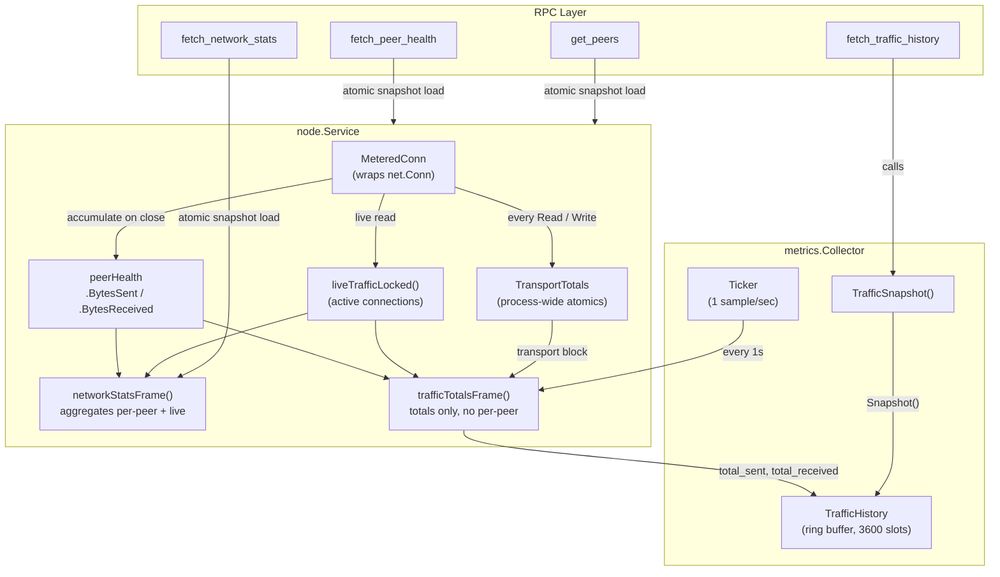
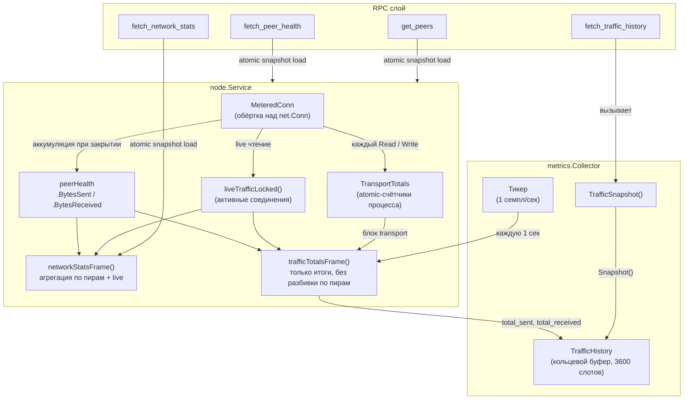

# Metrics Layer

## English

### Overview

The metrics layer (`internal/core/metrics/`) is a standalone data collection service that periodically samples node statistics and maintains rolling history buffers. It operates independently from the network service and accesses data through the `TrafficSource` interface.

### Architecture

*Metrics data collection flow*

### Data Flow

1. Every peer TCP socket — accepted, dialled for a session, and the one-shot `syncPeer` / `sendNoticeToPeer` dials — is wrapped in `MeteredConn` exactly once, where the socket is born. `MeteredConn` atomically counts bytes read/written per connection and, in the same call, adds them to the node-wide `TransportTotals` (see "Transport totals" below)
2. When a session or inbound connection closes, its final byte counts are accumulated into the peer's `peerHealth.BytesSent` / `peerHealth.BytesReceived`. The one-shot dials never become sessions and stay out of `peerHealth`; they reach only the transport totals
3. While connections are active, `liveTrafficLocked()` reads current counters directly from `MeteredConn` instances
4. The hot local RPCs (`fetch_network_stats`, `fetch_peer_health`, `get_peers`, plus `fetchRouteTable`/`fetchRouteSummary`/`fetchRouteLookup`) each return a pre-built snapshot via a single `atomic.Pointer` load — `networkStatsSnapshot`, `peerHealthSnapshot`, `peersExchangeSnapshot`, `cmSlotsSnapshot`, and `routingSnapshot` respectively — with ONE exception: `fetchRouteLookup` on a hit additionally takes `routing.Table.t.mu.RLock` via `HealthSnapshot()` (detailed at the end of this item), so it alone is not a pure single-load read. `cmSlotsSnapshot` caches `ConnectionManager.Slots()` so `peerHealthFrames` and `buildPeerExchangeResponse` never call `Slots()` on the RPC path — `Slots()` takes `cm.mu.RLock`, and Go's writer-preferring `sync.RWMutex` would otherwise serialise these RPC readers behind any queued CM-writer just like `s.mu` used to. `routingSnapshot` caches the routing snapshot for the same reason against `routing.Table.t.mu`: at scale building the view is expensive and a writer storm on the routing table (announce loop convergence, mass disconnect, hop_ack burst) would otherwise stall every routing-observability RPC and the file router's transit-forwarding callback (`HandleInbound`). The publisher builds it via `routing.Table.SnapshotIncremental` (copy-on-write under `t.mu.Lock`: reuses the unchanged route slices of the previous snapshot and re-copies only churned identities, plus a periodic full re-copy that only rides an already-dirty rebuild), so the per-publish cost is proportional to churn rather than a full deep copy of the whole table. The locally-originated file paths (`SendFileCommand`, `ExplainRoute`) and `isPeerReachable` deliberately bypass this cache and read the routing table per-destination via `routing.Table.Lookup(peer)` — they need immediate visibility of a route accepted moments before the call (cached-snapshot lag would surface as "isPeerReachable says yes, SendFile fails" for the ~1–1.5 s republish window — routingSnapshotMinInterval's 1 s floor plus the next refresh tick). Snapshots are primed **synchronously** by `primeHotReadSnapshots()` in `Run()` before the TCP listener opens, then refreshed every 500 ms by `hotReadsRefreshLoop` — the only path that takes `s.mu.RLock` (first three snapshots), `cm.mu.RLock` (fourth) or `routing.Table.t.mu.Lock` (fifth, gated by a dirty flag so an idle table skips the rebuild entirely) to read `health` / `peers` / `persistedMeta` / live counters / slot state / routing entries. The RPC handlers themselves never touch `s.mu`, `cm.mu` or `routing.Table.t.mu` and **do not fall back to a synchronous rebuild** on a snapshot miss — the previous fallback re-coupled the hot path to the very locks the snapshot infrastructure was meant to bypass. (One exception: `fetchRouteLookup` additionally takes `routing.Table.t.mu.RLock` via `RoutingProvider.HealthSnapshot()` on a hit — the cached `Snapshot.Health` was narrowed to the `{Dead ∪ cooled}` subset and its CompositeScore ranking needs the full per-pair tiers; the call is gated on the target having a live route, so a lookup miss stays lock-free. See `docs/routing.md` / `docs/rpc/routing.md`.) With the prime step in place, every hot-path handler observes a non-nil snapshot on its first load.
5. The `metrics.Collector` calls `fetch_traffic_totals` every second and records the totals into a ring buffer (`TrafficHistory`). This is a deliberately lightweight local frame: it sums only the cumulative sent/received `int64` totals (persisted `peerHealth` + live counters via `sumLiveTrafficLocked`, which walks inbound connections through the capability-free `forEachInboundConnIDLocked` iterator) and returns them in a `network_stats`-shaped reply with the per-peer fields left empty. Critically it does **not** stamp `networkStatsAccessNanos`, so the collector's once-a-second poll no longer pins the full `networkStatsSnapshot` rebuild-gate awake. The heavier `fetch_network_stats` (full per-peer breakdown, `knownPeers`/`connectedPeers`, sorted `peerTraffic`) is still served from the `atomic.Pointer` snapshot for the desktop UI, whose reader access re-arms the rebuild-gate only while a UI is actually polling — a headless node lets the gate idle out after `networkStatsRebuildIdleAfter`.
6. RPC clients call `fetch_traffic_history` to get the full 1-hour rolling window

Snapshot staleness is bounded by `networkStatsSnapshotInterval` (500 ms) for `networkStatsSnapshot`, `peerHealthSnapshot`, `peersExchangeSnapshot` and `cmSlotsSnapshot` — every state change a writer touches is reflected within one refresh tick. `routingSnapshot` is coalesced to at most one rebuild per `routingSnapshotMinInterval` (1 s), so its structural-change bound (route accepted, withdrawn, replaced; direct peer added/removed; flap burst arming hold-down; flap-state cleanup after a writer touched the table) is the 1 s floor plus the next refresh tick that crosses it (~500 ms) plus the publisher's `t.mu.Lock` acquisition — on the order of 1–1.5 s, and a wider bound applies to time-derived fields (`IsExpired`/`ttl_seconds` against `snap.TakenAt`, `FlapEntry.InHoldDown` flipping `true→false` on hold-down expiry): those advance on the wall clock without a writer event, so the dirty-flag publisher cannot observe them directly. `TickTTL` (every 10 s) converts those wall-clock transitions into writer events, which gives a worst-case lag of `TickTTL` interval + the structural publish bound (`routingSnapshotMinInterval` floor + a refresh tick, ~1–1.5 s) ≈ 11–11.5 s. See `docs/routing.md` "Snapshot freshness" for the full contract. Even if a writer holds `s.mu.Lock`, `cm.mu.Lock` or `routing.Table.t.mu.Lock` for many seconds, the RPCs keep serving the last successfully-built snapshot instead of blocking — clients prefer bounded-stale data over a frozen UI. The five rebuilds run in independent per-snapshot goroutines inside `hotReadsRefreshLoop`, each on its own 500 ms ticker. The fan-out isolates slow rebuilds (notably `peersExchangeSnapshot`, which re-acquires `s.mu.RLock` via `peerProvider.Candidates()` callbacks; `cmSlotsSnapshot`, which takes `cm.mu.RLock`; and `routingSnapshot`, which takes `routing.Table.t.mu.Lock` only when the dirty flag fires) so they do not delay the other snapshots' refreshes or widen their staleness windows.

### Transport totals

`fetch_traffic_totals` answers two different quantities side by side, and they must not be mixed:

| Fields | What it is | Monotonic within a process | Survives restart |
|---|---|---|---|
| `total_bytes_sent` / `total_bytes_received` / `total_traffic` | per-peer attribution summed up: persisted `peerHealth` + live sessions + live verified inbound connections | **no** | yes (health is persisted) |
| `transport.bytes_sent` / `transport.bytes_received` | every byte read from or written to a peer socket of this process | **yes** | no — starts from zero |

The attribution totals can dip or briefly double: an outbound session leaves the registry before its bytes are folded into health, an inbound connection is counted in health and as live until it is unregistered, and an orphaned health row evicted after `orphanedHealthEvictWindow` takes its bytes with it. A per-second delta computed from them can therefore be negative. They keep their meaning for the existing consumer (`metrics.Collector` and the Traffic tab).

The `transport` block is the one to compute rates from:

- **point of measurement** — `MeteredConn.Read` / `MeteredConn.Write`, the only code that can advance `netcore.TransportTotals` (its increment methods are unexported). A byte is counted once, however many layers above the socket look at it;
- **what is counted** — everything that actually crossed a peer socket: handshakes, frames, heartbeats, retransmissions and repeated dials, relay and datagram frames (they ride sessions), unauthenticated inbound bytes. A frame dropped from a queue before reaching the socket is not counted;
- **what is not** — the SOCKS5 handshake with the local proxy (it happens before the socket is wrapped), local control channels (RPC, deeplink socket, pprof), and TCP/IP headers below the socket;
- **reset** — the counters are in memory only. `transport.started_at` is the node's start (`Service.startedAt`, the same instant uptime is measured from); a different `started_at` between two readings means the process restarted. `transport.read_at` (RFC3339Nano) is when the counters were loaded;
- **rate** — `Δbytes / Δread_at` over two samples of ONE sequential poller with the same `started_at` and `read_at₂ > read_at₁`. The second sample's loads then follow the first one's, so neither difference can be negative; samples from two concurrent pollers carry no such ordering and must not be paired. Reading never resets anything.

The counters are atomics outside every domain mutex of `node.Service` (`docs/locking.md`), so the read is lock-free. `fetch_network_stats` does not carry the block. A separate process (a measurement stand, a dashboard) reads the same counters through the `fetchRouteSummary` RPC, section `transport_traffic` (`docs/rpc/routing.md`): `fetch_traffic_totals` is an in-process frame, and polling `fetch_network_stats` would re-arm the per-peer snapshot rebuild of the node being measured.

### Session kinds

Beside the bytes, the node counts its authenticated peer sessions by kind — secure session v2 or legacy v1 — and by direction, and the sessions whose peer announced a protocol version below 31 (`internal/core/node/session_kind_metrics.go`). They measure the share of the network still reached over v1, which is what the switch-off of the legacy path is decided by (`docs/protocol/session_v2.md`, "Measuring the legacy share").

- **point of measurement** — inbound in `completeInboundAuth` when the peer's identity is authenticated (v1 `auth_session` or v2 `session_proof`); outbound in `publishAndServeCMSession`, right before the ConnectionManager slot is promoted — after the setup succeeded, the session was registered and the pin let it through — so a dialled session whose setup failed, whose slot the ConnectionManager evicted during the setup, or that the pin refused at publication is not counted. Only ConnectionManager sessions enter the outbound counts; a session of the legacy dial path (`openPeerSession`) does not, though the `live` gauge, which walks every registered session, includes it. The kind is what proved the peer, not what it announced;
- **what is counted** — inbound: every authenticated accepted connection, including a peer's one-shot recovery or notice dial, which a listener cannot tell from a session; outbound: the published peer sessions, not this node's own one-shot dials. A v1 session that followed a v2 attempt answered by an old node is one legacy session; failed and refused attempts are not sessions and are counted in `session_outcomes` and `secure_sessions` instead;
- **old peers vs peers claiming v2** — `hellos_below_secure_version` and `welcomes_below_secure_version` count legacy sessions whose peer announced a version below 31; `legacy_at_claimed_v2` counts legacy sessions whose peer announced 31 or above — reached over v1 while claiming v2 (a stripped `corsa/2` ALPN, or a man in the middle), the ones the minimum raise would still cut off. The version is unsigned on a legacy session, so all three say what peers claim;
- **gameable, and the live gauge that is not** — the cumulative counts count SESSIONS, not peers: one peer opening many sessions runs them up, so they are a lower bound on activity, not a count of distinct nodes. `live` is the point-in-time gauge — sessions live now by kind and direction, with the DISTINCT identities behind each bucket, bounded by the connection count — built by a background walk on the announce cadence (`refreshLiveSessionKinds`) and published behind an `atomic.Pointer`, with `ready` telling "not walked yet" from "no sessions". The decision to raise `MinimumProtocolVersion` weighs `legacy_at_claimed_v2`, the `live` distinct-identity gauge, and out-of-band release-adoption data — never the cumulative counts alone;
- **reset and pairing** — in memory only, never reset by reading; `started_at` is the node's start and `read_at` the moment of the loads, with the pairing rule of the transport block.

The cumulative counters are atomics and the live gauge an immutable value behind an `atomic.Pointer`, all outside every domain mutex of `node.Service` (`docs/locking.md`); `fetchRouteSummary` serves them lock-free in its `session_kinds` section (`docs/rpc/routing.md`).

### Listener refusals

The node also counts the connections its listener refuses before any session exists, by the bound that refused them, and the refusals that went out without the TLS refusal alert because every alert sender was busy (`internal/core/node/listener_refusal.go`; the refusal itself is described in `docs/protocol/session_v2.md`, "Listener refusals").

- **point of measurement** — `listenerRefusals.refuse`, the one place a refused connection is answered: from the accept loop (connection rate, per-IP cap, connection budget) and from the connection handler (blacklist, inbound limit at registration, the per-source, node and loopback-share bounds on inbound v2 handshakes);
- **`closed_without_alert`** — part of the per-bound counts, not in addition to them. It rises only when more refusals arrive at once than the pool of 256 alert senders, or one source's share of 8, can hold; the refusals happen either way;
- **reset and pairing** — in memory only, never reset by reading; `started_at` is the node's start and `read_at` the moment of the loads, with the pairing rule of the transport block.

The counters are atomics outside every domain mutex of `node.Service` (`docs/locking.md`); `fetchRouteSummary` serves them lock-free in its `listener_refusals` section (`docs/rpc/routing.md`).

### Datagram handler calls

The datagram plane counts what its type handlers did, per registered dtype and mode (`internal/core/datagram/handler_stats.go`), and serves it in the `handlers` section of `fetchDatagramSummary` (`docs/rpc/datagram.md`).

- **point of measurement** — `Pipeline.runHandler`, the one wrapper through which the routed, request and response planes call a handler, after every gate and once the handler returned or panicked. A frame dropped earlier, an unknown dtype and a transit frame never reach it, so nothing here repeats `DropsByReason`, `UnknownDType` or `Forwarded`;
- **units** — `calls`, `accepted`, `rejected`, `failed` and `panics` are calls (`panics` is a subset of `failed`); `wall_ns` is **elapsed time** in nanoseconds from entering the handler to leaving it, measured on Go's monotonic clock (an injectable duration source, separate from the pipeline's wall clock), so an NTP step does not distort it; on a panic it stops before the crash report is written. It is **not CPU time**: it includes lock waits and I/O inside the handler;
- **keys** — only registered dtypes and the modes they declare; nothing from the wire becomes a key;
- **relation to `metrics.ByMode`** — the same calls cut by type, never summed with them (the exact equalities are listed in `docs/rpc/datagram.md`);
- **reset and pairing** — in memory only, never reset by reading; `started_at` is the node's start and `read_at` the moment of the loads, with the pairing rule of the transport block.

### Local send attribution

Every datagram this node originates is charged to the subsystem that sent it — `identity_resolver`, `presence_prober`, `identity_discovery`, `dm_control`, or `unattributed` for a call that named none (`internal/core/datagram/local_senders.go`), served in the `local_senders` section of `fetchDatagramSummary`.

- **point of measurement** — `Pipeline.sendLocal`, the one body of `SendLocal`, once per call from the outcome it returned. The sender is a required positional argument of `SendLocal`, and a guard test pins which constant each calling file passes;
- **units** — sends. `attempts == queued + no_route + failed + rejected`, and `rejected` is split by cause into `gate_refused`, `quota_capped`, `slot_busy`, `expired` and `other_rejected`;
- **relation to other counters** — `quota_capped` is the same event as the reverse table's `LocalRefusals` (by dtype), `gate_refused` the local share of `metrics.SendRefusals` (which also counts transit); they are other cuts, never added to these. A queued send is not a delivered one, and no bytes are counted here;
- **reset and pairing** — as above.

Both blocks are atomics — in the registry entries and in `datagram.Metrics` — outside every domain mutex of `node.Service` (`docs/locking.md`); the summary reads them lock-free.

### Resource breakdown coverage

`getResourceBreakdown` (`docs/rpc/system.md`) reports one line per value of the subsystem enum, and a guard test walks the enum itself — every value exactly once — rather than a list kept beside it. File-transfer state (the `fileMu` domain) has no subsystem and is NOT in the breakdown; this is a written exclusion with its reason, and the guard fails if the exclusion is dropped while file state is still unreported, or kept once a line reports it. The aggregate-status domain (`statusMu`, small fixed records plus a self-pruning reporter set) and the gossip-pool lock (`gossipPoolMu`, which owns no state) are listed as exclusions too; whether every domain must be reported or excluded is not checked. The breakdown's figures are a lower bound of memory held, not bytes on the wire, and are never added to or compared with the transport totals.

### TrafficHistory Ring Buffer

The ring buffer stores up to 3600 samples (1 hour at 1 sample/second). Each sample contains:

| Field | Description |
|---|---|
| `timestamp` | UTC time when the sample was recorded |
| `bytes_sent_ps` | Delta: bytes sent since the previous sample |
| `bytes_recv_ps` | Delta: bytes received since the previous sample |
| `total_sent` | Cumulative bytes sent at this moment |
| `total_received` | Cumulative bytes received at this moment |

When the buffer is full, new samples overwrite the oldest entries. `Snapshot()` returns samples in chronological order (oldest first).

#### Baseline seeding

Delta computation requires a baseline (`prevSent` / `prevRecv`). The baseline starts at zero and is updated on every `Record`. This default works when the collector starts together with the source — the first `Record` reports the bytes that flowed since startup.

When the collector attaches to a source whose counters are already non-zero, callers must invoke `Collector.Seed()` once before the first ticker tick. `Seed` reads current totals and sets them as baseline without recording a sample. Without `Seed`, the first sample would dump the entire pre-attach cumulative as a single-second spike.

`desktop`, `node`, and `sdk` runtimes call `Seed` between collector creation and the first `Run` tick so the bootstrap handshake traffic appears as a real per-second delta on the first chart bar instead of being lost (the previous skip-on-first behavior) or distorted (delta == totals).

### RPC Commands

| Command | Category | Description |
|---|---|---|
| `fetch_traffic_history` | metrics | Rolling 1-hour traffic history (per-second samples) |
| `fetch_network_stats` | network | Current aggregated traffic per peer and total |
| `fetch_peer_health` | network | Per-peer health including traffic counters |

### Desktop UI — Traffic Tab

The console modal includes a Traffic tab (reachable only inside the console) that visualizes network activity in real time. On tab open, the full history is loaded from `fetch_traffic_history` (up to 3600 samples). While the tab is active, a 1-second ticker appends new samples via `fetch_network_stats`.

The graph contains three visual elements:

- **In bars (green)** — received bytes per second, drawn as vertical bars on the left side of each sample slot
- **Out bars (blue)** — sent bytes per second, drawn as vertical bars on the right side of each sample slot
- **Total line (yellow)** — sum of In + Out, drawn as a continuous line connecting all non-zero sample points. The line bridges zero-traffic gaps to maintain visual continuity across bar clusters

All samples are spread across the full graph width. The Y-axis auto-scales to the maximum total value (with 10% headroom) and displays 4 grid lines with value labels. Inside the graph (top-right corner), cumulative totals (Total In / Total Out) are shown as badges.

The metrics collector runs independently from the UI — it always samples data in the background. Opening the Traffic tab loads the existing history rather than starting from zero.

---

## Русский

### Обзор

Слой метрик (`internal/core/metrics/`) — это автономный сервис сбора данных, который периодически снимает статистику ноды и хранит её в кольцевых буферах. Он работает независимо от сетевого сервиса и обращается к данным через интерфейс `TrafficSource`.

### Архитектура

*Диаграмма сбора данных метрик*

### Поток данных

1. Каждый peer-сокет TCP — принятый, набранный под сессию и одноразовые дозвоны `syncPeer` / `sendNoticeToPeer` — оборачивается в `MeteredConn` ровно один раз, в месте рождения сокета. `MeteredConn` атомарно считает прочитанные/записанные байты соединения и тем же вызовом добавляет их в общеузловые `TransportTotals` (см. «Транспортные итоги» ниже)
2. При закрытии сессии или входящего соединения финальные счётчики аккумулируются в `peerHealth.BytesSent` / `peerHealth.BytesReceived`. Одноразовые дозвоны сессией не становятся и в `peerHealth` не попадают — только в транспортные итоги
3. Пока соединения активны, `liveTrafficLocked()` читает текущие счётчики напрямую из экземпляров `MeteredConn`
4. Hot local RPC (`fetch_network_stats`, `fetch_peer_health`, `get_peers`, плюс `fetchRouteTable`/`fetchRouteSummary`/`fetchRouteLookup`) отдают заранее подготовленный snapshot одним `atomic.Pointer`-load'ом — `networkStatsSnapshot`, `peerHealthSnapshot`, `peersExchangeSnapshot`, `cmSlotsSnapshot` и `routingSnapshot` соответственно — с ОДНИМ исключением: `fetchRouteLookup` на hit'е дополнительно берёт `routing.Table.t.mu.RLock` через `HealthSnapshot()` (подробно в конце этого пункта), так что он один не является чистым single-load чтением. `cmSlotsSnapshot` кэширует `ConnectionManager.Slots()`, чтобы `peerHealthFrames` и `buildPeerExchangeResponse` не звали `Slots()` на RPC-пути — `Slots()` берёт `cm.mu.RLock`, и writer-preferring `sync.RWMutex` в Go иначе сериализовал бы этих RPC-читателей за любым queued CM-writer'ом ровно той же формы, что `s.mu` раньше. `routingSnapshot` кэширует routing snapshot по той же причине против `routing.Table.t.mu`: на масштабе построение вида дорогое, и writer-шторм на таблице маршрутизации (конвергенция announce-цикла, массовый disconnect, всплеск hop_ack) иначе стопорил бы каждый routing-observability RPC и transit-forward callback file router'а (`HandleInbound`). Publisher строит его через `routing.Table.SnapshotIncremental` (copy-on-write под `t.mu.Lock`: переиспользует неизменённые route-слайсы предыдущего снапшота и перекопирует только изменившиеся identity, плюс периодический full, который лишь подъезжает на уже-dirty rebuild), поэтому стоимость на publish пропорциональна churn'у, а не полной глубокой копии всей таблицы. Locally-originated пути файл-роутера (`SendFileCommand`, `ExplainRoute`) и `isPeerReachable` сознательно обходят этот кэш и читают таблицу per-destination через `routing.Table.Lookup(peer)` — им нужна немедленная видимость маршрута, принятого за моменты до вызова (cached-snapshot лаг проявился бы как «isPeerReachable говорит да, SendFile падает» в окне republish'а ~1–1.5 с — 1с-порог routingSnapshotMinInterval плюс ближайший refresh-тик). Snapshot'ы **синхронно** инициализируются в `Run()` вызовом `primeHotReadSnapshots()` ДО открытия TCP-listener'а, и далее пересобираются каждые 500 мс в `hotReadsRefreshLoop` — это единственный путь, который берёт `s.mu.RLock` (первые три snapshot'а), `cm.mu.RLock` (четвёртый) или `routing.Table.t.mu.Lock` (пятый, гейтится через dirty-флаг, поэтому idle-таблица пропускает rebuild целиком) для чтения `health` / `peers` / `persistedMeta` / live-счётчиков / slot state / routing entries. Сами RPC-handler'ы не касаются ни `s.mu`, ни `cm.mu`, ни `routing.Table.t.mu`, и **не делают синхронный rebuild на miss** — прежний fallback как раз возвращал hot-path обратно на те самые локи, от которых snapshot-инфраструктура должна была его отвязать. (Одно исключение: `fetchRouteLookup` дополнительно берёт `routing.Table.t.mu.RLock` через `RoutingProvider.HealthSnapshot()` на hit'е — кешированный `Snapshot.Health` сужен до подмножества `{Dead ∪ cooled}`, а его CompositeScore-ранжированию нужны полные per-pair тиры; вызов гейтится наличием живого маршрута, поэтому lookup-miss остаётся lock-free. См. `docs/routing.md` / `docs/rpc/routing.md`.) С prime-шагом каждый handler на первом же load'е видит непустой snapshot.
5. `metrics.Collector` вызывает `fetch_traffic_totals` каждую секунду и записывает итоги в кольцевой буфер (`TrafficHistory`). Это сознательно лёгкий локальный фрейм: он суммирует только кумулятивные итоги sent/received (`int64`) — persisted `peerHealth` + live-счётчики через `sumLiveTrafficLocked`, который обходит входящие соединения лёгким итератором `forEachInboundConnIDLocked` (без `core.Capabilities()`/`cloneCaps`) — и возвращает их в ответе формы `network_stats` с пустыми per-peer полями. Важно: он **не** штампует `networkStatsAccessNanos`, поэтому ежесекундный опрос коллектора больше не держит rebuild-gate полного `networkStatsSnapshot` вечно бодрствующим. Более тяжёлый `fetch_network_stats` (полная разбивка по пирам, `knownPeers`/`connectedPeers`, отсортированный `peerTraffic`) по-прежнему отдаётся из `atomic.Pointer`-snapshot для desktop UI, и его reader-access перевзводит gate только пока UI реально опрашивает — headless-нода даёт gate'у заснуть через `networkStatsRebuildIdleAfter`.
6. RPC-клиенты вызывают `fetch_traffic_history` для получения полного часового окна

Максимальная устаревшесть `networkStatsSnapshot`, `peerHealthSnapshot`, `peersExchangeSnapshot` и `cmSlotsSnapshot` ограничена `networkStatsSnapshotInterval` (500 мс) — любое изменение состояния, которое touch'ит writer, отражается в течение одного refresh-тика. `routingSnapshot` коалесится до не более одного rebuild'а на `routingSnapshotMinInterval` (1 с), поэтому его граница для структурных изменений (маршрут принят, отозван, заменён; добавлен/удалён direct peer; flap-burst, армирующий hold-down; flap-state cleanup после writer-touch'а) равна 1 с-порог плюс ближайший refresh-тик, пересекающий его (~500 ms), плюс захват `t.mu.Lock` publisher'ом — порядка 1–1.5 с, а более широкая граница действует для time-производных полей (`IsExpired`/`ttl_seconds` относительно `snap.TakenAt`, `FlapEntry.InHoldDown` flipping `true→false` на истечении hold-down): они двигаются по wall-clock без writer-события, поэтому dirty-флаг publisher их напрямую не видит. `TickTTL` (каждые 10 с) конвертирует эти wall-clock переходы в writer-события, что даёт worst-case lag `TickTTL` interval + структурная граница публикации (`routingSnapshotMinInterval` + refresh-тик, ~1–1.5 с) ≈ 11–11.5 с. Полный контракт — в `docs/routing.md` «Свежесть снапшота». Даже если writer держит `s.mu.Lock`, `cm.mu.Lock` или `routing.Table.t.mu.Lock` много секунд, RPC продолжает отдавать последний успешно построенный snapshot вместо того, чтобы блокироваться — клиент предпочитает bounded-stale данные замёрзшему UI. Пять rebuild'ов выполняются в независимых под-горутинах внутри `hotReadsRefreshLoop`, по одной на snapshot, каждая со своим 500 мс тикером. Fan-out изолирует медленные rebuild'ы (особенно `peersExchangeSnapshot`, который повторно берёт `s.mu.RLock` через callback'и `peerProvider.Candidates()`; `cmSlotsSnapshot`, который берёт `cm.mu.RLock`; и `routingSnapshot`, который берёт `routing.Table.t.mu.Lock` только при срабатывании dirty-флага), так что они не задерживают refresh остальных snapshot'ов и не расширяют их окна staleness.

### Транспортные итоги

`fetch_traffic_totals` отдаёт рядом две разные величины, и смешивать их нельзя:

| Поля | Что это | Монотонно внутри процесса | Переживает рестарт |
|---|---|---|---|
| `total_bytes_sent` / `total_bytes_received` / `total_traffic` | сумма атрибуции по пирам: persisted `peerHealth` + живые сессии + живые проверенные входящие соединения | **нет** | да (health персистится) |
| `transport.bytes_sent` / `transport.bytes_received` | каждый байт, прочитанный из peer-сокета или записанный в него этим процессом | **да** | нет — начинается с нуля |

Итоги атрибуции могут проседать и кратковременно удваиваться: исходящая сессия покидает реестр раньше, чем её байты попадают в health; входящее соединение до снятия с регистрации учтено и в health, и как живое; осиротевшая health-запись, вытесненная через `orphanedHealthEvictWindow`, уносит свои байты. Поэтому посекундная дельта по ним может быть отрицательной. Для существующего потребителя (`metrics.Collector` и вкладка Traffic) их смысл не меняется.

Скорость считается по блоку `transport`:

- **точка учёта** — `MeteredConn.Read` / `MeteredConn.Write`, единственный код, способный увеличить `netcore.TransportTotals` (методы инкремента неэкспортируемые). Байт учитывается один раз, сколько бы слоёв над сокетом на него ни смотрело;
- **что учитывается** — всё, что реально прошло через peer-сокет: рукопожатия, кадры, heartbeat-ы, повторные отправки и повторные дозвоны, relay- и датаграммные кадры (они идут поверх сессий), байты неаутентифицированных входящих. Кадр, отброшенный из очереди до записи в сокет, не учитывается;
- **что не учитывается** — SOCKS5-рукопожатие с локальным прокси (оно идёт до обёртки сокета), локальные управляющие каналы (RPC, deeplink-сокет, pprof) и заголовки TCP/IP ниже уровня сокета;
- **сброс** — счётчики только в памяти. `transport.started_at` — старт узла (`Service.startedAt`, тот же момент, от которого считается uptime); другой `started_at` между двумя чтениями означает рестарт процесса. `transport.read_at` (RFC3339Nano) — момент загрузки счётчиков;
- **скорость** — `Δбайт / Δread_at` по двум выборкам ОДНОГО последовательного опрашивающего с одинаковым `started_at` и `read_at₂ > read_at₁`. Загрузки второй выборки тогда идут после загрузок первой, и ни одна разность не бывает отрицательной; выборки двух параллельных опрашивающих такого порядка не имеют, и в пару их не ставят. Чтение ничего не сбрасывает.

Счётчики — atomic вне всех доменных мьютексов `node.Service` (`docs/locking.md`), поэтому чтение lock-free. `fetch_network_stats` этот блок не отдаёт. Отдельный процесс (стенд измерений, дашборд) читает те же счётчики через RPC `fetchRouteSummary`, раздел `transport_traffic` (`docs/rpc/routing.md`): `fetch_traffic_totals` — кадр внутри процесса, а опрос `fetch_network_stats` перевзводил бы пересборку per-peer снимка у измеряемого узла.

### Виды сессий

Кроме байтов, узел считает свои аутентифицированные сессии с пирами по виду — защищённая сессия v2 или legacy v1 — и по направлению, а также сессии, чей пир объявил версию протокола ниже 31 (`internal/core/node/session_kind_metrics.go`). Они измеряют долю сети, до которой узел всё ещё доходит по v1, — именно по ней решается отключение legacy-пути (`docs/protocol/session_v2.md`, «Измерение доли legacy»).

- **точка учёта** — входящие в `completeInboundAuth`, когда identity пира аутентифицирована (v1 `auth_session` или v2 `session_proof`); исходящие в `publishAndServeCMSession`, прямо перед повышением слота менеджера соединений — после успешной настройки, регистрации сессии и пропуска pin-ом, — поэтому исходящая сессия, чья настройка упала, чей слот менеджер вытеснил во время настройки или которую pin отверг при публикации, не учитывается. В исходящие счётчики входят только сессии менеджера соединений; сессия legacy-пути дозвона (`openPeerSession`) в них не входит, но входит в срез `live`, который обходит все зарегистрированные сессии. Вид — то, чем пир доказан, а не то, что он объявил;
- **что учитывается** — входящие: каждое аутентифицированное принятое соединение, включая одноразовый recovery- или notice-дозвон пира, который слушатель не отличает от сессии; исходящие: опубликованные сессии с пирами, без собственных одноразовых дозвонов узла. Сессия v1 после попытки v2, на которую ответил старый узел, — одна legacy-сессия; неудачные и отвергнутые попытки сессиями не являются и учитываются в `session_outcomes` и `secure_sessions`;
- **старые пиры и пиры, заявляющие v2** — `hellos_below_secure_version` и `welcomes_below_secure_version` считают legacy-сессии, чей пир объявил версию ниже 31; `legacy_at_claimed_v2` считает legacy-сессии, чей пир объявил 31 и выше, — достигнут по v1, заявляя v2 (срезанный ALPN `corsa/2` или посредник), именно их отрежет подъём минимума. На legacy-сессии версия не подписана, поэтому все три счётчика говорят о том, что пиры заявляют;
- **накручиваемо, и срез, который — нет** — накопительные счётчики считают СЕССИИ, а не пиров: один пир, открывающий много сессий, их поднимает, так что это нижняя граница активности, а не число различных узлов. `live` — мгновенный срез: живые сейчас сессии по виду и направлению с РАЗЛИЧНЫМИ identity за каждой корзиной, ограниченными числом соединений; строится фоновым обходом на такте анонса (`refreshLiveSessionKinds`) и публикуется за `atomic.Pointer`, а `ready` отличает «ещё не обходили» от «сессий нет». Решение о подъёме `MinimumProtocolVersion` взвешивает `legacy_at_claimed_v2`, срез различных identity `live` и внешние данные о принятии релизов — но не накопительные счётчики сами по себе;
- **сброс и пары** — только в памяти, чтением не сбрасываются; `started_at` — старт узла, `read_at` — момент загрузки, правило пар — как у транспортного блока.

Накопительные счётчики — atomic, живой срез — неизменяемое значение за `atomic.Pointer`, и всё это вне доменных мьютексов `node.Service` (`docs/locking.md`); `fetchRouteSummary` отдаёт их без блокировок в разделе `session_kinds` (`docs/rpc/routing.md`).

### Отказы слушателя

Узел также считает соединения, которые его слушатель отверг до появления сессии, по ограничению, которое их отвергло, и отказы, ушедшие без TLS-alert отказа, потому что все отправители alert были заняты (`internal/core/node/listener_refusal.go`; сам отказ описан в `docs/protocol/session_v2.md`, «Отказы слушателя»).

- **точка измерения** — `listenerRefusals.refuse`, единственное место, где отвергнутому соединению отвечают: из цикла `accept` (частота соединений, предел на IP, бюджет соединений) и из обработчика соединения (чёрный список, входящий лимит при регистрации, пределы входящих рукопожатий v2 на источник, на узел и доля loopback);
- **`closed_without_alert`** — входит в счётчики по ограничениям, а не прибавляется к ним. Растёт, только когда одновременно приходит больше отказов, чем вмещает пул из 256 отправителей alert или доля одного источника в 8; сами отказы происходят в любом случае;
- **сброс и пары** — только в памяти, чтением не сбрасываются; `started_at` — старт узла, `read_at` — момент загрузки, правило пар — как у транспортного блока.

Счётчики — atomic вне всех доменных мьютексов `node.Service` (`docs/locking.md`); `fetchRouteSummary` отдаёт их без блокировок в разделе `listener_refusals` (`docs/rpc/routing.md`).

### Вызовы обработчиков датаграмм

Плоскость датаграмм считает, что сделали обработчики типов, по зарегистрированному dtype и режиму (`internal/core/datagram/handler_stats.go`), и отдаёт это в разделе `handlers` команды `fetchDatagramSummary` (`docs/rpc/datagram.md`).

- **точка измерения** — `Pipeline.runHandler`, единственная обёртка, через которую обработчик вызывают плоскости routed, request и response, — после всех гейтов, когда обработчик вернулся или упал с паникой. Кадр, отброшенный раньше, неизвестный dtype и транзитный кадр до неё не доходят, поэтому здесь не повторяются `DropsByReason`, `UnknownDType` и `Forwarded`;
- **единицы** — `calls`, `accepted`, `rejected`, `failed` и `panics` — вызовы (`panics` — подмножество `failed`); `wall_ns` — **прошедшее время** в наносекундах от входа в обработчик до выхода по монотонным часам Go (инжектируемый источник длительностей, отдельный от настенных часов конвейера), поэтому шаг NTP его не искажает; при панике отсчёт останавливается до записи crash-report. Это **не CPU**: сюда входят ожидание блокировок и I/O внутри обработчика;
- **ключи** — только зарегистрированные dtype и объявленные ими режимы; ничто с провода ключом не становится;
- **связь с `metrics.ByMode`** — те же вызовы в разрезе по типу, с ними не складываются (точные равенства перечислены в `docs/rpc/datagram.md`);
- **сброс и пары** — только в памяти, чтением не сбрасываются; `started_at` — старт узла, `read_at` — момент загрузки, правило пар — как у транспортного блока.

### Атрибуция локальных отправок

Каждая датаграмма, созданная этим узлом, приписывается подсистеме, которая её отправила, — `identity_resolver`, `presence_prober`, `identity_discovery`, `dm_control` или `unattributed` для вызова без отправителя (`internal/core/datagram/local_senders.go`); отдаётся в разделе `local_senders` команды `fetchDatagramSummary`.

- **точка измерения** — `Pipeline.sendLocal`, единственное тело `SendLocal`, один раз на вызов по возвращённому исходу. Отправитель — обязательный позиционный аргумент `SendLocal`, а тест-сторож закрепляет, какую константу передаёт каждый вызывающий файл;
- **единицы** — отправки. `attempts == queued + no_route + failed + rejected`, а `rejected` раскладывается по причине на `gate_refused`, `quota_capped`, `slot_busy`, `expired` и `other_rejected`;
- **связь с другими счётчиками** — `quota_capped` — те же события, что `LocalRefusals` reverse-таблицы (по dtype), `gate_refused` — локальная доля `metrics.SendRefusals` (там же и транзит); это другие разрезы, с этими не складываются. Поставленная в очередь отправка не равна доставленной, байты здесь не считаются;
- **сброс и пары** — как выше.

Оба блока — atomic (в записях реестра и в `datagram.Metrics`) вне всех доменных мьютексов `node.Service` (`docs/locking.md`); сводка читает их без блокировок.

### Полнота разбивки ресурсов

`getResourceBreakdown` (`docs/rpc/system.md`) даёт по строке на каждое значение перечисления подсистем, а тест-сторож обходит само перечисление — каждое значение ровно один раз, — а не список рядом с ним. Состояние передачи файлов (домен `fileMu`) подсистемы не имеет и в разбивку НЕ входит; это записанное исключение с причиной, и сторож падает, если исключение убрали, а файлы по-прежнему не учитываются, или оставили, когда их начала учитывать какая-то строка. Домен агрегированного статуса (`statusMu`: небольшие записи и самоочищающееся множество репортёров) и блокировка пула gossip (`gossipPoolMu`, состояния не владеет) тоже записаны исключениями; то, что каждый домен обязан быть либо учтён, либо исключён, не проверяется. Цифры разбивки — нижняя оценка удерживаемой памяти, а не байты по сети; с транспортными итогами они не складываются и не сравниваются.

### Кольцевой буфер TrafficHistory

Буфер хранит до 3600 семплов (1 час при 1 семпл/секунду). Каждый семпл содержит:

| Поле | Описание |
|---|---|
| `timestamp` | UTC-время записи семпла |
| `bytes_sent_ps` | Дельта: байты отправленные с предыдущего семпла |
| `bytes_recv_ps` | Дельта: байты полученные с предыдущего семпла |
| `total_sent` | Кумулятивные байты отправленные на этот момент |
| `total_received` | Кумулятивные байты полученные на этот момент |

Когда буфер заполнен, новые семплы перезаписывают самые старые. `Snapshot()` возвращает семплы в хронологическом порядке (от старых к новым).

#### Сидирование baseline

Расчёт дельты требует baseline (`prevSent` / `prevRecv`). Baseline начинается с нуля и обновляется при каждом `Record`. Этот вариант корректен когда коллектор стартует одновременно с источником — первый `Record` показывает байты, прошедшие с момента старта.

Когда коллектор подключается к источнику, в котором счётчики уже ненулевые, вызывающий обязан выполнить `Collector.Seed()` один раз до первого tick'а тикера. `Seed` читает текущие totals и записывает их как baseline без добавления семпла. Без `Seed` первый семпл сбросит весь pre-attach кумулятив одним выбросом за секунду.

Runtimes `desktop`, `node` и `sdk` вызывают `Seed` между созданием коллектора и первым `Run`-тиком, чтобы bootstrap-трафик handshake'ов появился реальной посекундной дельтой на первом баре графика, а не потерялся (старое поведение skip-on-first) и не исказился (delta == totals).

### RPC-команды

| Команда | Категория | Описание |
|---|---|---|
| `fetch_traffic_history` | metrics | Часовая история трафика (посекундные семплы) |
| `fetch_network_stats` | network | Текущий агрегированный трафик по пирам и общий |
| `fetch_peer_health` | network | Здоровье пиров включая счётчики трафика |

### Desktop UI — вкладка Traffic

Модалка консоли содержит вкладку Traffic (открыть можно только внутри консоли) для визуализации сетевой активности в реальном времени. При открытии вкладки загружается полная история из `fetch_traffic_history` (до 3600 семплов). Пока вкладка активна, тикер раз в секунду добавляет новые семплы через `fetch_network_stats`.

График содержит три визуальных элемента:

- **Бары In (зелёные)** — полученные байты в секунду, рисуются как вертикальные столбцы слева в каждом слоте сэмпла
- **Бары Out (синие)** — отправленные байты в секунду, рисуются как вертикальные столбцы справа в каждом слоте сэмпла
- **Линия Total (жёлтая)** — сумма In + Out, рисуется как непрерывная линия, соединяющая все ненулевые точки. Линия перекрывает участки с нулевым трафиком для визуальной непрерывности между кластерами баров

Все семплы распределяются на всю ширину графика. Ось Y автоматически масштабируется до максимального значения total (с запасом 10%) и отображает 4 линии сетки с подписями значений. Внутри графика (правый верхний угол) показаны кумулятивные итоги (Всего вх / Всего исх) в виде бейджей.

Коллектор метрик работает независимо от UI — он всегда собирает данные в фоне. Открытие вкладки Traffic загружает существующую историю, а не начинает с нуля.
