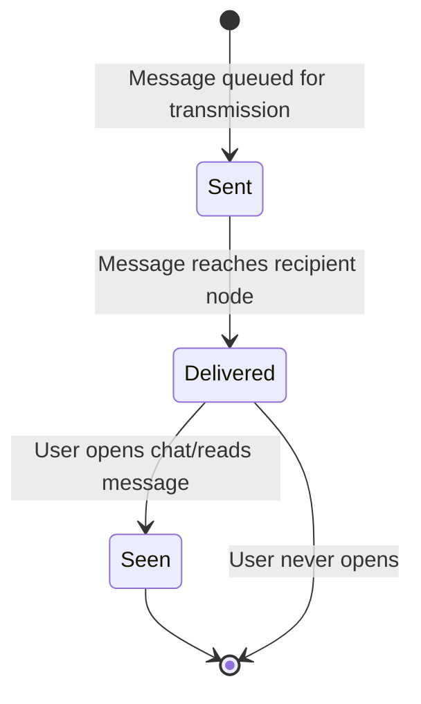
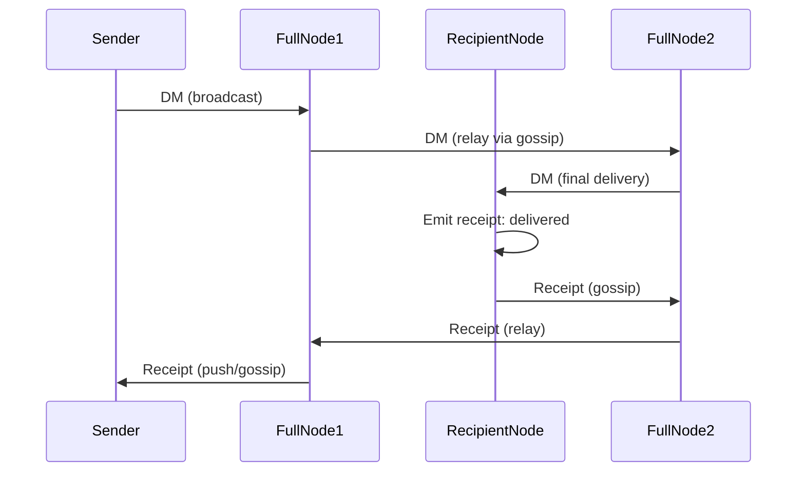

# Delivery Receipts Protocol

## Overview

Delivery receipts report two states for a direct message. `delivered` reports that the message reached the recipient's node, and `seen` reports that the recipient opened it in chat.

Every new DM v1 sent by Desktop or the SDK carries the signed-receipt requirement and original message reference inside both encrypted copies. Sending does not wait for a capability probe or require datagrams. Upgraded endpoints store the requirement with the message across reconnections and restarts. The signatures on `delivered`, `seen`, and `seen_ack` bind the original message reference, status, and timestamp. When a direct writer is unavailable, a signed receipt can travel inside an encrypted control DM through a protocol 31 relay, including v2.5.71. A new message whose bound encoding exceeds the relay's 64 KiB limit fails at send time.

v2.5.71 can read the DM, including through a relay. An unsigned receipt counts for a DM v1 only when the TLS session that carried it proved the receipt author's identity. For a message that requires signatures, this exception is limited to a peer that did not negotiate `signed_direct_receipts_v1`. The receiving node still checks the original message reference. An unsigned receipt received through a relay leaves the local delivery or read status and the retry state unchanged, including for messages sent before this policy. A message may therefore reach an older recipient while delivery remains unconfirmed at the sender. Other capability negotiation is unchanged.

## Commands

> **Transport scope:** All commands in this section are **LOCAL ONLY** — available through RPC HTTP and `handleLocalFrameDispatch`. Not available on the TCP data port; a remote peer receives `unknown_command`. For P2P receipt delivery between nodes, see the realtime path (`push_delivery_receipt` and `relay_delivery_receipt` P2P wire commands).

### send_delivery_receipt

Sends a delivery or read receipt back to the original message sender.

**Request Format:**
```json
{
  "type": "send_delivery_receipt",
  "id": "550e8400-e29b-41d4-a716-446655440000",
  "address": "a1b2c3d4e5f6",
  "recipient": "x9y8z7w6v5u4",
  "status": "delivered",
  "delivered_at": "2026-03-19T12:01:02Z"
}
```

**Field Descriptions:**
| Field | Type | Description |
|-------|------|-------------|
| `type` | string | Fixed value: `"send_delivery_receipt"` |
| `id` | uuid | Original message UUID that this receipt acknowledges |
| `address` | fingerprint | Fingerprint of the DM recipient (the node sending the receipt) |
| `recipient` | fingerprint | Fingerprint of the original DM sender (receipt target) |
| `status` | enum | `"delivered"` or `"seen"` |
| `delivered_at` | RFC3339 | Timestamp when the status was reached (UTC) |

**Status Values:**
- `delivered`: Message reached the final recipient node in the network
- `seen`: Recipient user opened the message in their chat application
- `seen_ack` (wire-only, v23): acknowledgment the original message sender returns for a received `seen` receipt. Never sent through this local command, never persisted to chatlog, never surfaced to the UI — it exists solely to stop the seen-sender's retry loop.

**Sender-owned retry.** Relays are forwarding-only, so confirmations drive the retry engine on the node that owns each artefact:
- a locally-sent DM is re-sent (same MessageID; receivers dedupe silently and re-send `delivered`) until the recipient's `delivered`/`seen` receipt is accepted;
- a locally-sent `seen` receipt is re-sent until the original sender's `seen_ack` is accepted. The original sender answers each accepted `seen`, including duplicates. For the direct TLS compatibility case, the acknowledgment goes back on that same session. In the relay path, `seen_ack` follows the original message direction, while `delivered` and `seen` follow the reverse path. `seen_ack` is never stored in the runtime receipt set — it cannot appear in `fetch_delivery_receipts` or the backlog replay. An incoming `seen_ack` must name the identity the seen receipt was addressed to. The receiver checks that field against the pending retry entry before updating deduplication state. The local `send_delivery_receipt` command rejects this wire-only status;
- `delivered` needs no own ack: the message retry re-triggers it on every duplicate.

Retries are exponential (30s → 1m → 2m → 5m → 11m capped; early intervals only help over a direct route — transit dedup absorbs re-emissions for up to ~10 min). A MESSAGE has no attempt cap: it ends when the recipient confirms it, when its author withdraws it, or when its own `ttl_seconds` expires, and the capped backoff is what paces the re-sends meanwhile — see [message_delivery.md](message_delivery.md). `CORSA_DELIVERY_RETRY_MAX_ATTEMPTS` (default 20) bounds the SEEN-RECEIPT retry only, which the far side re-triggers on every arrival. On a desktop node both retry sets survive restarts: messages are reseeded from every chatlog row still in `sent` with no horizon at all, and seen receipts from the chatlog `seen_ack` journal (seen rows whose confirmation has not been recorded; that reseed scans the last 7 days). When a message does expire, it is finalised: outbound state goes terminal (`expired`, visible via `fetch_pending_messages`), the pending/relay retry state is cleared, and the abandonment is journaled (`delivery_failed`) so a restart does not reseed it — the chatlog row intentionally stays at `sent`, which is the truthful "never confirmed delivered" state.

**Response Format:**

New receipt:
```json
{
  "type": "receipt_stored",
  "recipient": "x9y8z7w6v5u4",
  "count": 1,
  "id": "550e8400-e29b-41d4-a716-446655440000"
}
```

Duplicate receipt:
```json
{
  "type": "receipt_known",
  "recipient": "x9y8z7w6v5u4",
  "count": 1,
  "id": "550e8400-e29b-41d4-a716-446655440000"
}
```

Refused write:
```json
{
  "type": "error",
  "code": "store-failed"
}
```

**Behavior:**
- Receipts are **automatically emitted** when a live DM reaches the final recipient node
- Full nodes **relay receipts** to the original sender via push notification or gossip
- The receipt references the original message by UUID for correlation
- Deduplication returns `receipt_known` for already-stored receipts
- `store-failed` means the chatlog refused the delivery status. It is NOT the message-path meaning of that code: the message itself is on disk and unaffected, and the receipt may already have been distributed to the network. What it says is that THIS node did not record the status, so the client must not treat the conversation as read — nothing else writes that row, because the network re-send of a receipt goes to the peer rather than to our own chatlog. The receipt stays un-handled: no dedup key, the sender's retry keeps running, and the peer is not told to forget their copy, so the next arrival tries the write again

### fetch_delivery_receipts

Retrieves all delivery receipts for messages sent to a specific recipient.

**Request Format:**
```json
{
  "type": "fetch_delivery_receipts",
  "recipient": "a1b2c3d4e5f6"
}
```

**Field Descriptions:**
| Field | Type | Description |
|-------|------|-------------|
| `type` | string | Fixed value: `"fetch_delivery_receipts"` |
| `recipient` | fingerprint | Fingerprint of the recipient to fetch receipts for |

**Response Format:**
```json
{
  "type": "delivery_receipts",
  "recipient": "a1b2c3d4e5f6",
  "count": 3,
  "receipts": [
    {
      "message_id": "550e8400-e29b-41d4-a716-446655440000",
      "sender": "d4e5f6g7h8i9",
      "recipient": "a1b2c3d4e5f6",
      "status": "delivered",
      "delivered_at": "2026-03-19T12:01:02Z"
    },
    {
      "message_id": "660f9511-f40c-52e5-b827-557766551111",
      "sender": "d4e5f6g7h8i9",
      "recipient": "a1b2c3d4e5f6",
      "status": "seen",
      "delivered_at": "2026-03-19T12:05:15Z"
    }
  ]
}
```

**Response Field Descriptions:**
| Field | Type | Description |
|-------|------|-------------|
| `type` | string | Fixed value: `"delivery_receipts"` |
| `recipient` | fingerprint | Echo of the requested recipient |
| `count` | integer | Number of receipts in the response |
| `receipts[].message_id` | uuid | Original message UUID |
| `receipts[].sender` | fingerprint | Sender of the original message |
| `receipts[].recipient` | fingerprint | Recipient of the original message |
| `receipts[].status` | enum | `"delivered"` or `"seen"` |
| `receipts[].delivered_at` | RFC3339 | When the status was reached (UTC) |

## Message Lifecycle Diagram



**Diagram: Delivery Receipt Lifecycle**

## Network Relay Behavior

The following diagram shows how receipts flow through the network:



**Diagram: Receipt Network Flow**

## Implementation Notes

1. **Automatic Emission**: When a message with a valid signature arrives at a node where the recipient is local, a receipt is automatically generated with status `"delivered"`

2. **Timestamp Accuracy**: The `delivered_at` field is set by the node that emits the receipt, ensuring it reflects when the status was achieved locally

3. **Idempotency**: Duplicate receipts for the same message should be deduplicated by the receiving node

4. **Clock Drift**: Nodes must validate that `delivered_at` timestamps are within acceptable clock drift windows (see `message-timestamp-out-of-range` error)

5. **Privacy**: Receipts contain minimal identifying information; the message body is never included in a receipt

---

# Протокол Квитанций Доставки

## Обзор

Квитанции доставки сообщают о двух состояниях прямого сообщения. `delivered` означает, что сообщение дошло до узла получателя, а `seen` — что получатель открыл его в чате.

Каждый новый DM v1 из Desktop или SDK содержит требование подписывать квитанции и ссылку на исходное сообщение в обеих зашифрованных копиях. Отправка не ждёт проверки capability и не требует поддержки datagram. Обновлённые узлы сохраняют требование с сообщением при переподключении и перезапуске. Подписи `delivered`, `seen` и `seen_ack` связывают ссылку на исходное сообщение, статус и время. Если прямой сессии нет, подписанная квитанция может пройти в зашифрованном служебном DM через реле протокола 31, включая v2.5.71. Если после добавления ссылки новое сообщение превышает лимит реле в 64 КиБ, отправка завершается ошибкой.

v2.5.71 читает само сообщение, в том числе через реле. Неподписанная квитанция засчитывается для DM v1 только на той TLS-сессии, которая доставила её и подтвердила identity автора. Для сообщения, требующего подписи, исключение действует только для пира, с которым поддержка `signed_direct_receipts_v1` не согласована. Получатель квитанции также сверяет ссылку на исходное сообщение. Неподписанная квитанция через реле оставляет локальный статус доставки или прочтения и состояние повторов прежними, даже для ранее отправленного сообщения. Поэтому старый получатель может прочитать DM, пока у отправителя доставка остаётся неподтверждённой. Согласование остальных capability работает по-прежнему.

## Команды

> **Область транспорта:** Все команды в этом разделе доступны **ТОЛЬКО ЛОКАЛЬНО** — через RPC HTTP и `handleLocalFrameDispatch`. Недоступны на TCP data port; удалённый пир получит `unknown_command`. Для P2P-доставки квитанций между узлами см. realtime-путь (P2P wire-команда `push_delivery_receipt`).

### send_delivery_receipt

Отправляет квитанцию доставки или чтения обратно исходному отправителю сообщения.

**Формат запроса:**
```json
{
  "type": "send_delivery_receipt",
  "id": "550e8400-e29b-41d4-a716-446655440000",
  "address": "a1b2c3d4e5f6",
  "recipient": "x9y8z7w6v5u4",
  "status": "delivered",
  "delivered_at": "2026-03-19T12:01:02Z"
}
```

**Описание полей:**
| Поле | Тип | Описание |
|------|-----|---------|
| `type` | строка | Фиксированное значение: `"send_delivery_receipt"` |
| `id` | uuid | UUID исходного сообщения, которое эта квитанция подтверждает |
| `address` | отпечаток | Отпечаток получателя ПМ (узел, отправляющий квитанцию) |
| `recipient` | отпечаток | Отпечаток исходного отправителя ПМ (цель квитанции) |
| `status` | перечисление | `"delivered"` или `"seen"` |
| `delivered_at` | RFC3339 | Временная метка достижения статуса (UTC) |

**Значения статуса:**
- `delivered`: Сообщение достигло финального узла получателя в сети
- `seen`: Пользователь открыл сообщение в приложении чата
- `seen_ack` (только wire, v23): подтверждение, которое исходный отправитель сообщения возвращает на полученную `seen`-квитанцию. Через эту локальную команду не отправляется, в chatlog не персистится, в UI не показывается — существует только чтобы остановить ретраи отправителя seen-квитанции.

**Повторы на стороне отправителя.** Relay-узлы только пересылают, поэтому подтверждения управляют retry-движком на узле-владельце артефакта:
- локально отправленный DM переотправляется (тем же MessageID; получатель молча дедупит и переотправляет `delivered`), пока узел не примет `delivered` или `seen` от получателя;
- локально отправленная `seen`-квитанция переотправляется, пока узел не примет `seen_ack` исходного отправителя. Исходный отправитель отвечает на каждую принятую `seen`, включая дубликаты. В режиме совместимости на прямой TLS-сессии ответ уходит по той же сессии. В релейном режиме `seen_ack` идёт в направлении исходного сообщения, а `delivered` и `seen` идут по обратному пути. `seen_ack` не сохраняется в runtime-наборе квитанций — он не может попасть в `fetch_delivery_receipts` или backlog replay. Входящий `seen_ack` должен указывать identity, которой была адресована seen-квитанция. Принимающий узел сверяет это поле с ожидающей записью перед обновлением состояния дедупликации. Локальная команда `send_delivery_receipt` отклоняет этот статус;
- `delivered` собственного ack-а не требует: ретраи сообщения сами переоткрывают его на каждом дубликате.

Ретраи экспоненциальные (30s → 1m → 2m → 5m → 11m с потолком; ранние интервалы полезны только при прямом маршруте — транзит-дедуп поглощает повторы до ~10 мин). У СООБЩЕНИЯ лимита попыток нет: оно заканчивается подтверждением получателя, отзывом автора или истечением собственного `ttl_seconds`, а темп повторов задаёт backoff с потолком — см. [message_delivery.md](message_delivery.md). `CORSA_DELIVERY_RETRY_MAX_ATTEMPTS` (по умолчанию 20) ограничивает ТОЛЬКО повторы seen-квитанций, которые дальняя сторона перезапускает при каждом прибытии. На desktop-ноде оба набора ретраев переживают рестарт: сообщения пересеиваются из ВСЕХ строк chatlog со статусом `sent`, без горизонта, а seen-квитанции — из chatlog-журнала `seen_ack` (seen-строки без записанного подтверждения; этот пересев сканирует последние 7 дней). Когда сообщение всё-таки истекает, оно финализируется: outbound-состояние становится терминальным (`expired`, видно через `fetch_pending_messages`), pending/relay-retry состояние очищается, а отказ журналируется (`delivery_failed`), чтобы рестарт не пересеял его заново — строка chatlog намеренно остаётся в `sent`: это честное состояние «доставка не подтверждена».

**Формат ответа:**

Новая квитанция:
```json
{
  "type": "receipt_stored",
  "recipient": "x9y8z7w6v5u4",
  "count": 1,
  "id": "550e8400-e29b-41d4-a716-446655440000"
}
```

Дублирующая квитанция:
```json
{
  "type": "receipt_known",
  "recipient": "x9y8z7w6v5u4",
  "count": 1,
  "id": "550e8400-e29b-41d4-a716-446655440000"
}
```

Отказ записи:
```json
{
  "type": "error",
  "code": "store-failed"
}
```

**Поведение:**
- Квитанции **автоматически генерируются**, когда DM достигает финального узла получателя
- Полные ноды **передают квитанции** исходному отправителю через push или gossip
- Квитанция ссылается на исходное сообщение по UUID для корреляции
- Дедупликация возвращает `receipt_known` для уже сохранённых квитанций
- `store-failed` означает, что chatlog отказал в записи статуса доставки. Это НЕ то же самое, что тот же код в message-пути: само сообщение на диске и не затронуто, а квитанция могла уже уйти в сеть. Код говорит, что ЭТОТ узел статус не записал, поэтому клиенту нельзя считать переписку прочитанной — эту строку не пишет больше ничто, ведь сетевой повтор квитанции адресован пиру, а не нашему chatlog. Квитанция остаётся необработанной: dedup-ключа нет, ретрай отправителя продолжается, пиру не сообщается забыть свою копию — и следующее прибытие снова пробует запись

### fetch_delivery_receipts

Получает все квитанции доставки сообщений, отправленных конкретному получателю.

**Формат запроса:**
```json
{
  "type": "fetch_delivery_receipts",
  "recipient": "a1b2c3d4e5f6"
}
```

**Описание полей:**
| Поле | Тип | Описание |
|------|-----|---------|
| `type` | строка | Фиксированное значение: `"fetch_delivery_receipts"` |
| `recipient` | отпечаток | Отпечаток получателя для выборки квитанций |

**Формат ответа:**
```json
{
  "type": "delivery_receipts",
  "recipient": "a1b2c3d4e5f6",
  "count": 3,
  "receipts": [
    {
      "message_id": "550e8400-e29b-41d4-a716-446655440000",
      "sender": "d4e5f6g7h8i9",
      "recipient": "a1b2c3d4e5f6",
      "status": "delivered",
      "delivered_at": "2026-03-19T12:01:02Z"
    },
    {
      "message_id": "660f9511-f40c-52e5-b827-557766551111",
      "sender": "d4e5f6g7h8i9",
      "recipient": "a1b2c3d4e5f6",
      "status": "seen",
      "delivered_at": "2026-03-19T12:05:15Z"
    }
  ]
}
```

**Описание полей ответа:**
| Поле | Тип | Описание |
|------|-----|---------|
| `type` | строка | Фиксированное значение: `"delivery_receipts"` |
| `recipient` | отпечаток | Эхо запрошенного получателя |
| `count` | целое число | Количество квитанций в ответе |
| `receipts[].message_id` | uuid | UUID исходного сообщения |
| `receipts[].sender` | отпечаток | Отправитель исходного сообщения |
| `receipts[].recipient` | отпечаток | Получатель исходного сообщения |
| `receipts[].status` | перечисление | `"delivered"` или `"seen"` |
| `receipts[].delivered_at` | RFC3339 | Когда был достигнут статус (UTC) |

## Диаграмма жизненного цикла сообщения


**Диаграмма: Жизненный цикл квитанции доставки**

## Поведение сетевой передачи

На следующей диаграмме показано, как квитанции проходят через сеть:


**Диаграмма: Поток квитанций в сети**

## Примечания реализации

1. **Автоматическая генерация**: Когда сообщение с корректной подписью прибывает на узел, где получатель локален, квитанция автоматически генерируется со статусом `"delivered"`

2. **Точность временной метки**: Поле `delivered_at` устанавливается узлом, генерирующим квитанцию, обеспечивая отражение момента достижения статуса локально

3. **Идемпотентность**: Дублирующиеся квитанции для одного и того же сообщения должны дедупликироваться принимающим узлом

4. **Сдвиг часов**: Узлы должны проверять, что временные метки `delivered_at` находятся в допустимых окнах сдвига часов (см. ошибка `message-timestamp-out-of-range`)

5. **Конфиденциальность**: Квитанции содержат минимум идентифицирующей информации; тело сообщения никогда не включается в квитанцию
