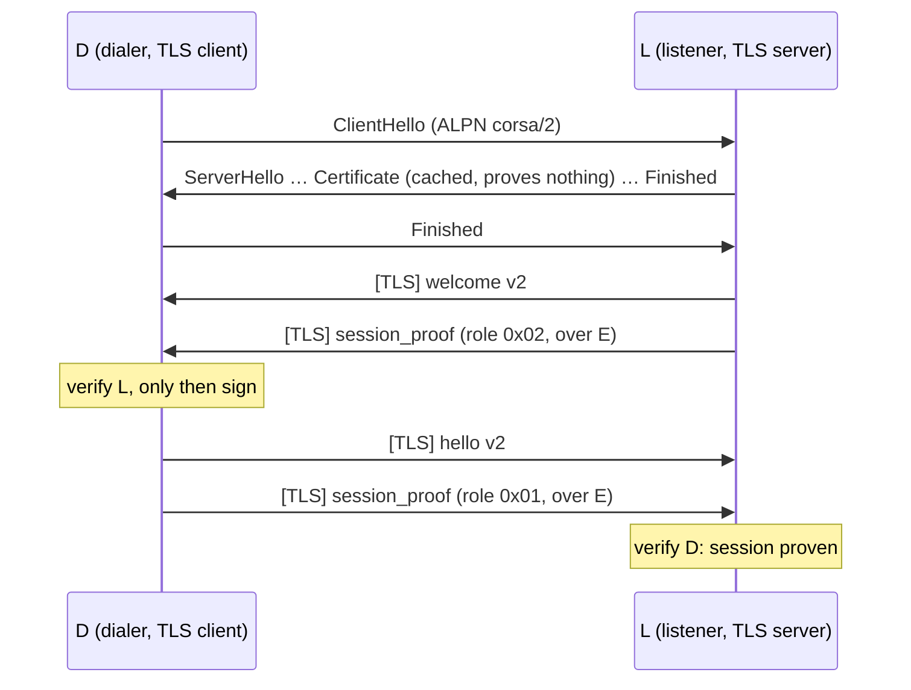
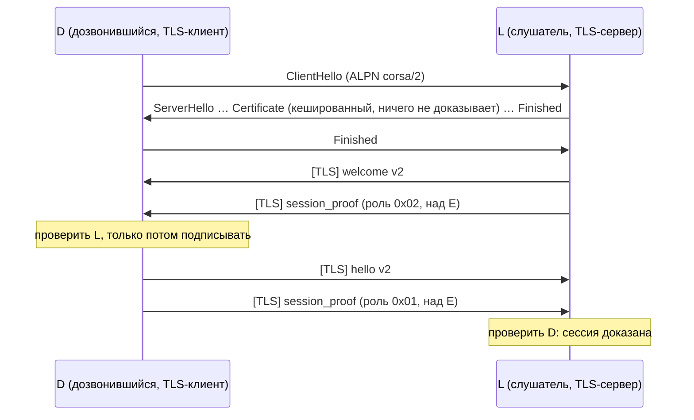

# CORSA Secure Session v2

## Current verification scope / Текущая область проверки — 2026-10-23

The [later owner decision](../operations/d1-release-decision-proposal.md#measurement-scope-2026-10-23) defers real Windows/DACL and Tor measurements while work proceeds on macOS/Linux. Earlier unconditional Windows/Tor release prerequisites below are superseded only in that scope; the historical results are retained. Windows and Tor remain UNVERIFIED/UNKNOWN, never PASS. Schema 2 retains all 17 conditions: 7 done, 2 partial, 7 not_done and 1 deferred (`tor_phase_measurement`). The unsafe-store composite remains partial; clearnet/real-old-release first-contact timing and timeout derivation remain required. Proxy/no-direct-fallback, authentication, independent crypto review, other tests, G2 and separate release decisions remain required. The gate is closed. Any Tor observation role remains deferred; macOS/Linux data establishes no Tor threshold or guarantee.

[Последнее решение владельца](../operations/d1-release-decision-proposal.md#measurement-scope-2026-10-23) переносит реальные Windows/DACL и Tor замеры; работа идёт на macOS/Linux. Прежние безусловные требования Windows/Tor ниже заменены только в этой области, исторические результаты сохранены. Фактический статус — UNVERIFIED/UNKNOWN, не PASS. Schema 2 сохраняет 17 условий: 7 done, 2 partial, 7 not_done и 1 deferred (`tor_phase_measurement`). Условие небезопасного хранилища остаётся partial; clearnet/настоящие старые выпуски, замеры первого контакта и вывод timeout остаются обязательными. Proxy/no-direct-fallback, аутентификация, независимая криптоэкспертиза, остальные проверки, G2 и отдельные решения о выпуске сохраняются. Gate закрыт. Tor-роль наблюдения отложена; данные macOS/Linux не доказывают пороги или гарантии Tor.

## English

### Status

**Nodes use v2.** From protocol version 31 two new nodes connect over v2, and a new node and an old one over v1, in either direction:

- **accepting:** a first byte `0x16` makes the connection v2: the handshake runs before the connection is registered, and the peer's `hello` is applied only once its proof verified. Any other first byte is a v1 connection, as before. A connection the listener refuses gets a TLS alert, not a silent close ("Listener refusals");
- **dialling** — every path that opens a connection to a node (the connection manager's long-lived sessions, the one-shot `syncPeer` recovery dial and the `sendNoticeToPeer` fallback): TLS first. A failed TLS attempt never leads to v1 by itself: v1 follows only a correct old-protocol answer to a separate identity-less probe, on that probe's connection, and never where v2 is required ("Choosing the session kind on dial"). Every one of these sockets is opened the same way: a name in an overlay top-level domain (`.onion`, `.i2p`, any case, trailing dot ignored) is never dialled or resolved locally — a valid one goes only through the SOCKS5 proxy (`CORSA_PROXY`), with the name handed to the proxy, and an invalid one is refused before any socket; a proxy that cannot be reached, or no proxy at all, ends the attempt with an error and never turns it into a direct connection. The socket of a one-shot dial counts against the shared connection limit, and a cancelled dial — the proxy handshake included — closes it and returns its share at once.

### Downgrade protection

A v1 answer can be forged by whoever stands on the path, so a node remembers what proved v2 and refuses v1 for it — across restarts:

| What | Kept | Effect |
|---|---|---|
| an **identity** that proved itself over v2 (either direction) | for good | a v1 `hello` naming it is refused on accept, a v1 `welcome` naming it is refused on dial — before anything is signed; checked again at `auth_session` and right after an outbound v1 session is registered. A v1 connection naming it that was open before the proof is **closed at the proof**, and what such connections wrote into the routing table before it is forgotten (see below) |
| an **endpoint** this node dialled and reached over v2 | 30 days from the last v2 session on it (an ordinary binding) | a v1 answer from it, naming any identity, is a downgrade: the dial fails instead of falling back — until the binding expires |
| a **protected** endpoint binding | for good — never lowered or removed automatically | the same, without expiry. Only a dial with the intent "to X" that proved X, X a contact or a relation of this node, creates or raises one (a relation is not derived by any path yet, so today only a contact qualifies — see "Dial intent" below). **No dial path carries such an intent yet**, so no new protected binding is created today; protected bindings written by earlier builds — which protected an endpoint wherever a dial reached a contact — stay as they are. Only an operator lowers one: by a confirmed demotion of named endpoints ("Operator actions on endpoint bindings" below) |

Every v1 session refused because its identity proved v2 is counted in `fetchRouteSummary.secure_sessions.v1_refusals_identity_pinned`, on accept and on dial alike, and every v1 answer refused because its endpoint is bound to v2 in `fetchRouteSummary.secure_sessions.v1_refusals_endpoint_bound` ([rpc/routing.md](../rpc/routing.md)).

**The dialler refused on accept is told so.** A v1 `hello` naming a pinned identity — or its `auth_session`, when the identity proved v2 in between — is answered with `connection_notice{code=peer-banned, reason=peer-ban}` before the connection closes — a frame and a reason every release since protocol 28 understands ([errors.md](errors.md)). It carries no `until`, so the dialler applies its own default window (24 h on protocol 28–30 builds) and its dial gate stops offering this address — one it keeps a peer record for — until the window ends: an old dialler — or an old build still running under an identity that has proved v2 — does not turn the refusal into a storm of redials, each refused the same way. This node charges nothing for the refusal: no ban score, no peer ban, no record of the claimed identity. The dialler does pay: it does not dial this address for its whole default window, and upgrading it to a build that speaks v2 does not lift that before the window ends (this node can still dial it). `until` is left out on purpose: the dialler reads it against its own clock, and a short window is fragile when the two clocks disagree — it may expire at once or last far longer than meant — while the dialler's default is a window it already applies to such notices.

**A refusal on dial is not a failure of the address.** A v1 answer refused on dial — its `welcome` names a pinned identity, or its endpoint is bound to v2 — is this node's decision, and a man in the middle can provoke it at will by forging the answer. Charging the address for it would let him push the address out of rotation and keep v2 away from it. So the refusal counts nothing against the address: no failure, no score, no failure cooldown, no setup failure, no route quarantine, and the address is not published as disconnected. Its consequences are two backoffs of that address, both kept in memory and started over only after a proven outbound v2 session to it:

- **the hold of the fall back to v1**: 5 minutes after the first refusal, doubled after each further one, at most 6 hours. The refusal also forgets the address's `legacy_observed` hint — the old answer behind it may have been forged by the same man in the middle — and no probe runs there while the hold runs, so every dial there is a TLS attempt alone; only the fall back to v1 is withheld. The hold never delays a v2 attempt. Withheld fall backs are counted in `fetchRouteSummary.secure_sessions.v1_dials_held_by_refusal_backoff`;
- **the v2 retry backoff**: a v2 attempt that ended without v2 there for a reason that says nothing against the address — its v1 answer refused, its fall back held, the listener refused it with its alert ("Listener refusals"), the listener answered with TLS and the handshake then failed, a dial "to X" met another identity, the probe was answered by a node that speaks v2, or the probe's answer admitted nothing (none in time, none at all, cut off, broken or forged — with the TLS-first switch on or off) — makes the next dial wait 30 s, doubled per further such end, at most 30 min — one step per attempt: an end met while the wait still runs (a parallel dial, a second failure inside one attempt) takes no step; after a listener's refusal a random extra of up to half that wait is added, so the diallers one busy listener refused together do not come back together. The connection manager's own retry backoff still applies and the later of the two wins: a dial inside the v2 retry backoff is refused before any socket, and the address is not picked as a candidate meanwhile. This is pacing of the next v2 attempt, not the failure cooldown: it reads no failure count and writes nothing into the address's score, failures or setup failures, and it ends with the backoff. It is kept per endpoint: one address's backoff holds no other address of the same node. Only a proven **outbound** v2 session to that endpoint resets it — with the identity the dial expected, when it named one; an inbound v2 session of the same identity resets none of its addresses' backoffs and starts no redial of them, and it serves within its own capabilities meanwhile. A retry never allows v1 and never lifts a pin. Dials it refused are counted in `fetchRouteSummary.secure_sessions.dials_held_by_v2_retry_backoff`.

**A failure before authentication is not a failure of the address either.** A TLS attempt over a TCP connection that was opened and that ended before the identity proof verified — a TLS answer that then failed (a certificate, a handshake broken on the way, a proof or its binding to the TLS session that does not verify), an alert, or, where v1 is ruled out, silence until the deadline, a reset or bytes that are neither TLS nor v1 — and a probe whose answer admitted nothing — none in time, the connection closed without one or in the middle of it, an answer broken or forged — end before anything authenticated who answered, so nothing shows the node there at fault, and a man in the middle can cause each of them at will. Like a refusal, they count nothing against the address: no failure, no score, no failure cooldown, no ban of the address, its IP or an identity. They create no pin, no binding, no `v2_strong` and no proven identity, and none of them leads to v1: a failed proof or binding ends the attempt, with no probe after it. Their one consequence is the v2 retry backoff above, one step per dial — however many stages of the dial end without v2 and however long it runs — with the TLS-first switch on or off; once it has run out, the next dial is chosen as usual. Not this case: a TCP connection that cannot be opened is an ordinary failed dial of the address — a failure of reachability, never a ban of its IP or a penalty of an identity — and a dial this node ended itself (its stop, the caller cancelling) or whose probe failed on this node before reaching the wire counts nothing at all and paces nothing.

A v1 dial whose full `hello` got no welcome at all — the far end hung up on it, as a v2 node that pinned this node does — forgets the address's `legacy_observed`, so the next dial starts with TLS instead of repeating a probe that leads nowhere.

The same applies when a v1 session is closed for the same reason after it was registered — its identity proved v2 between the dial and the registration, or the sweep at a proof (below) closes it: the session is withdrawn as this node's decision, nothing about it is published or charged, and the fall back to v1 at its address is held.

An ordinary binding that expired lets v1 back in on that endpoint — for an identity that is not pinned; the pin of the identity that proved v2 there still holds.

An ordinary binding past its term is removed by the periodic flush of the store (the 2-second maintenance tick, at most once a minute, and once more when the node stops) — not only when a full ordinary tier needs room — and also when a new binding of the same endpoint replaces it. Every removal is logged as `endpoint_binding_expired` with the endpoint, its last proven identity and its last v2 time, and is written with the next batch. A protected binding is never removed this way.

**At the moment of a proof** (`onIdentityProvenV2`, after the pin is on disk and before the v2 connection is registered) every v1 connection that names the identity is closed: such a connection proved nothing, and leaving it open would leave it a path to the identity and a voice on its routing plane — also after the identity's last v2 session closes, since the pin keeps refusing its reconnects. While an identity has a live v2 connection, a v1 connection naming it is refused too. Routing input a v1 connection wrote in the identity's name before the proof — claims, withdrawals with an arbitrary SeqNo, cooldowns, flaps, the v3 epoch — is forgotten locally at the same moment, without a wire withdrawal, unless a live v2 connection of the identity already vouches for its routes; the v2 session's connect-time full sync repopulates them (docs/protocol/network_security.md §13). An old device running under an identity that has proved v2 elsewhere is therefore cut off from this node — the same consequence the pin already had for its new connections.

A session counts only once the protection it earns is on disk: if the store cannot be written, the v2 session is not established — the peer reconnects, and the write is retried, including any earlier change that never reached the disk.

The state lives in `secure-sessions-<port>.json` next to the peers file (`CORSA_SECURE_SESSION_STORE_PATH` overrides it), written atomically and owner-only. A store file that exists but cannot be read — damaged, or written by a newer build — stops the node from starting (see "Refusal to start" below); the file is left for the operator as it is. A protected binding is written with `protected_by` and `pool`; a protected record without them was written by an earlier build, when only a contact's binding was protected, and is read as given by its own identity in pool K. A record that contradicts itself — a pool on an ordinary binding, an unknown pool, a protected binding with only one of the two — makes the file unreadable, with the effect above. Temp files of interrupted saves older than an hour are removed when the store is loaded; younger ones may belong to a node on another port that shares the directory and is writing at that moment, and are left.

**Where the store lives must be private too.** The file is only as private as the directories above it: whoever can write into any of them can move the store's directory away and put their own in its place. When the store is loaded — once, before the node listens or dials — its location and the location of its marker (below) are audited:

- the file, if it exists, is not a symlink, is a regular file, and is owner-only as far as the audit can see: on POSIX owned by the node's effective user with mode `0600`, on Windows by the rule below;
- on POSIX, every directory and symlink the path passes through, from the file's directory up to `/`, symlinks followed, is owned by the node's user or by root, and no directory is group- or world-writable unless it has the sticky bit. A sticky directory others may write (`/tmp`, `1777`) is accepted on the way only when the entry inside it belongs to the node's user — a data directory under `/tmp` passes, a root-owned one inside `/tmp` does not. A symlink on the way is not a violation by itself (macOS reaches every data directory through `/var → private/var`); it is judged by its owner and by the directory holding it.
- on Windows, mode bits mean nothing and the audit reads owners and DACLs back from the objects, from the file up to the **root of its volume** — the same boundary inside the user's profile and outside it, since a directory owned by SYSTEM halfway up can still be moved away by whoever may delete children of its parent. The file (and the marker) is owned by the node's user, SYSTEM or Administrators (an elevated writer's files belong to Administrators) and every allow entry that applies to it names one of those three: the writer grants the user alone, but a copy in Explorer, robocopy without `/SEC` or a restore from a backup adds the inherited SYSTEM and Administrators entries, which give nobody anything new — those two reach any file through the backup and take-ownership privileges. Every directory is owned by one of those or by TrustedInstaller, and no allow entry for another account grants `FILE_DELETE_CHILD`, `DELETE`, `WRITE_DAC` or `WRITE_OWNER` on it — generic rights mapped first (`GENERIC_ALL`, `GENERIC_WRITE`), deny entries skipped, entries inherited by children only (`INHERIT_ONLY`) not applied to the directory itself, an entry of a type the audit does not read refused, a missing DACL refused. The directory holding the file additionally grants no other account `FILE_ADD_FILE` or `FILE_ADD_SUBDIRECTORY`: a name planted there before the first write would be read as the store. On an ancestor those two rights are accepted: they only create **siblings**, and the next directory on the path can be replaced only after it has been moved away, which needs `DELETE` on it or `FILE_DELETE_CHILD` above it — both refused. That is what the root of the system drive gives Authenticated Users. On the volume root itself `DELETE` is not judged either — a root cannot be deleted or renamed — so the root of a data drive where Authenticated Users hold "Modify" passes, while the directory below it passes only once it is made private (to be confirmed on a real Windows host). A reparse point on the way that redirects its name — a symlink, a junction or mount point — is a violation (`symlink`), and so is one of an unknown kind (`reparse_point`); a cloud placeholder (OneDrive Files On-Demand), a deduplicated or a WOF-compressed entry only stores its own data differently and is judged like any other. A volume without security descriptors (FAT, exFAT) reports no DACL and is refused. The marker's directory, when the node has to create it (an SDK node given its key inline), is made owner-only and the location is judged again right before the marker is written. All of it is judged before the first write as well, on the directories that exist. A path outside the profile passes only where its directories were made private: a directory created under `C:\` inherits "Authenticated Users: Modify" and is refused. The verdict on real descriptors is covered by tests under the `windows` build tag; they must run on a real Windows host before a release.

**Limit: extended ACLs are not seen.** Only owner and mode bits are judged on POSIX. macOS (and Linux with POSIX ACLs) can grant others access through an extended ACL — read on the file, `add_file` or `delete_child` on a directory — that the mode does not show; the audit does not read ACLs, so a location that passes is safe as far as its mode bits go. On macOS the writer is affected too: a file created `0600` inherits the inheritable ACL entries of its directory, so in a directory carrying, for example, `everyone allow read,file_inherit` the store file is readable by others from the moment it is created. Keep the data directory free of inheritable ACL entries (`ls -le` shows them; `chmod -N` removes them).

**The pin store marker.** Next to the identity file lives `<identity file>.pin-store-marker.json` — by default `identity-<port>.json.pin-store-marker.json` in the data directory; it follows `CORSA_IDENTITY_PATH`. It holds no secret: a format number and the absolute path of the store it vouches for. It tells a first start from a lost store, which otherwise look the same — no store file — and would both start on an empty store that lets every peer that proved v2 be taken back to v1. A new node is a new identity and starts without a marker; an identity restored into an empty data directory starts as a new node too and loses its pins (copy the store with the identity). The protection against a lost store is about an existing node **continuing**: a new identity carries none of its trust history, and losing nothing is all a new node can promise.

**A changed port.** With the default paths the identity file, the marker and the store all carry the port. A port not used before is therefore a **separate node** with a new identity: it starts, and when the directory holds the markers of other nodes it says so loudly — `pin_store_new_node_beside_other_nodes`, with their file names — and leaves their files untouched. A port used before is the node of that port, with its identity and its pins. An environment override is not a reason to refuse by itself; the refusal comes from inconsistent saved state only: an explicit `CORSA_IDENTITY_PATH` with a changed port keeps the identity and the marker while the default store path follows the port, so the marker vouches for a store that is not where the node looks — `store_missing`. A changed `CORSA_SECURE_SESSION_STORE_PATH` or data directory under the same identity file is the same case.

**Moving a node to another port** while keeping its identity, store and marker:

1. Stop the node.
2. Either rename every file of the old port to the new one — `identity-<old>.json` → `identity-<new>.json`, `identity-<old>.json.pin-store-marker.json` → `identity-<new>.json.pin-store-marker.json`, `secure-sessions-<old>.json` → `secure-sessions-<new>.json`, and the other files whose names carry the port (`trust-`, `peers-`, `identity-intents-`, the chat database);
3. or keep the files and point the node at them: `CORSA_IDENTITY_PATH` at the old identity file and `CORSA_SECURE_SESSION_STORE_PATH` at the old store (and the other `CORSA_*_PATH` variables as needed).
4. Start the node on the new port. It loads the pins; after a rename the marker still records the old store path, and the start rewrites it to the new one (`pin_store_marker_written`, `store_moved`). A copy left at the old path is refused (`two_stores`) until it is moved aside. The marker is written through the same writer as the store (owner-only at creation, never through a link) and audited like it.

Order of writes: the store lands first, the marker after it, and only once — when no marker vouches for this store yet. A change counts as written, and the session that needed it is established, only when both are on disk; a marker that failed is retried with the next write. A crash at any point therefore leaves one of three states: neither file (the first write never landed; nothing was promised — a first start), a store without a marker (the next start keeps the pins and writes the marker), or both. A marker is never written before its store, so a crash never leaves a marker that would raise a false alarm.

What a start does with what it finds:

| marker | store | start |
|---|---|---|
| none | none | first start; the marker comes with the first write of the store |
| none, damaged, or recording another path | loads | the store wins: pins loaded, marker (re)written, `pin_store_marker_written` warning with `no_marker_for_existing_store`, `marker_damaged` or `store_moved`; a marker that cannot be written is a refusal, `marker_unwritable` |
| recording another path that still holds a store | loads | refusal, `two_stores`: the store was copied, not moved, and which copy is current is the operator's call; the marker is not rewritten. One file reached under two spellings of its path (a link to its directory) is one store |
| present (any shape) | not configured (no peers file, no `CORSA_SECURE_SESSION_STORE_PATH`: memory only) | refusal, `store_missing` |
| present (any shape) | none | refusal, `store_missing` |
| any | cannot be read | refusal, `store_unreadable` |

The first start of this build on a node that already has a store is the second row: the pins are kept and the marker is written. A store moved by the operator to the path the node now uses loads, and the marker follows it.

**Refusal to start.** A node whose store or marker sits in an unsafe location (`location_unsafe`) or one the audit could not inspect (`location_unverifiable`), whose marker says a store was kept that is not there (`store_missing`), whose store cannot be read (`store_unreadable`), whose marker cannot be written for an existing store (`marker_unwritable`) or whose marker records a path that still holds another store (`two_stores`) does not start. Neither does a node that could not enforce its pins: a build with the secure session whose v2 state cannot be built — the session mode, the identity's proof or the certificate source failed — refuses with `secure_session_unavailable` instead of falling back to v1, and a build that speaks v1 only (a rollback) refuses with `legacy_only_build` while a pin store or a marker is on disk. `NewService` finds it; `Service.StartupRefusal` reports it, `Run` returns it before the node's listener, and the headless node, the desktop and the SDK check it before their own RPC and pprof listeners — the node is never reachable. The error matches `errors.Is(err, domain.ErrPinStoreRefused)`; a location refusal also matches `secretfile.ErrUnsafeLocation`. It names the file's path, the violation with the component's owner and mode, the user and group the process runs as, and the fix — for Docker as well. The path goes only to the process that starts the node — its output, the desktop's startup notice (a message box on Windows, the terminal elsewhere) — never into an RPC answer; the store's own log line, `pin_store_refused`, carries the reason and, for a location, the component by role, the violation code (`symlink`, `not_regular_file`, `file_not_owner_only`, `foreign_owner`, `writable_by_others`, `sticky_child_not_owned`), the owner and the mode, never a path. The node changes no permissions, removes no pin and falls back neither to v1 nor to a temporary store; meanwhile the refused store treats every peer as pinned and writes nothing. The node does not re-issue its own identity record either ("The minimum session version in the record"). `fetchRouteSummary.secure_sessions.pin_store_unsafe` and `store_unreadable` are therefore never true on a running node ([rpc/routing.md](../rpc/routing.md)).

The way out is the operator's: restore the store from a backup; after a changed `CORSA_SECURE_SESSION_STORE_PATH` or data directory — or a changed port with an explicit `CORSA_IDENTITY_PATH` — move the store to the path the refusal names (or point the variable at the old one); with two stores, keep the current one and move the other aside. Only if the store is lost for good, remove the marker: the node then starts with no pins, and every peer may be taken back to v1 once more — a choice made knowingly, not by default. For an unsafe location: make the file `0600` and the node's user's, and every directory above it changeable only by that user or root. **Docker:** do not mount a `0777` volume — `chown` the volume to the container's user (the image runs as `uid 10001`), or, for a volume other users must write, make it sticky (`chmod 1777`) and give the node its own subdirectory owned by its user with mode `0700`, pointing `CORSA_DATA_DIR` at it. A directory the node cannot write into at all — a root-owned `0755` data directory for a non-root node — is not an unsafe location; its first write fails with `pin_store_directory_not_writable`, naming the directory's owner and mode, and the session that needed the write is not established.

**Bounds of the endpoint bindings.** Ordinary bindings — 16 384. Protected bindings, apart from them — 32 768:

- 8 192 of the protected places are a reserve for the **contact pool (K)** only. The **relation pool (R)** never takes it, not even for a while: nothing protected is ever evicted, so a reserve place R took would never come back. R therefore holds at most 24 576; K may take any free place, so R may get fewer;
- one identity gives protection to at most 4 endpoints (`protected_by`);
- the pool is fixed when the binding is created or raised and is read back from the file, never derived again: removing a contact, or an identity moving between the classes, leaves its bindings in the pool they were counted in;
- the three bounds are checked and the binding is inserted in one step under the store's mutex, so concurrent sessions never pass a bound by even one binding.

**Endpoint keys and source groups.** A binding is keyed by the endpoint's canonical form — transport, host and port — so two spellings of one endpoint are one binding and a man in the middle cannot pick the spelling the binding does not cover. The host is parsed as an IP first and only otherwise read as a name:

| Host | Canonical form |
|---|---|
| IPv4 | decimal dotted form |
| IPv6 | RFC 5952 — lower case, zeros compressed; an IPv4-mapped address (`::ffff:a.b.c.d`) is its IPv4 form; the zone (`%eth0`) is part of the key only on a link-local or interface-local address, where the same address on another interface is another endpoint; on any other address it is dropped, or one host would have as many keys as there are strings to append |
| DNS name | lower case, no trailing dot, ASCII letters, digits, `-` and dots only; an internationalised name only in its punycode form (`xn--…`). The key is the name, not what it resolves to |
| onion | a v3 name (56 base32 characters), lower case, transport `tor` |
| i2p | a `.b32.i2p` name, lower case, transport `i2p` |
| port | decimal, 1–65535; one IP on two ports is two endpoints |

Every other host is `tcp`. A host that a resolver could read as an IPv4 address — a name whose **last** label is an IPv4 number: decimal or octal digits, or `0x` followed by hex digits only (`127.1`, `127.0.1`, `0x7f000001`, `017700000001`, `2130706433`); a `0x` label elsewhere in the name (`node.0x.org`, `0xnode.example.com`) is an ordinary name — a subdomain of an onion service (`www.<v3>.onion`), a v2 onion name, a non-ASCII name and any host longer than 253 bytes have **no canonical form**: a v2 session dialled there pins its identity and stands, but its endpoint gets no binding. Such a skip is logged as `endpoint_binding_skipped_not_canonical` with the address and the reason and counted in `fetchRouteSummary.secure_sessions.endpoint_bindings_skipped_not_canonical`.

The first three are **aliases** of a host that has a canonical form, and a binding of that host is not found under an alias without resolving it. A dial to an alias therefore **always requires v2**: a v1 answer there is refused like one from a bound endpoint. No legitimate configuration names a peer this way, so nothing that works today stops working. Any other address without a canonical form requires v2 only where the store file holds a record under that exact address (below).

Each binding keeps the **source group** it was created in:

- an IP endpoint — the group of its address: the IPv4 `/16`, the IPv6 `/32`; all of loopback (`127.0.0.0/8`, `::1`) is **one** group, since every inbound onion connection arrives from loopback and must not pass for many sources;
- a name dialled direct — the group of the address the dial actually reached; a name whose reached address is not known (a binding written before groups existed) — one shared group, `unresolved_name`;
- onion — the group `tor`, i2p — the group `i2p`.

**At most 64 new ordinary bindings per source group in any 24 hours.** A mutual v2 handshake costs an attacker with fresh keys nothing, and onion names cost nothing either; the bound keeps one block or one overlay from filling the ordinary tier. A name dial is one creation, whether it binds the name, its derived key (below) or both, and a refusal of the pair is counted once. Past the bound a new ordinary binding is not created: the session stands on its identity pin; the first refusal in a group is logged as `endpoint_binding_refused_source_group_quota` with the endpoint and the group, and every refusal is counted in `fetchRouteSummary.secure_sessions.general_refusals_source_group_quota`. Bindings that exist are never touched by it: their renewals and changes of owner go on, and a protection is not bounded by it. The quota counts creations, not live bindings, and the creation time is kept in the file, so a restart does not give a group a place back: after a restart every binding created within the day counts, a protected one too — the file does not tell one created ordinary and raised from one created protected — except a derived key created together with its name.

**Known gap: a full ordinary tier refuses instead of evicting.** The intended behaviour, once the 16 384 ordinary places are taken, is to evict the newest bindings of the most numerous source group, so that a flood displaces its own fresh bindings rather than everyone's new ones. This build does not evict: it removes only expired ordinary bindings and otherwise refuses the new one (`secure_session_endpoint_binding_refused_store_full`). The daily quota limits how fast any one group can fill the tier, but while the tier is full an honest new endpoint gets no binding either.

**The address behind a name.** When a name is dialled direct (not through the SOCKS5 proxy) and the session proves v2, the address the socket reached is bound too, as a **derived key** of the name (`derived_from`) in the same source group: the connection manager dials both forms of one host — the name from the configuration, the IP from peer exchange — and without it the IP form would be open to a downgrade after a restart. A derived key is always ordinary with the usual 30 days, even for a contact: the address behind a name is the provider's fact, not part of the identity. It is never raised — a dial "to X" on the IP form only renews it, and a protection asked for is refused with `derived_key`, which is not a bound and is not counted. Not covered: the other addresses of the name the node did not reach, the other address family, other names of the same host — each is bound when v2 is proven on it. A dial through the proxy reaches the proxy, not the peer, and derives nothing.

**The endpoint-record compatibility rules.** The main file now uses [format 2 with explicit pin metadata](../design/session-v2-pin-metadata.md); historical format 1 migrates to unclassified pins without changing endpoint protections. `transport`, `source_group`, `first_at` (creation time), `derived_from` and `demoted_at` (an operator's demotion, on an ordinary binding only — a protected record carrying it fails the load closed) are optional fields of a record. A record without them — written by an earlier build under the raw address it dialled — is read under the canonical key of that address, with the transport and the group of the address itself and no creation time (it counts against no group's day). Records that are spellings of one endpoint become one binding, field by field: the strongest protection — any over none, the contact pool over the relation pool, with its giver — so a merge never lowers protection or moves a contact's place into the relation pool; the identity and last v2 of the record with the latest last v2 (then the smaller stored address), the endpoint's last proven owner; the earliest creation time; the latest demotion, kept only while the merged binding is ordinary. The outcome does not depend on the order of the file, and the bounds' counts follow the merged binding. Each folded record is logged as `endpoint_binding_merged`, and the merged state is written with the next batch.

A record whose address has no canonical form is **kept as it was**, under that exact address, and logged at load as `endpoint_binding_kept_not_canonical`: dropping it would remove a protection automatically. It is for comparison only — a lookup of that exact address finds it — and is never renewed, raised, re-owned or created again. A protected one never expires and counts against the protected bounds and the contact reserve like any other; an ordinary one counts against the ordinary bound and expires 30 days after its last v2. Every write carries it back to the file. It is checked at load like any other record, except that its `transport`, which cannot be compared with the address, need only be a known one. Their number is `fetchRouteSummary.secure_sessions.non_canonical_bindings`. A record whose `transport` contradicts its address, an empty `source_group`, or a `derived_from` that is not an endpoint or sits on a protected binding makes the file unreadable, with the effect above. None of this is on the wire: bindings, keys and groups are this node's local state.

Every dial path today is an address dial (the connection manager's candidate, the sender for `syncPeer`, a gossip target for the notice): it may reach whoever stands on the address, so it creates and renews only ordinary bindings, however the proven identity is pinned. A new owner of an endpoint takes the binding over with its tier — a protected one stays protected and stays counted for the identity that gave the protection — but never raises it: a protection asked for by a new owner is refused with `owner_changed`, which is not a bound and is not counted as one; only an identity that already was the endpoint's last proven identity raises an ordinary binding to protected.

**Dial intent.** The dial carries a typed intent: an address dial, or a dial "to X" — never an empty identity standing for "nobody"; a dial path that states no intent at all is refused before any socket. Only the caller that knows X states it (sending to X, opening contact X); an endpoint binding, the address map or a pin never does, since none of them says who stands on an address. A dial "to X" differs from an address dial in two places, both on v2:

- **another identity proves itself** — the handshake expects X, so the dialler closes before it proves itself and the dial fails with `errEndpointOwnerMismatch`: that session is not a session with X. Nothing is recorded for it — no pin, no binding, the endpoint's binding (if any) stays exactly as it was — and the address is not charged: no failure, score, cooldown or setup failure, since the address may simply have changed hands. The mismatch is logged as `endpoint_owner_mismatch` with the endpoint, X, the identity proven instead and the dial's `conn_id`;
- **X proves itself** — the dial succeeds. On an endpoint last owned by another identity it takes the binding over like any dial (`endpoint_owner_changed`) without raising it; the next such dial may. When X is a contact and the endpoint either has no binding or is already X's, the binding is created or raised to protected in pool K, with X as `protected_by`, and logged as `endpoint_binding_protected` — within the bounds below; a refusal there leaves an ordinary binding. A dial "to X" for an X that is not a contact creates an ordinary binding, as an address dial does.

In dual or v2-only mode, a dial "to X" requires v2 even when X is not pinned and TLS-first is switched off: it sends neither a legacy probe nor a fallback legacy handshake. In legacy-only mode, the transport instead follows the v1 path; the intent supplies no proof there, and the identity a v1 `welcome` names is checked by whoever reads it. **No production path makes a dial "to X" yet** — the connection manager, `syncPeer` and the notice dial all dial addresses — and a guard test keeps it so until a path is chosen. Choosing a consumer must account for both legacy compatibility and the permanent endpoint protection a contact dial can create.

**Inactive private candidate.** A private sender-key recovery candidate can preserve the identity of an originally proven-v2 outbound hop for EXTRA fresh fan-out only; that hop X is not the missing sender S. The candidate is unused by active/default callers. Before its fresh dial it rechecks the original Service/session/proof/connection/generation/health tuple, then releases the peer lock; a stale named selection refuses rather than becoming an address dial. This is an admission-time check, not a lease on the old connection throughout the new handshake. The previous hop, unknown/legacy candidates, CM and notice defaults remain address dials. Selecting this candidate for active use remains a separate decision: it can refuse a new endpoint owner and protect a contact endpoint permanently under the existing bounds. It grants no new K/R class or backend.


**A change of owner.** A dialled v2 session that proves an identity other than the endpoint's last one takes the binding over at once, and the change is logged as `endpoint_owner_changed` with the endpoint, the previous and the new identity, the connection (`conn_id`: on a connection-manager dial the same ID the session runs on; on a one-shot recovery or notice dial — `syncPeer`, `push_notice` — it names that dial, which registers no connection, so no other line carries it and the line is matched to the dial by the endpoint and the time) and the tier. The requirement of v2 is never weakened by it: the tier stays, a protected binding keeps its `protected_by` and `pool`, and an ordinary one's 30 days restart from this session, so its term is never shorter than before. The new owner inherits nothing of the previous one: the previous identity keeps its pin, which holds on every address; trust, routes, subscriptions and budgets are kept per identity, and the binding holds none of them; the protection stays counted for the identity that gave it, so it takes none of the new owner's quota and does not make the new owner trusted — it says only that this endpoint speaks v2. The change is one record replaced in one atomic write of the file, so a crash leaves either the previous owner or the new one, both requiring v2.

**What the journal shows, and what it does not.** `endpoint_owner_changed`, `endpoint_owner_mismatch`, `endpoint_binding_protected`, `endpoint_binding_expired`, `endpoint_binding_removed_by_operator` and `endpoint_binding_demoted_by_operator` pair an endpoint with identities — metadata about this node's neighbours. They stay in the node's local log: no RPC answer carries them, and `fetchRouteSummary.secure_sessions` reports only counts, never an endpoint or an identity. The one answer with pairs is the loopback-only `listEndpointBindings`, and it shows each endpoint's current state only; the answers of a removal and a demotion name endpoints, never an identity.

**Which records may hold a claimed identity.** A node keeps many records about other nodes by identity, and a v1 session only claims the identity it names. Each such record of the node is classified by what stands behind its identity: a v2 proof; the origin split (penalties and budgets keyed by the proven identity of a v2 session or by what the node observed about a v1 connection, never by the identity it names); an unproven claim (a v1 session's or unsigned content's — the record says how it goes when the identity proves v2, or that it does not); a signature or key fingerprint checked before the write; an identity the node named itself; or none. A guard test finds every such record — every map the node service keeps; every map in the node whose key or value is an identity or a node type carrying one, also through a named map type, a generic type instantiated with such a type, or an aliased import; and a hand-kept list of maps that key an identity by a plain string — and fails on one that is not classified, so a new record cannot be added without deciding whether it trusts a v1 claim. Outside its reach: a new map outside the node service keyed by an identity spelled as a plain string, an identity inside another package's type, containers other than maps, and the state of other components (the routing table, the datagram admission).

**The address → identity map.** The identity recorded for an address keeps its origin: proven over v2, or claimed (a v1 `hello` or `welcome`; peer exchange carries no identity). A claim never replaces what v2 recorded, and a claim of an identity that has already proved itself over v2 is not recorded at all: the check is made under the same lock as the write, so a proof that lands between a v1 path's pin check and its write does not let the claim back in. When an identity proves itself over v2, every address only a claim ties to it is forgotten — in memory, and in `peers.json` (`identity_origin` is written beside `identity`), so a restart does not bring it back — except an address v2 recorded for it or one bound to it by a v2 dial. An identity read from a `peers.json` without `identity_origin` (an earlier build) is taken as claimed.

At a bound nothing is removed or lowered: existing protected bindings and identity pins stay. The new protection is refused with a reason — `per_identity` (the identity already gives 4), `pool_r_full` (a relation, and the places R may take are taken), `store_full` (a contact, and every place is taken, the reserve included) — logged as `protected_binding_limit_reached` with the endpoint, the identity, the reason and what was recorded instead, and counted per reason in `fetchRouteSummary.secure_sessions` — once per binding: a renewal that meets the same bound again is refused again but neither logged nor counted again. The endpoint then gets an ordinary binding with its 30 days if the ordinary tier has room, and none otherwise; the session stands. The outcome is one of three, and they are never confused: protected; protection refused and an ordinary binding recorded; no binding. An operation that needs the endpoint protected fails with the typed refusal instead of passing an ordinary binding off as protected; the ordinary binding its v2 session earned is still recorded, since it records a completed mutual v2 handshake on an endpoint this node dialled. A file that holds more protected bindings than the bound is loaded whole; every new protection is refused until the count falls under the bound.

**Historical format-1 rollback only.** The following describes old format-1 files. A node binary that predates format 2 refuses the current file; [the coordinated upgrade boundary](../design/session-v2-pin-metadata.md) applies. On a historical format-1 file, an earlier build reads the file — it ignores `protected_by` and `pool` and keeps `protected` — but it writes the file back without them, so after a return to this build every protected binding is read as a contact's (pool K) given by its last identity, and the earlier build bounds ordinary and protected bindings together at 16 384. It ignores `transport`, `source_group`, `first_at` and `derived_from` as well and writes the file back without them: after a return the groups come from the addresses again (a name's from the shared `unresolved_name`), the creation times are gone, so those bindings count against no group's day, and a derived key reads as an endpoint dialled by itself. It ignores `demoted_at` too: a binding demoted by an operator counts its term from its last v2 there, which for a former protected binding may already be past, so it may expire at once.

**Writes.** A change that creates, raises or re-owns a binding is written at once; the removal of an expired binding goes with the next batch. A renewal of an ordinary binding is made in memory at once and written in a batch for the whole store, at most once a minute, by the node's 2-second maintenance tick, and once more when the node stops, after every session and handshake has ended: a crash loses at most a minute (plus one tick) of a binding's 30 days. A renewal of a protected binding is not written at all, since a protected binding never expires; its new last v2 time goes to disk with the next write. Concurrent saves of one state write it once.

**The clock of the terms.** Terms of ordinary bindings, and every time the store writes, run on the **trusted time** of the process, not on the wall clock as it reads: the wall clock read at the start plus how far a clock that keeps running through sleep has moved since — `CLOCK_BOOTTIME` on Linux and Android, `CLOCK_MONOTONIC` on darwin (it runs through sleep there), `GetTickCount64` on Windows. Sleep moves both clocks alike and counts toward the 30 days in full. A wall clock that runs **more than one hour ahead** of the trusted time — a forged NTP answer, an operator's step — is a jump: the excess is not counted, the terms go on by the trusted time, and the jump is logged once as a `clock_jump_detected` warning with the store, the wall clock, the trusted time and how far ahead it ran, and counted in `fetchRouteSummary.secure_sessions.clock_jumps_detected` (`clock_jump_active` while it lasts). Without this, one forged NTP answer would end every ordinary binding at once and the endpoints would take v1 again from identities nobody pinned. Up to an hour ahead is an honest correction and is taken as it is. A wall clock set back is taken as it is too and is no jump; a renewal made meanwhile never moves `last_v2` back, so setting the clock back, renewing and returning it — a return is no jump — ends nothing early. A clock since boot that stops answering mid-run holds its last reading, so nothing ends early while it is gone; but an hour later the moving wall clock reads as a jump that lasts until the source answers again — a false `clock_jump_detected`, which fails toward terms that end later. Protected bindings and identity pins never expire and are not affected either way.

What is **not** covered:

- At the start there is nothing to hold the wall clock against, so a step made before or during a restart is taken as it is and may end ordinary bindings early — a known residue, as is a platform without a clock since boot (then `clock_jump_guarded` is false and `clock_jump_guard_unavailable_wall_clock_steps_end_ordinary_bindings_early` is logged at load).
- **A wall clock wrong at the start** — a device without a battery-backed clock that starts the node before NTP has synchronised, Δ behind. The honest correction that follows is more than an hour ahead of the trusted time, so it is a jump that never ends: `clock_jump_active` stays true for the life of the process, the process keeps running Δ behind the real time, and every time it stamps — `last_v2`, `first_at`, `demoted_at`, the pins — lags by Δ. After the next restart, on the right clock, those terms end Δ early, and at once for Δ of 30 days or more. The trusted time is not re-anchored automatically on purpose: re-anchoring would let an attacker step the clock forward and simply wait. **Diagnostic:** `clock_jump_active` that stays true long after a `clock_jump_detected` at start-up means the node started on a wrong clock — check the clock, and restart once it is right, so the next stamps are right; bindings stamped before that may end early. `last_v2` and the other times of a record found in the future at load — the clock was set back since — are brought to the load time, so a step back never stretches a term past its 30 days.

**Operator actions on endpoint bindings.** Three loopback-only RPC commands with authentication ([rpc/secure_session.md](../rpc/secure_session.md)) are the only way a binding leaves the store other than the expiry of an ordinary one. There is no bulk removal, automatic or by hand: every endpoint is named.

- `listEndpointBindings` — the live bindings a page at a time (at most 1 000), in key order, filtered by identity (the last one proven there, or the one whose protection it is) and by endpoint: the endpoint, its key form (canonical, or a record kept under an address without one), the transport, the source group, the tier — protected with its pool and `protected_by`, or general with its term — the last identity and the last v2. It is the one answer that pairs endpoints with identities, which is why it is loopback-only; it shows the current owner only, never an earlier one.
- `removeEndpointBinding` — removes one **ordinary** binding by its address, in any spelling of the endpoint. A protected binding is refused with `endpoint_binding_protected`: removal is not how a protection ends.
- `demoteEndpointBindings` — moves **selected** protected bindings to general, in two steps. Without `confirm` it is a dry run: it changes nothing and shows each endpoint, its pool, the term it would get and whether the pin of its last identity remains, the consequence — after 30 days without v2 on it, the endpoint accepts v1 again from an identity that is not pinned — and a `confirm_token`: a deterministic digest of exactly that selection with the protection each binding holds and the identity last proven on it — a guard against confirming the wrong set, not against an adversary, whom only the RPC's authentication keeps out. With the token the same selection is demoted; another selection, or the same one after a protection or an owner changed, is refused with `endpoint_binding_selection_changed`. At most 256 endpoints, each once; there is no "all" and no "all of an identity".

A demoted binding is ordinary from the confirmation on. Its term is 30 days from the later of the confirmation and the last v2 session on it — `demoted_at` in the record, because a protected binding's last v2 is not written on renewal, and a term counted from it alone could end at once — every v2 session extends it as usual, and it survives a restart. When it ends, the endpoint admits v1 again unless another reason to require v2 remains: the pin of the identity proven there keeps refusing v1 that names **that** identity, on any address. A demotion may leave the ordinary tier above its 16 384 — the bindings already held their places in the store — and new ordinary bindings are then refused until the tier falls back under its bound. Removing an identity's pin, which no command offers yet, would not remove the protected bindings it gave either.

An operator's change is written before it is made: the store as it would be after the change is written as one version of the file, and only once that write landed is the change made in memory. After a demotion whose write failed no binding is lowered, in memory or on disk. If a session changes a selected binding — its owner or its tier — while the file is written, none of the action is made in memory and the file is written again from memory in the same operation, so the disk never stays without a protection memory holds; the action answers `endpoint_binding_selection_changed`. Each removed or demoted endpoint is journalled — `endpoint_binding_removed_by_operator`; `endpoint_binding_demoted_by_operator` with the protection it lost (`previous_protected_by`, `pool`) and the new term — under the action's `operation_id`, which does not depend on any connection; a refused action is journalled as `endpoint_binding_operator_action_refused` with its reason. A node whose store file could not be read refuses all three (`endpoint_binding_store_unavailable`): nothing may be written over that file.

**Historical format-1 size at the bounds.** Measured on a format-1 store filled to every bound with 253-character host names, every record with its creation time and a group string of its own, every ordinary one a derived key naming another 253-character name, and the daily quota full — the worst case: the file is ≈ 28.7 MiB (JSON, no checksum), the live structure ≈ 32.8 MiB (above the ≈ 30 MiB estimated for this design), and the heap during a save ≈ 92 MiB — the live structure, a snapshot, and the file twice, because `encoding/json` builds the document in its own buffer and returns a copy. On disk a save holds the old file and one temp copy, never more: saves are serialised. The current format-2 unclassified-pin fixture measures approximately 30.4 MiB on disk, 34.1 MiB live and 95.4 MiB during save, retaining the existing 36 MiB live-memory bound. These measurements do not admit future classified metadata under a D1 resource budget; see the [metadata format boundary](../design/session-v2-pin-metadata.md).

**A full pin store** — 20 000 identities. Existing protection is guaranteed and never dropped to make room; pinning a NEW identity is not promised. A v2 session of an identity that is not pinned yet, whose mandatory pin therefore cannot be stored, is **not established**: it fails with the explicit error `pin_store_full`, in either direction, and the dialler does **not** fall back to v1 in that attempt. On dial the refusal is this node's own limit, not a fault of the peer: it is not charged to the address (no failure, no score, no cooldown, no setup failure), and the address is dialled again as soon as the store has room, 30 minutes later at the latest, never doubled; the dials it holds meanwhile are counted with `dials_held_by_v2_retry_backoff`. Identities pinned earlier keep connecting as before, across reconnects and restarts. The refusal is logged (`secure_session_refused_pin_store_full`) and counted in `fetchRouteSummary.secure_sessions` ([rpc/routing.md](../rpc/routing.md)). An endpoint that gets no binding because the ordinary tier is full is logged; the session's identity pin still protects it. **The limit, stated plainly:** refusing the new v2 session does not by itself remove the v1 risk for an identity that is not pinned — until it has a pin, v1 connections naming it (an impostor's included) are not refused; the refusal only keeps an unprotected session from passing for a protected one.

**What v2 fixes.** The v1 proof signs `corsa-session-auth-v1|<challenge>|<own address>`. That names neither the verifier nor the connection, so a man in the middle M that holds a connection to X and one to B hands B's challenge to X, carries X's signature to B, and B takes M for X. Adding the verifier's identity to the signature would not help: M simply calls itself B. And even an honest v1 handshake leaves every later frame unprotected. v2 binds the identity proof to a protected channel instead.

**What v2 does not claim.** A node keeps accepting v1 from builds that do not speak v2 (legacy compatibility), so the v1 weakness remains for those connections. v2 protects a connection only when both ends use it.

### Choosing the session kind on dial

Every dial path — the connection manager, `syncPeer`, `sendNoticeToPeer`; the idle legacy session path speaks v1 only and opens it only through the probe — chooses the session kind for one address the same way.

**Where v2 is required, nothing leads to v1.** v2 is required for an endpoint bound to v2 in the store, for an address on which an outbound v2 session was proven within the last 7 days (`v2_strong`), for a dial "to X", and on a v2-only node. There no probe is sent: a v1 line answering the TLS attempt is a refused downgrade, and silence, a reset, a timeout or a TLS error are ordinary v2 failures. Everywhere, an error in checking the identity, its signature or its binding to the TLS session ends the attempt without fall back, and the mandatory fields of v2 are checked strictly — a missing one is a failure, not a sign of an old version.

**Otherwise:**

1. **TLS first** — always, also to an address marked `legacy_observed` (skipping the TLS attempt is a separate mode the operator switches on by hand: "Switching TLS-first off" below). The dialler sends a ClientHello; a proven session sets `v2_strong`. A v2 attempt this node cannot even start — its own identity unusable — is a local failure: no probe, no mark, not charged.
2. **What answered a failed TLS attempt** decides what may follow:

| First answer | Hint | What follows |
|---|---|---|
| `0x16`, then a failure (certificate, identity, proof) | `v2_hint` | no probe; the next v2 attempt waits for the v2 retry backoff; not charged |
| another identity than the dial's X proved itself | — | no probe; the v2 retry backoff; not charged |
| `0x15` — an alert, the listener's refusal included | `v2_hint` | no probe — unless the address is `legacy_observed` or a further alert meets that hint; not charged, the next v2 attempt paced (a listener's refusal with a jitter) |
| `{` (a v1 line), a reset, EOF, a timeout, other bytes | none | the probe, on a separate connection |

Before the probe and again before v1 is admitted on its connection, the plan is read afresh: the TLS attempt and the probe take seconds, and meanwhile a parallel dial may have proven v2 at the address (`v2_strong`), bound it, or started a hold. If v2 is now required or the fall back is held, v1 is refused there — not counted, not charged. A dial this node aborted itself learns nothing: an aborted probe forgets no mark and paces nothing.

3. **The probe** is a `hello` with `type`, `version`, `client` and `network` and nothing else: it names no identity and no address of the dialler. An old release answers it with a `welcome` without a challenge.
4. **A correct old-protocol answer** — a `welcome` of this network, of a version from the floor (28) up to below 31, without a challenge, whose address is the fingerprint of its key and whose box key is signed by that key — allows v1 **on the probe's own connection**. First the identity it names is checked against the pins: a pinned identity, or one with a live v2 connection, is refused there, before this node's identity is on the wire (the refusal is counted and held like any refused v1 answer). Otherwise the address is marked `legacy_observed`, and the full `hello` with this node's identity follows on the same connection; the `welcome` with the challenge that answers it must name the same identity and the same version as the probe's answer, or the connection is closed before anything is signed.
5. **A v2 answer to the probe** — a `welcome` of version 31 or above, or a TLS alert — closes the connection: `v2_hint`, and the next v2 attempt is paced, not charged. An answer below the floor is an incompatible version that is only **claimed**: if the answer is correct — a welcome of this network that names a version, its identity binding — the endpoint gets its old-version delay (below), and a broken one only moves the v2 retry backoff; nothing else happens — no score, no ban of the address or its IP, no version lockout, no update reporter ([network_security.md](network_security.md) §14, "Only a proven version is penalised"). No answer in time is paced and not charged. Anything else — an error frame, a `welcome` with a challenge, identity fields that do not bind, an answer cut off before its line ended — allows nothing; every one of these forgets `legacy_observed` and is not charged to the address, only paces the next dial ("A failure before authentication is not a failure of the address either").

**The marks** are per address and in memory only (at most 16 384 addresses):

| Mark | Term | Set by | Effect |
|---|---|---|---|
| `v2_hint` | 1 h | a TLS answer or alert, a v2 answer to the probe | the next dial starts with TLS; it never forbids v1 |
| `legacy_observed` | 24 h | a correct old-protocol answer to the probe | the TLS attempt still comes first; a first alert then lets the probe follow at once, and the probe decides afresh |
| `v2_strong` | 7 days | a proven **outbound** v2 session, and nothing else | the address requires v2 |

`v2_hint` and `legacy_observed` are unproven — a man in the middle can forge the answer behind either — so the later of the two replaces the other, and neither creates a proven identity or a pin.

**Residual risk at a first contact.** For an address and an identity this node has never met over v2, a man in the middle who breaks TLS and answers the probe with a correct old `welcome` — an old release's, replayed — gets a v1 session: the transition cannot tell such an answer from an old node's. The pin and the endpoint binding close this from the first proven v2 session on; until then the v1 weakness of the old protocol applies. This risk is accepted for the transition and is not claimed to be closed.

**An endpoint that claims an old version.** A **correct** answer — the probe's, or a v1 welcome: a welcome of this network that names a version, its address the fingerprint of its key, its box key signed by that key; a v1-only node, which reads the welcome without a probe, holds it to the same — that claims a version below this node's minimum delays that endpoint alone: 30 s, doubled per further such answer, at most 6 h, one step per attempt. No IP, no identity, no score and no other address is touched. A timeout, a broken answer (identity fields that do not bind), a TLS error and a full pin store are not this reason. The delay is reset only by a successful outbound connection to the same endpoint over a protocol it may use, the pin respected (v2 proven, or v1 after `auth_ok`); an inbound session of the same identity does not reset it. The operator may end the current wait of one endpoint by hand after the peer was upgraded (`retryEndpointDial`, loopback-only with authentication): one more attempt, not a reset — the count stays, so a peer that still claims an old version is delayed longer. It dials nothing itself and lifts nothing else — not the v2 retry backoff, not the connection manager's cooldown, no pin — so it permits no downgrade. The operator sees each delay with its reason, the claimed version and the next attempt (`listEndpointDialDelays`, [rpc/secure_session.md](../rpc/secure_session.md)). **The claim proves nothing:** an old version in an answer does not show that the node is old, and a man in the middle who substitutes such an answer can hold the endpoint off for up to 6 h. That is the accepted price for not redialling a really old node every few seconds — not evidence against the peer.

**A node that speaks v1 only.** A node falls back to v1-only by itself when its identity or its certificate source is unusable. It runs no TLS attempt and no probe, but its dials keep every delay above: the old-version delay, and the v2 retry backoff a claimed version moves, are checked before any socket and keep the address out of the candidates, whatever the node speaks.

**After a restart.** The marks live in memory only. What still requires v2 after a restart is the store: the identity's pin and the endpoint's binding. A proven session does not always leave a binding — the daily quota of its source group, a full ordinary tier, an address without a canonical form — and then, once `v2_strong` is gone with the restart, the address is a first contact again for any identity that is not pinned, with the residual risk above.

**Timeouts.** Direct addresses: the TLS attempt 5 s for TLS and 3 s for the proof, the probe 2 s for the hello and its answer. Overlay addresses (onion, i2p, cjdns), whose first connection may cross a cold circuit, have their own: 20 s, 10 s and 15 s. All of them are placeholder values, to be chosen from the first-connection latency measured against real old releases and over Tor; none is approved yet.

#### Switching TLS-first off

The operator may switch TLS-first off by hand. It is the way back from TLS-first that keeps v2: a rollback to a build without v2 is not one, since every peer that pinned this node would refuse it v1. It is a manual measure, not an automatic rollback, and there is no RPC to flip it at run time.

- **Where the value comes from.** Headless: `config.Node.DisableV2TLSFirst`, set by `CORSA_V2_TLS_FIRST` — TLS-first stays on unless the variable is explicitly falsey (`0`, `false`, `no`, `off`). SDK: `sdk.NodeConfig.V2TLSFirst` (`*bool`, `nil` = on); the SDK reads no environment.
- **What changes.** Only the preliminary ClientHello, and only on a dial where v1 is not ruled out — an unpinned identity at an endpoint nothing binds. Such a dial opens with the identity-less probe (step 3), and the probe's answer is judged as in steps 4–5. A correct old-protocol answer of a supported old version (28 up to below 31) lets v1 in on the probe's connection — no ClientHello reaches an old node at all. A correct `welcome` of version 31 or above requires v2 from then on: the same dial goes on with a TLS attempt on a new connection, and if that attempt fails — silence, a reset, a v1 line, a TLS error, an alert — nothing in this dial leads to v1: no second probe, no full `hello` (a v1 line there is counted and held as a refused downgrade). A TLS alert to the probe ends the dial and is read as the listener's refusal of a TLS attempt: not charged, paced with a jitter. A v1 line on the TLS attempt after a v2 welcome is counted on its own (`v1_refusals_after_v2_welcome`). After an alert or a v2 welcome to the probe the next dial to the address waits for the v2 retry backoff, and so does it after any probe answer that admitted nothing, a probe the far end closed without an answer included.
- **Recorded marks do not bring the ClientHello back.** `v2_hint` — whether a handshake record, an alert or a v2 welcome to an earlier probe left it — and `legacy_observed` are unproven answers of the past: with the switch off a dial at such an address still opens with the probe, and the mark stays as it was until the probe's own answer is judged (steps 4–5). Only a **live** answer moves a dial to TLS: a correct `welcome` of version 31 or above to that dial's own probe. `v2_strong` is not a hint but a requirement, and neither is the hold of the fall back to v1 (both below).
- **Known limit (to be decided before nodes that speak v2 only are allowed).** A future node that speaks v2 only closes a connection that is not TLS: with TLS-first off, the probe to it meets EOF, nothing follows in that dial, and such a node is unreachable at an endpoint nothing binds — the next dial only waits for the v2 retry backoff instead of coming at the connection manager's rate. Either a v2-only listener answers the probe with a `welcome` of version 31 or above, or the mode is closed for v2-only nodes in another way; this is decided before the minimum protocol version is raised to the secure session.
- **What it is not.** The mode is not a way around a block of TLS to a node of v31 or later: such a node is still reached over v2 or not at all. It only spares an old node, and the path to it, the ClientHello it cannot answer.
- **What does not change.** Where v2 is required — an endpoint bound to v2, `v2_strong`, a dial "to X", a v2-only node — the dial still opens with TLS, no probe runs and no answer leads to v1. A pinned identity, or one with a live v2 connection, named in the probe's answer is refused there before this node's identity is on the wire, and the hold that refusal starts makes the next dial to the address open with TLS. The listener keeps accepting v2.
- **While the fall back to v1 is held.** After a refused v1 answer the fall back to v1 at that address is held (5 minutes, doubled per further refusal, at most 6 hours). While it is held, a dial there opens with TLS even with the switch off — the probe could offer nothing, since v1 is forbidden there — and only once the address's v2 retry backoff lets a dial through at all. No failure of that TLS attempt — silence, a reset, a v1 line, a TLS error, an alert — leads to v1. The hold is not evidence that the address speaks v2: it creates no pin, no binding, no `v2_strong`, no proven identity, and it charges neither the address's IP nor an identity. Once it has ended and nothing else requires v2, the switch decides again: the dial opens with the probe.
- **Visibility.** A Warn line `secure_session_v2_tls_first_disabled` at start, with the session mode; `fetchRouteSummary.secure_sessions.v2_tls_first_disabled` and the counter `dials_opened_by_probe` ([rpc/routing.md](../rpc/routing.md)); `v2_tls_first` in `fetchAggregateStatus` ([rpc/network.md](../rpc/network.md)). On a node that speaks v1 only the switch is reported as set and changes no dial.

### Transition from v1

The session mode of a build follows from its version constants alone (`sessionv2.ModeFor`, `config.ProtocolVersionSecureSession = 31`):

| Constants | Mode | Behaviour |
|---|---|---|
| `ProtocolVersion < 31` | `legacy_only` | v1 only — builds before v31 |
| `ProtocolVersion ≥ 31`, `MinimumProtocolVersion < 31` | `transition` — **this build** | TLS first; v1 only after a correct old-protocol answer to the identity-less probe, and never where v2 is required ("Choosing the session kind on dial") |
| `MinimumProtocolVersion ≥ 31` | `v2_only` | the listener closes what is not TLS, the dialer never probes and never goes legacy |

The downgrade to legacy is a temporary allowance of the transition. Raising `MinimumProtocolVersion` to 31 closes the relay hole for the whole network. It is closed by switching the legacy **path** off, not by checking a version number: the version in a v1 `hello` is unsigned, and a man in the middle would simply write 31 into it.

A build cannot select a mode its accept and dial paths do not implement: `TestTheConfiguredSessionModeIsWired` fails on such a version bump. `legacy_only` and `transition` are wired; `v2_only` waits for the legacy path to be removed.

#### The minimum session version in the record

A node states in its own signed identity record ([identity-lookup.md](identity-lookup.md)) the lowest session version it accepts: `"min_session": 2` in `transition` and `v2_only` — the listener of such a build always takes v2, whatever it still allows for peers that never proved v2 — and no field at all in `legacy_only`, where a minimum the build cannot meet would tell every neighbour to refuse the only session it can make. The session mode of the build is the only source of the value (`selfRecordMinSession`). A change of the statement — the activation upgrade from a build before protocol 31 — re-issues the record under the next `seq`; a restart of the same build re-issues nothing, and neither does a start that is refused ("Refusal to start"): such a start keeps the stored record as it is, so a v2 build whose v2 state could not be built — and which therefore runs a legacy-only stand-in until it stops — never drops the field from its record.

The record reaches every neighbour in the initial `push_identity` right after authentication, in both directions and on a v2 and a legacy session alike: a neighbour still on legacy is exactly the one the statement is for. The neighbour keeps the bytes the owner signed, and this build reads the field from them. It does not yet act on a received `min_session`: a v2 requirement still comes only from a pin or an endpoint binding, never from a record. Nor does a record lower anything: `min_session: 1`, an absent field, or a newer record that dropped it removes no pin and no endpoint binding.

**Compatibility.** The field is additive. Releases with the identity record (v2.0.65 and later, protocol 28–30) ignore fields they do not know, and the signature covers the body bytes verbatim, so the record verifies on them unchanged and is stored and forwarded as it is. A release without the identity record does not take `push_identity` and is skipped. A rollback to a build that predates the field does not compare it: such a build re-issues the record only when something it knows changed, so after the rollback the record may keep stating `min_session: 2` — one more reason a rollback goes only to a build that speaks v2.

#### Measuring the legacy share

When to raise `MinimumProtocolVersion` to 31 is decided by measurement, not by a date. Every node counts its authenticated sessions by kind — v2 or legacy — and by direction, served by `fetchRouteSummary` in `session_kinds` ([rpc/routing.md](../rpc/routing.md)). A session is counted once, when its peer's identity is authenticated: inbound when the accept-side handshake verifies, outbound when the ConnectionManager session is published (its setup succeeded and the pin let it through; a dialled session that fails setup, loses its slot during setup or is refused by the pin is not counted). The dialling side counts its peer sessions only, not the one-shot recovery and notice dials.

A legacy session is split by what the peer announced, which is unsigned and therefore a claim: below 31 (`hellos_below_secure_version` / `welcomes_below_secure_version`) it is an old peer; at or above 31 (`legacy_at_claimed_v2`) a secure handshake was expected and did not happen — a `corsa/2` ALPN stripped by DPI, or a man in the middle — and raising the minimum would cut it off despite the claim.

**The cumulative counts count sessions, not peers, and are gameable:** one peer opening many sessions runs them up. So `session_kinds` also carries `live`, a point-in-time gauge of the sessions live now by kind and direction with the DISTINCT identities behind each — bounded by the connection count, so a peer cannot inflate it by reconnecting. The decision rests on `live`, on `legacy_at_claimed_v2`, and on out-of-band data about which releases the network has taken — never on the cumulative counts alone. Nothing on the wire depends on any of this.

### Scheme

TLS 1.3 from the Go standard library carries the session. TLS provides the traffic keys of each direction, key confirmation (`Finished`), unique AEAD nonces and record integrity. Identity is proven separately, by an Ed25519 signature over the TLS exporter of this very connection. The TLS certificate proves nothing.

```
E    = TLS-Exporter("EXPORTER-corsa-session-v2", context = empty, 32)
P    = DOMAIN("corsa-session-v2-proof") ‖ role ‖ E      role: 0x01 dialer, 0x02 listener
DOMAIN(tag) = tag ‖ 0x00 ‖ uint16be(len(network)) ‖ network
sig  = Ed25519_identity(P)
frame: {"type":"session_proof","signature":"<86 characters of unpadded base64url>"}
```

A man in the middle runs two TLS sessions and therefore holds two different `E`. A proof made over one never verifies over the other. The network name in `DOMAIN` keeps a proof from one network valid on another. The role byte, taken from the local TLS side and never from a frame, keeps a proof from being reflected back to the end that made it.

### Handshake



*The v2 handshake: TLS 1.3, then the listener proves, then the dialer. Used by nodes from protocol version 31.*

The listener proves first. The dialer verifies it before it signs anything, so a dialer never hands a signature to a listener that has not proven itself.

The `hello` and `welcome` of v2 carry `address`, `pubkey`, `boxkey`, `boxsig` and `network`, and **no** `challenge` or `signature`. The sender fills the identity fields from its identity, never from caller input. Neither frame is signed. Their integrity comes from TLS and from the mandatory proof over `E`.

### Verification

The receiver closes the connection on the first failure:

1. the intro is the expected frame (`welcome` from the listener, `hello` from the dialer);
2. it has no v1 `challenge` or `signature`;
3. it has every identity field;
4. it is for this node's network;
5. its key passes `identity.ParsePublicKey`: wrong length, the 14 small-order encodings and a non-canonical `y` are refused. Without this check the neutral key `01 00…00` with the signature (R = neutral, S = 0) would verify for every message and forge the proof as well as the box binding;
6. the key's fingerprint equals `address`;
7. `boxkey` is bound by `boxsig` (`identity.VerifyBoxKeyBinding`);
8. the next frame is a strictly parsed `session_proof`: exactly `type` and `signature`, an 86-character unpadded base64url encoding of 64 bytes. Any other frame before the proof closes the connection;
9. the signature verifies over `P` built from **this** connection's `E` and the **peer's** role;
10. the peer is not this node;
11. when the caller dialled a named identity ("to X"), the proven identity is X. An address dial expects nobody and accepts whoever proved itself.

Nothing about the peer is applied anywhere before step 9 passes: the intro is held as a local value and handed out only inside the `ProvenSession`. `ProvenSession` has unexported fields, is returned only by `Dial` and `Accept`, and its zero value refuses every question (`ErrZeroSession`).

| Refusal | Meaning |
|---|---|
| `ErrNotV2` | not TLS 1.3 with ALPN `corsa/2` on both sides |
| `ErrIntro` | intro malformed, a field missing, wrong network, a key refused (wraps the `identity` error), the box key not bound |
| `ErrProofFrame` | the frame after the intro is not a strict `session_proof` |
| `ErrProofInvalid` | the proof does not verify for this session and this role |
| `ErrSelfConnection` | the peer is this node |
| `ErrPeerMismatch` | a dial "to X" reached somebody else |

All refusals are errors of the handshake. A v2 failure never falls back to v1 on its own.

### TLS parameters

| Parameter | Value |
|---|---|
| versions | TLS 1.3 only |
| ALPN | `corsa/2`, checked explicitly on both sides |
| server certificate | self-signed Ed25519, cached and rotated every hour, served through `GetCertificate`; never stored in `tls.Config.Certificates` |
| client certificate, SNI | none |
| verification of the server certificate | skipped by design: identity is proven by `session_proof`. Allowed in `sessionv2` only (guard test) |
| resumption, tickets, 0-RTT | off (`SessionTicketsDisabled`, no `ClientSessionCache`; Go has no 0-RTT) |
| `KeyLogWriter` | none |
| `DynamicRecordSizingDisabled` | on, so the record count below is an exact upper bound |

### Time limits

| Phase | Limit |
|---|---|
| TLS handshake complete | 5 s |
| the peer's intro and proof | 3 s |
| a cancelled context | stops the handshake at once |
| a recovery dial (`syncPeer`) as a whole | 30 s: the dial (1.5 s), the TLS and proof phases above (8 s) and up to two reply drains of 10 s each |

### Listener refusals

The listener never closes a connection it refuses in silence. Its refusals before any session exists are:

- for an external source, the per-IP connection rate (10 per 10 s) and the per-IP cap on simultaneous connections (8);
- for a loopback source — the onion entry — the loopback inbound class instead: at most 64 connections held at once and 100 new ones in any 10 s, for every loopback source together ([network_security.md](network_security.md), §1a; the numbers are to be checked by measurement before release);
- the shared connection budget (its inbound limit, total ceiling and outbound reserve);
- the blacklist, of an external source only;
- the inbound connection limit at registration;
- the bounds on inbound v2 handshakes below.

Each is answered with the same seven bytes, whatever the connection was going to speak:

```
15 03 03 00 02 02 50      TLS alert record: fatal, internal_error
```

- **A dialler of this build** reads exactly these seven bytes as a busy listener (any other alert stays an ordinary v2 failure). It is a v2 hint and never by itself a reason to probe or to fall back to v1 — only a further alert while that hint lasts lets the probe run, where v1 is not ruled out — and it is not charged to the address — no failure, no score, no failure cooldown, no setup failure: the next v2 attempt there just waits for the v2 retry backoff, with jitter ("Downgrade protection").
- **An old dialler (v28–v30)** reads seven bytes without a newline and then the end of the connection. Its line reader sees EOF — what the silent close gave it. Nothing is charged on either side: the listener records no ban score, and the dialler records an ordinary failed dial and retries as before.
- No frame is written on these paths: the alert is the whole answer.

**Delivery.** Closing a socket with unread input makes the kernel send a reset, and a reset can discard the alert at the peer before it is read. So the listener:

1. writes the alert under a 100 ms write deadline;
2. half-closes (FIN);
3. reads what the peer already sent, at most 200 ms and 4 KiB — also on a socket that cannot half-close;
4. closes.

**The pool.** Alerts go out from a pool of at most 256 senders — goroutines, and the sockets they hold — of which one external source (an IPv4 address, or an IPv6 /64) holds at most 8, so one source cannot take the pool from everybody else. Loopback sources — the onion entry, many clients behind `127.0.0.1` — have no share of their own and are bounded by the pool alone. The accept loop and the connection handler take a sender without waiting. With none free for the source, the connection is closed at once without the alert: that tells the peer no less than a silent close. The accept loop never waits for a write or a drain. On shutdown the node waits for the senders in flight; each ends within its deadlines.

**Inbound v2 handshakes** are bounded in two steps, so that holding a slot costs the holder something:

1. **At the first byte `0x16`** — not at accept — a slot of the source: at most 4 at once per external source, where a source is an IPv4 address or an IPv6 /64 (one subscriber routinely holds a whole /64). The bound is not lower because many honest clients share one address behind CGNAT or a Tor exit. The whole ClientHello record must then arrive within **1 s**; a dialler that sends it slower is closed, without the alert — the deadline is a phase that ran out, not a refusal. A first record that cannot be a ClientHello — its type is not `0x16`, or its length is 0 or above 2^14 — is closed the same way, without the alert and before any slot of the node is taken: it is not TLS this listener speaks, and a refusal is no answer to it.
2. **Once the ClientHello record is whole**, a slot of the node: at most 64 at once, of which loopback sources (the onion entry, many clients behind `127.0.0.1`) hold at most 16, so that they cannot take the whole node bound from the clearnet entry.

Both slots are held until the handshake and the storing of the pin it earns are done, whatever the outcome. A socket that sends nothing holds no slot, and one that trickles its ClientHello holds only its own source's slot and only for 1 s, so a few addresses cannot close v2 to everybody. Loopback sources are not bounded per source: they share their part of the node bound, and the loopback inbound class bounds their connections ([network_security.md](network_security.md), §1a). The per-source bound is switched off together with the other per-IP limits. A handshake over a bound gets the alert above.

A v2 connection refused at registration has already finished its TLS handshake, and a plaintext alert inside it is not something the dialler can read as a refusal: it is closed. The shared connection budget holds the same inbound limit from accept on, before the first byte, so this case stays a defence behind the budget.

The refusals are counted per bound, together with those that went out without the alert: `fetchRouteSummary`, section `listener_refusals` ([rpc/routing.md](../rpc/routing.md)).

### Key rotation

Go never initiates TLS `KeyUpdate`. Each end counts its own records as `writes + bytes / 16384`. At 2^24 the write is refused with `ErrRotationDue`, and the caller re-establishes the session. The count is never reset: when the peer requests `KeyUpdate`, Go also rotates our write key without telling us, so counting on is the conservative choice — at worst the reconnect comes early.

### Secrets

- **Certificate key.** It lives only in `CertificateSource`. `json.Marshal` and `json.Unmarshal` of the source fail with `identity.ErrSecretSerialization`. Every `fmt` verb, `%d` included, prints a redacted form. A guard test scans that output for the key in raw, base64, base64url, hex and decimal form.
- **Where TLS secrets may sit.** No other struct in the tree keeps a `tls.Certificate` or a `tls.Config` in a field (guard test).
- **Traffic keys and `E`.** Traffic keys stay inside `crypto/tls`. `E` is neither logged nor returned.

### Vectors

Listener seed `01…20`, dialer seed `21…40`, `E = 55…74`, network `gazeta-devnet`.

```
P_L (71 B) = 636f7273612d73657373696f6e2d76322d70726f6f6600000d67617a6574612d6465766e65740255565758595a5b5c5d5e5f606162636465666768696a6b6c6d6e6f7071727374
sig L      = 74e805b8cf5ef320a547f1511ec1468f0694bd2a8719444db76aca4512adef006f8be1d5429b9fe913cb9d7a7e641208a9de09e3c480f19df2c8d9de831e680a
{"type":"session_proof","signature":"dOgFuM9e8yClR_FRHsFGjwaUvSqHGURNt2rKRRKt7wBvi-HVQpuf6RPLnXp-ZBIIqd4J48SA8Z3yyNnegx5oCg"}
P_D (71 B) = 636f7273612d73657373696f6e2d76322d70726f6f6600000d67617a6574612d6465766e65740155565758595a5b5c5d5e5f606162636465666768696a6b6c6d6e6f7071727374
sig D      = 914a3f9ae1cf2b98e50fd76ece8d65eb528a0d497b94e56deb1dd12c89cb612e9d8eff853a45fde89b34ec940b1450fac3059f8b09bf7dc29dcdae556d9a200f
{"type":"session_proof","signature":"kUo_muHPK5jlD9duzo1l61KKDUl7lOVt6x3RLInLYS6djv-FOkX96Js07JQLFFD6wwWfiwm_fcKdza5VbZogDw"}
```

Each of these must verify `false`:

- N1 — another `E`;
- N2 — the proof reflected to its maker;
- N3 — the role byte swapped;
- N4 — another key;
- N5 — a v1 `auth_session` signature presented as a proof;
- the same proof on another network.

### Tests

`internal/core/sessionv2` pins:

- **The vectors.**
- **The relay attack, both legs:**
  - M carries B's proof to X: X refuses and signs nothing;
  - M carries X's proof to B: B refuses. The same relay under v1 verifies, and the test shows it.
- **The dialer's refusals:**
  - forged small-order key;
  - a missing field;
  - v1 fields in a v2 intro;
  - another network;
  - a wrong frame type;
  - a frame before the proof;
  - reflection;
  - a proof over another exporter;
  - key-compromise impersonation;
  - self-connection;
  - an unexpected identity.
- **The transport:**
  - no ALPN on either side;
  - an altered record;
  - a replayed record;
  - the record budget;
  - the zero `ProvenSession`;
  - a cancelled handshake.
- **Guards:** TLS parameters, certificate caching and rotation, secret leakage.
- **What answered a failed dial:** a TLS handshake record, an alert, a v1 line and nothing at all are told apart and never overlap.

`internal/core/node` pins the dial choice (`session_dial_choice_test.go`): the terms of the marks and that only `v2_strong` requires v2; no evidence → the probe on a second connection; a TLS failure → a hint without a probe; a repeated alert → the probe; no probe at all, whatever the answer, where v2 is required; the probe carries no identity; a pinned identity in the probe's answer stops the dial before the full hello; a full welcome unlike the probe's answer ends the dial; the retry backoff grows and resets per endpoint, an inbound session resets nothing, `pin_store_full` is not charged; a proof made by a parallel dial between the steps stops v1; a probe timeout, a local failure and an attempt aborted by this node are not charged, and one attempt steps the backoff once; and, against an emulated old release of versions 28–30, TLS → failure → probe → legacy, while a node of this build is reached over TLS at once. `unproven_version_test.go` pins that a forged low version — in the probe's answer, a v1 welcome before `auth_ok` or an inbound hello — only paces the address: no IP ban, no lockout, no reporter, while an honest release below the floor is still refused.

#### Running the compatibility check against released builds

`internal/core/node/release_interop_test.go` (build tag `interop`, so a plain `go test` never sees it) runs a node of this build, in process, against the **released** `corsa-node` binaries that speak only v1 — every release given for each legacy `ProtocolVersion`: 28 (`v1.0.64` … `v2.1.67`), 29 (`v2.2.68`), 30 (`v2.3.69`, `v2.4.70`). The release version and the `ProtocolVersion` are different numbers; the test logs both, requires the release version to be one `MAJOR.MINOR.BUILD` line and requires the announced `ProtocolVersion` as the release put it on the wire (the recording proxy forwards a release's frames byte for byte). For every binary it checks: (a) a dial of this build goes TLS → v1 answer → identity-less probe → legacy session on the probe's connection, and the address is not charged; (b) a DM from this build reaches the release's inbox, read back over the release's RPC; (c) two nodes of this build that reach each other only through the release exchange a DM each way and never meet; (d) the release dials this build and gets a legacy session counted by the session-kind metrics; (e) no legacy for what requires v2 — an identity pinned by this node is refused on the probe's answer (outbound, no full `hello`) and at its `hello` (inbound, no `welcome`), and an endpoint bound to v2 ends the dial after the TLS attempt with no probe; (f) the first-dial latency of a fresh node of this build to the release, 20 paced runs, TLS-first and probe-first, and how many unpaced first dials in a row pass the release's per-IP limiter (10 connections per 10 s from one IP: a TLS-first dial spends two of them); (g) with TLS-first switched off, an unpinned release is reached on one connection — the probe, then the full `hello`, legacy, no ClientHello — a pinned identity is refused on the probe's answer, and an endpoint bound to v2 gets a TLS attempt alone; (h) after a restart of the node of this build on its data directory, a release whose identity it pinned before is refused on the probe's answer, and an unpinned one is reached again TLS → probe → legacy; (i) after a restart of the release on its own data directory it is reached the same way again; (j) a forged answer to the probe — its identity fields relabelled so they do not bind, or a self-consistent welcome of a pinned identity — and an answer cut off half way admit no v1 and send no `hello` with this node's identity; the pinned one is a refusal (the fall back to v1 held, the next v2 attempt paced, nothing charged), the other two pace the next dial and are not charged (no failure, no hold of v1); a TLS attempt dropped right after the ClientHello is followed by the probe and v1 comes only from the release's correct answer to it, nothing charged; a TLS handshake broken in the middle leaves a v2 hint and paces the next v2 attempt, not charged — no probe, no v1. Every one of these is checked against what the connection manager records for the failed dial, and none leaves a ban, a setup failure or a v2 binding.

A released binary is run only in isolation, and the test enforces it rather than trusting the caller:

- **The fuse.** It skips without `sandbox-exec` (non-darwin). Before the first start it requires the sandbox profile to refuse an external connection with `Operation not permitted` and to allow a loopback one. The profile denies every outbound connection and bind except loopback, and every write under the user's real data directory (its path and, if a symlink, its resolved path).
- **The watchdog, fail-closed.** The sandbox does not stop a bind on `0.0.0.0`, so a watchdog reads the old process group's sockets (`lsof`) at once and every 0.5 s and kills the group on any endpoint outside loopback (listener included), on any `lsof` error or output on its stderr, when the node's listener it has seen is gone, and after 5 minutes. Afterwards the old node's logs (stdout, `corsa.log`, `stderr.log`, `crash-*.log`) are scanned for any address outside loopback, IPv4 or IPv6, bracketed or bare.
- **The environment.** Each old process — `--version` included, since a binary that ignored the argument would start as a node — gets an empty environment, its own temporary `HOME` and data directory and a test identity the test generated; its bootstrap and `CORSA_CONNECT_ONLY` always name a loopback peer of the test (an empty bootstrap list would mean the production seeds, and a release ignores arguments, so there is no flag for its data directory).
- **The process group.** Releases run one after another; each old process runs in its own process group behind a lifeline shell that kills the whole group when the binary exits, when the test closes the lifeline, or when the test process dies. `t.Cleanup` kills the group while its leader is still unreaped, so the group id cannot have passed to another process.
- **Completeness.** Every legacy `ProtocolVersion` must be given at least one binary; one is left out only by name (`CORSA_INTEROP_SKIP=V29`), and the skip shows in the output. A name that is not a legacy version fails the run.
- **No overlap with heavy jobs.** The test refuses to run unless it holds the heavy-job lock of `scripts/heavy-run.sh` (a directory and owner file of this user, not symlinks, naming the test's process group).

Build each binary offline from its tag, in a directory of its own outside the repository tree:

```bash
git archive v2.4.70 | tar -x -C "$SRC"
(cd "$SRC" && GOTOOLCHAIN=local GOMODCACHE="$REPO/.gomodcache" GOCACHE="$REPO/.gocache" \
  GOPROXY=off GOFLAGS=-mod=readonly go build -o "$BIN/corsa-node-v2.4.70" ./cmd/corsa-node)
shasum -a 256 "$BIN"/corsa-node-*
```

Run (about 2½ minutes per release; the binaries of one version are separated like `PATH`; `CORSA_INTEROP_LOG_DIR` keeps copies of the old nodes' logs; the lines `interop latency` and `interop rate limit` of the `-v` output carry the measurements):

```bash
CORSA_INTEROP_BIN_V28="$BIN/corsa-node-v1.0.64:$BIN/corsa-node-v2.1.67" \
CORSA_INTEROP_BIN_V29="$BIN/corsa-node-v2.2.68" \
CORSA_INTEROP_BIN_V30="$BIN/corsa-node-v2.3.69:$BIN/corsa-node-v2.4.70" \
scripts/heavy-run.sh interop-releases go test -tags interop \
  -run 'TestReleasedBuildsInterop|TestInteropFuse' -count=1 -v -timeout 60m ./internal/core/node/
```

What it does not show: latency over a real network or Tor (everything is loopback on one host), and a DM sent by the release (a headless release answers `sendDm` with 503).

## Address aging

Address aging is independent of unauthenticated score penalties. A real CM ladder that ends in a busy/pre-proof/probe/v1-refusal outcome counts once for aging, while local decisions, pin capacity, cancellation and proxy unavailability do not. A completed transport does not reset history: only the published admissible outbound session resets its exact endpoint after pin/identity checks. Inbound v2 cannot reset another endpoint, and a fallback success cannot reset its primary alias. Stale retries pass the common six-hour-plus-jitter gate even for an existing CM slot. See [peers.md](peers.md#address-aging-and-admission).


### Ordering the first authenticated data

A peer may pipeline its first data immediately behind its valid authentication reply. For legacy, the reader delivers only the **expected** auth_ok to the active handshake request, then pauses before reading/admitting the next line until the handshake owner publishes negotiated metadata and auth readiness. This prevents a legitimate initial push_identity from being discarded because the local waiter was scheduled later. Traffic actually preceding auth_ok remains off the plane; an unsolicited auth_ok cannot authenticate or pause the reader. For proven v2, the validated intro and authentication are published before the session reader starts.

The barrier retains no frame queue and uses the existing 12-second peer-request bound. Failed authentication, cancellation before readiness, timeout and session close cannot leave a parked reader or admit pending data. A committed ready is preserved across later cancellation of the dial context; a real session close still terminates it. No gate on capability, pin or expected identity is bypassed.


### Identity pin operator preparation

The read-only [identity pin preview](../rpc/secure_session.md#identity-pin-preview-and-confirmation) identifies one pin and its downgrade consequence. Every accepted v2 proof, including a proof of an existing pin, invalidates earlier previews for that identity without changing its original timestamp. A store-wide monotonic runtime revision prevents remove/re-pin ABA; a process-specific key invalidates previews after restart. Proofs of other identities and endpoint renewals do not invalidate the preview.

Confirmation is unavailable until verified durable recovery and an external restart fence are admitted. The preparatory API neither removes pins nor changes endpoint bindings, ordinary proof publication, downgrade checks or network availability. There is no permanent exception or bulk reset.


### Local identity pin recovery boundary

The internal transaction obtains an external fenced permit before guard/main writes. Runtime pin deletion follows durable main, durable guard cleanup and an acknowledged external receipt. Cleanup/receipt failure retains the pin and attempts protective rollback; unconfirmed rollback stops networking with a non-successful Service/process outcome. Cancellation and final flush never clear the fatal latch. Endpoint bindings and all other v2 requirements survive; a new proof pins the identity normally.

Recovery precedes listeners and requires the complete original main to have been loaded. Missing/corrupt main is never synthesised, even when the marker disappeared too. An exact external permit can restore the pin after guard disappearance, preserving every other pin/endpoint; damaged or foreign guards are refused. A recovery Service never enters Run, and its receipt alone grants no restart permission. An enrolled main requires verified supervised startup even without a guard.

Local business ports are implemented and tested separately. Public confirm and visual UI remain inactive. The concrete verified-session adapter and offline CLI are an explicit [review candidate](../operations/identity-pin-recovery-candidate.md); supervisor/operator-finalize workflow approval and independent provisioning remain admission gates. The strict Windows backend rejects before mutation; this does not establish actual-Windows admission.

---

## Русский

### Статус

**Узлы используют v2.** С версии протокола 31 два новых узла соединяются по v2, а со старым узлом — по v1, в обе стороны:

- **приём:** первый байт `0x16` — соединение v2: рукопожатие идёт до регистрации соединения, и `hello` собеседника применяется только после проверки его доказательства. Любой другой первый байт — соединение v1, как раньше. Отвергнутое слушателем соединение получает TLS alert, а не молчаливое закрытие («Отказы слушателя»);
- **дозвон** — все пути, открывающие соединение с узлом (долгоживущие сессии менеджера соединений, разовый дозвон восстановления `syncPeer`, запасной путь `sendNoticeToPeer`): сначала TLS. Неудачная попытка TLS сама к v1 не ведёт никогда: v1 следует только за корректным ответом старого протокола на отдельную пробу без identity, на соединении этой пробы, и никогда там, где требуется v2 («Выбор вида сессии при дозвоне»). Каждый из этих сокетов открывается одинаково: имя в overlay-домене верхнего уровня (`.onion`, `.i2p`, без учёта регистра, завершающая точка отбрасывается) никогда не набирается и не разрешается локально — корректное идёт только через прокси SOCKS5 (`CORSA_PROXY`), и имя передаётся прокси, а некорректное отвергается до открытия сокета; недоступный прокси или его отсутствие завершают попытку ошибкой и никогда не превращают её в прямое подключение. Сокет разового дозвона учитывается в общем лимите соединений, а отменённый дозвон — включая рукопожатие с прокси — закрывает его и сразу возвращает свою долю лимита.

### Защита от понижения

Ответ v1 может подделать тот, кто стоит на пути, поэтому узел помнит, что доказало v2, и отказывает таким в v1 — в том числе после перезапуска:

| Что | Хранится | Действие |
|---|---|---|
| **identity**, доказавшая себя по v2 (в любую сторону) | бессрочно | v1-`hello` с ней отвергается на приёме, v1-`welcome` с ней — на дозвоне, до того как что-либо подписано; повторная проверка — на `auth_session` и сразу после регистрации исходящей v1-сессии. v1-соединение с ней, открытое до доказательства, **закрывается в момент доказательства**, а то, что такие соединения записали в таблицу маршрутов раньше, забывается (см. ниже) |
| **адрес**, на котором наш дозвон получил v2 | 30 суток с последней сессии v2 на нём (обычная привязка) | ответ v1 с него, с любой identity, — попытка понижения: дозвон отказывает, а не откатывается — пока привязка не истекла |
| **защищённая** привязка адреса | бессрочно — автоматически не понижается и не удаляется | то же, без срока. Создаёт или повышает её только дозвон с намерением «к X», доказавший X, где X — контакт или отношение этого узла (отношение пока не выводит ни один путь, поэтому сегодня подходит только контакт — см. «Намерение дозвона» ниже). **Ни один путь дозвона пока такого намерения не несёт**, поэтому новые защищённые привязки сегодня не создаются; защищённые привязки, записанные прежними сборками, — те защищали адрес везде, где дозвон доставал контакт, — остаются как есть. Понижает её только оператор: подтверждённым понижением названных адресов («Действия оператора над привязками адресов» ниже) |

Каждая сессия v1, отвергнутая потому, что её identity доказала v2, учитывается в `fetchRouteSummary.secure_sessions.v1_refusals_identity_pinned` — и на приёме, и при дозвоне, — а каждый ответ v1, отвергнутый потому, что его адрес привязан к v2, — в `fetchRouteSummary.secure_sessions.v1_refusals_endpoint_bound` ([rpc/routing.md](../rpc/routing.md)).

**Дозвонившемуся, отвергнутому на приёме, об этом сообщается.** На v1-`hello` с закреплённой identity — или на его `auth_session`, если identity доказала v2 в промежутке, — до закрытия соединения отправляется `connection_notice{code=peer-banned, reason=peer-ban}` — кадр и причина, которые понимает каждый выпуск начиная с протокола 28 ([errors.md](errors.md)). `until` в нём нет, поэтому дозвонившийся применяет собственное окно по умолчанию (24 ч у сборок протокола 28–30), и его гейт дозвона не предлагает этот адрес — если ведёт по нему запись пира — до конца окна: старый дозвонившийся — или старая сборка под identity, уже доказавшей v2, — не превращает отказ в шторм повторных дозвонов, каждый из которых отвергся бы так же. Этот узел за отказ ничего не ставит в счёт: ни ban score, ни бана пира, ни записи о названной identity. Платит дозвонившийся: он не дозванивается до этого адреса всё своё окно по умолчанию, и его обновление до сборки с v2 не снимает этого до конца окна (этот узел до него дозвониться может). `until` не задаётся намеренно: дозвонившийся читает его по своим часам, и короткое окно хрупко при расхождении часов — оно может истечь сразу или длиться намного дольше задуманного, — а окно по умолчанию дозвонившийся и так применяет к таким уведомлениям.

**Отказ на дозвоне — не неудача адреса.** Ответ v1, отвергнутый на дозвоне, — его `welcome` называет закреплённую identity, или его адрес привязан к v2, — решение этого узла, и посредник может вызвать его когда угодно, подделав ответ. Если бы за это штрафовался адрес, посредник выталкивал бы адрес из ротации и не подпускал бы к нему v2. Поэтому отказ ничего не ставит адресу в счёт: ни неудачи, ни снижения рейтинга, ни охлаждения за неудачи, ни неудачи установки сессии, ни карантина маршрутов, и адрес не публикуется как отключившийся. Следствия — два отступа этого адреса, оба в памяти, оба начинаются заново только после доказанной исходящей сессии v2 с ним:

- **задержка отката на v1**: 5 минут после первого отказа, удвоение после каждого следующего, не больше 6 часов. Отказ также забывает подсказку `legacy_observed` адреса — старый ответ, на котором она стоит, мог подделать тот же посредник, — и пока задержка действует, проба туда не идёт, поэтому каждый дозвон туда — только попытка TLS; задерживается только откат на v1. Попытку v2 задержка не откладывает никогда. Задержанные откаты учитываются в `fetchRouteSummary.secure_sessions.v1_dials_held_by_refusal_backoff`;
- **отступ повторов v2**: попытка v2, закончившаяся там без v2 по причине, которая ничего не говорит против адреса, — её ответ v1 отвергнут, откат задержан, слушатель отверг её своим alert («Отказы слушателя»), слушатель ответил TLS и рукопожатие затем не удалось, дозвон «к X» встретил другую identity, на пробу ответил узел, говорящий на v2, или ответ на пробу ничего не допустил (нет ответа в срок, нет вовсе, оборван, повреждён или подделан — при включённом и выключенном TLS-первым), — заставляет следующий дозвон ждать 30 с, удвоение на каждый следующий такой исход, не больше 30 мин — один шаг на попытку: исход, встреченный, пока ожидание ещё идёт (параллельный дозвон, вторая неудача внутри одной попытки), шага не делает; после отказа слушателя добавляется случайная прибавка до половины этого ожидания, чтобы дозвонившиеся, которых один занятый слушатель отверг вместе, не вернулись вместе. Собственный отступ повторов менеджера соединений действует по-прежнему, и побеждает больший из двух: дозвон внутри отступа повторов v2 отвергается до открытия сокета, а адрес на это время не выбирается кандидатом. Это темп следующей попытки v2, а не охлаждение за неудачи: он не читает счётчик неудач и ничего не пишет в рейтинг, неудачи или неудачи установки сессии адреса и кончается вместе с отступом. Он свой у каждого адреса: отступ одного адреса не задерживает другие адреса того же узла. Сбрасывает его только доказанная **исходящая** сессия v2 к этому адресу — с той identity, которую ждал дозвон, если он её назвал; входящая сессия v2 той же identity не сбрасывает отступы ни одного из её адресов и не запускает их повторного обзвона, а пока отступ идёт, она используется в пределах своих возможностей. Повтор никогда не разрешает v1 и не снимает pin. Отвергнутые им дозвоны учитываются в `fetchRouteSummary.secure_sessions.dials_held_by_v2_retry_backoff`.

**Неудача до аутентификации — тоже не неудача адреса.** Попытка TLS по открытому TCP-соединению, закончившаяся до проверки доказательства identity, — ответ TLS и затем неудача (сертификат, рукопожатие, оборванное по пути, доказательство или его привязка к TLS-сессии, которые не проверяются), alert или, там, где v1 исключён, молчание до срока, сброс или байты, не похожие ни на TLS, ни на v1, — и проба, чей ответ ничего не допустил, — нет ответа в срок, соединение закрыто без ответа или посреди него, ответ повреждён или подделан, — заканчиваются раньше, чем что-либо аутентифицировало ответившего, поэтому ничто не показывает вину узла там, а посредник может вызвать каждую из них когда угодно. Как и отказ, они ничего не засчитывают адресу: ни неудачи, ни score, ни охлаждения за неудачи, ни бана адреса, его IP или identity. Они не создают ни pin, ни привязки, ни `v2_strong`, ни доказанной identity, и ни одна не ведёт к v1: неудачная проверка доказательства или привязки завершает попытку без пробы после неё. Их единственное следствие — отступ повторов v2 выше, один шаг на дозвон — сколько бы стадий дозвона ни кончилось без v2 и сколько бы он ни длился, — при включённом и выключенном TLS-первым; когда он истёк, следующий дозвон выбирается как обычно. Не этот случай: TCP-соединение, которое не удалось открыть, — обычный неудачный дозвон адреса, неудача доступности, но никогда не бан его IP и не штраф identity; а дозвон, который этот узел завершил сам (остановка, отмена вызывающим), или проба, сломавшаяся на этом узле до выхода на провод, не засчитываются вовсе и ничего не откладывают.

v1-дозвон, чей полный `hello` не получил `welcome` вовсе, — дальняя сторона оборвала соединение на нём, как делает v2-узел, закрепивший этот узел, — забывает `legacy_observed` адреса, и следующий дозвон начинается с TLS, а не повторяет пробу, которая никуда не ведёт.

То же относится к v1-сессии, закрытой по той же причине уже после регистрации, — её identity доказала v2 между дозвоном и регистрацией, или её закрывает чистка в момент доказательства (ниже): сессия снимается как решение этого узла, ничего о ней не публикуется и никому не ставится в счёт, а откат на v1 на её адресе задерживается.

Истёкшая обычная привязка снова допускает v1 на этом адресе — для незакреплённой identity; закрепление identity, доказавшей там v2, продолжает действовать.

Обычная привязка с истёкшим сроком удаляется периодическим сбросом хранилища (2-секундный служебный тик, не чаще раза в минуту, и ещё раз при остановке узла) — а не только когда заполненному обычному ярусу нужно место, — и ещё когда её заменяет новая привязка того же адреса. Каждое удаление пишется в журнал как `endpoint_binding_expired` с адресом, последней доказанной identity и временем последней сессии v2 и записывается на диск со следующим пакетом. Защищённая привязка так не удаляется никогда.

**В момент доказательства** (`onIdentityProvenV2`, после записи pin на диск и до регистрации v2-соединения) закрывается каждое v1-соединение, называющее эту identity: такое соединение ничего не доказало, и, оставшись открытым, оно осталось бы путём к identity и голосом в её маршрутной плоскости — и после закрытия её последней v2-сессии тоже, ведь pin продолжает отвергать его переподключения. Пока у identity есть живое v2-соединение, v1-соединение с ней тоже отвергается. Маршрутный вход, записанный v1-соединением от имени identity до доказательства, — claim-ы, отзывы с произвольным SeqNo, cooldown, flap, v3 epoch — в тот же момент забывается локально, без отзыва на проводе, если только живое v2-соединение identity уже не подтверждает её маршруты; их заново заполняет полная синхронизация v2-сессии при подключении (docs/protocol/network_security.md §13). Старое устройство под identity, доказавшей v2 в другом месте, поэтому отрезается от этого узла — то же следствие, что pin уже имел для его новых соединений.

Сессия считается установленной только после того, как заработанная ею защита записана на диск: если хранилище не записывается, сессия v2 не устанавливается — собеседник переподключается, и запись повторяется, включая любое прежнее изменение, не дошедшее до диска.

Состояние лежит в `secure-sessions-<port>.json` рядом с файлом пиров (переопределяется `CORSA_SECURE_SESSION_STORE_PATH`) и пишется атомарно, только для владельца. Файл, который есть, но не читается, — повреждённый или записанный более новой сборкой, — не даёт узлу стартовать (см. «Отказ старта» ниже); файл остаётся оператору как есть. Защищённая привязка записывается с `protected_by` и `pool`; защищённая запись без них записана прежней сборкой, когда защищалась только привязка контакта, и читается как данная собственной identity в пуле K. Запись, противоречащая сама себе, — пул у обычной привязки, неизвестный пул, защищённая привязка только с одним из двух полей, — делает файл нечитаемым, с последствиями выше. Временные файлы прерванных сохранений старше часа удаляются при загрузке хранилища; более молодые могут принадлежать узлу на другом порту, который делит каталог и пишет прямо сейчас, и остаются.

**Место хранилища тоже должно быть закрытым.** Файл закрыт ровно настолько, насколько закрыты каталоги над ним: тот, кто может писать в любой из них, может убрать каталог хранилища и положить на его место свой. При загрузке хранилища — один раз, до слушателя и первого дозвона — проверяются его место и место его маркера (ниже):

- файл, если он есть, — не symlink, обычный файл и доступен только владельцу в той мере, в какой проверка это видит: на POSIX принадлежит эффективному пользователю узла и имеет режим `0600`, на Windows — по правилу ниже;
- на POSIX каждый каталог и symlink, через которые проходит путь, от каталога файла до `/`, с переходом по ссылкам, принадлежит пользователю узла или root, и ни один каталог не доступен на запись группе или всем без sticky-бита. Sticky-каталог, куда пишут другие (`/tmp`, `1777`), допустим на пути, только если запись в нём принадлежит пользователю узла: каталог данных под `/tmp` проходит, принадлежащий root внутри `/tmp` — нет. Symlink на пути сам по себе не нарушение (macOS ведёт к любому каталогу данных через `/var → private/var`); он оценивается по владельцу и по каталогу, в котором лежит.
- на Windows биты режима ничего не значат, и проверка читает владельцев и DACL с самих объектов — от файла до **корня его тома**; граница одна и та же внутри профиля пользователя и вне его, потому что каталог SYSTEM на полпути всё равно может убрать тот, кто вправе удалять дочерние элементы его родителя. Файл (и маркер) принадлежит пользователю узла, SYSTEM или Administrators (файлы писателя с повышенными правами принадлежат Administrators), и каждая применимая к нему разрешающая запись называет одного из этих трёх: писатель даёт доступ одному пользователю, но копирование в Проводнике, robocopy без `/SEC` или восстановление из резервной копии добавляют унаследованные записи SYSTEM и Administrators, которые никому ничего нового не дают — эти двое и так достают любой файл через привилегии резервного копирования и смены владельца. Каждый каталог принадлежит одному из них или TrustedInstaller, и ни одна разрешающая запись для другой учётной записи не даёт на него `FILE_DELETE_CHILD`, `DELETE`, `WRITE_DAC` или `WRITE_OWNER` — общие права сначала отображаются (`GENERIC_ALL`, `GENERIC_WRITE`), запрещающие записи пропускаются, записи только для наследования (`INHERIT_ONLY`) к самому каталогу не применяются, запись непрочитанного типа — отказ, отсутствующий DACL — отказ. Каталог файла вдобавок не даёт другим `FILE_ADD_FILE` и `FILE_ADD_SUBDIRECTORY`: имя, подложенное до первой записи, читалось бы как хранилище. У предка эти два права допустимы: они создают лишь **соседей**, а следующий каталог пути можно подменить, только убрав его, для чего нужен `DELETE` на нём или `FILE_DELETE_CHILD` над ним — оба запрещены. Именно это даёт Authenticated Users корень системного диска. У самого корня тома не оценивается и `DELETE` — корень нельзя удалить или переименовать, — поэтому корень диска данных, где у Authenticated Users «Изменение», проходит, а каталог под ним — только когда сделан закрытым (проверить на настоящей Windows). Точка повторной обработки на пути, перенаправляющая имя, — symlink, junction или точка монтирования, — нарушение (`symlink`), как и точка неизвестного вида (`reparse_point`); заглушка облака (OneDrive Files On-Demand), дедуплицированная или сжатая WOF запись лишь иначе хранит собственные данные и оценивается как обычная. Том без дескрипторов безопасности (FAT, exFAT) не сообщает DACL и отвергается. Каталог маркера, если узлу приходится его создавать (узел SDK с ключом, переданным напрямую), делается доступным только владельцу, а место проверяется ещё раз непосредственно перед записью маркера. Всё это проверяется и до первой записи — у существующих каталогов. Путь вне профиля проходит, только если его каталоги сделаны закрытыми: каталог, созданный под `C:\`, наследует «Authenticated Users: Modify» и отвергается. Вердикт на настоящих дескрипторах покрыт тестами под build-тегом `windows`; до выпуска их обязательно прогнать на настоящей Windows.

**Ограничение: расширенные ACL не видны.** На POSIX оцениваются только владелец и биты режима. macOS (и Linux с POSIX ACL) может дать доступ другим через расширенный ACL — чтение файла, `add_file` или `delete_child` на каталоге, — которого режим не показывает; проверка ACL не читает, поэтому место, прошедшее её, безопасно лишь в части битов режима. На macOS это касается и писателя: файл, созданный с `0600`, наследует наследуемые записи ACL своего каталога, поэтому в каталоге с записью вроде `everyone allow read,file_inherit` файл хранилища читается другими с момента создания. Держите каталог данных без наследуемых записей ACL (`ls -le` их показывает, `chmod -N` снимает).

**Маркер хранилища pin.** Рядом с файлом identity лежит `<файл identity>.pin-store-marker.json` — по умолчанию `identity-<port>.json.pin-store-marker.json` в каталоге данных; он следует за `CORSA_IDENTITY_PATH`. Секрета в нём нет: номер формата и абсолютный путь хранилища, за которое он ручается. Он отличает первый запуск от утраты хранилища, которые иначе выглядят одинаково — файла хранилища нет — и оба начались бы с пустого хранилища, позволяющего снова понизить до v1 каждого пира, доказавшего v2. Новый узел — это новая identity, и он стартует без маркера; identity, восстановленная в пустой каталог данных, тоже стартует как новый узел и теряет pin (копируйте хранилище вместе с identity). Защита от утраты хранилища относится к **продолжению работы существующего узла**: новая identity его историю доверия не несёт, и новому узлу обещать можно лишь, что ничего чужого он не потеряет.

**Смена порта.** При путях по умолчанию порт несут файл identity, маркер и хранилище. Поэтому ранее не использованный порт — **отдельный узел** с новой identity: он стартует, а если в каталоге есть маркеры других узлов, громко сообщает об этом — `pin_store_new_node_beside_other_nodes` с именами их файлов — и их файлы не трогает. Повторно использованный порт — узел этого порта, с его identity и pin. Env-переопределение само по себе не основание для отказа; отказ — только при несогласованности сохранённого состояния: явный `CORSA_IDENTITY_PATH` при смене порта сохраняет identity и маркер, а путь хранилища по умолчанию следует за портом, и маркер ручается за хранилище не там, где узел его ищет, — `store_missing`. Смена `CORSA_SECURE_SESSION_STORE_PATH` или каталога данных при том же файле identity — тот же случай.

**Перенос узла на другой порт** с сохранением identity, хранилища и маркера:

1. Остановите узел.
2. Либо переименуйте все файлы прежнего порта на новый — `identity-<old>.json` → `identity-<new>.json`, `identity-<old>.json.pin-store-marker.json` → `identity-<new>.json.pin-store-marker.json`, `secure-sessions-<old>.json` → `secure-sessions-<new>.json` и остальные файлы, в имени которых есть порт (`trust-`, `peers-`, `identity-intents-`, база чата);
3. либо оставьте файлы и укажите их узлу: `CORSA_IDENTITY_PATH` — на прежний файл identity, `CORSA_SECURE_SESSION_STORE_PATH` — на прежнее хранилище (и остальные `CORSA_*_PATH` по необходимости).
4. Запустите узел на новом порту. Он загрузит pin; после переименования маркер ещё хранит прежний путь хранилища, и старт перепишет его на новый (`pin_store_marker_written`, `store_moved`). Копия, оставленная по прежнему пути, — отказ (`two_stores`), пока её не уберут в сторону. Маркер пишется тем же писателем, что и хранилище (только владельцу с момента создания, никогда через ссылку), и проверяется так же.

Порядок записи: сначала ложится хранилище, затем маркер, и только один раз — пока ни один маркер не ручается за это хранилище. Изменение считается записанным, а нуждавшаяся в нём сессия — установленной, только когда на диске оба файла; маркер, запись которого не удалась, повторяется со следующей записью. Поэтому обрыв в любой момент оставляет одно из трёх состояний: ни одного файла (первая запись не легла, ничего не обещано — первый запуск), хранилище без маркера (следующий старт сохраняет pin и пишет маркер) или оба. Маркер никогда не пишется раньше своего хранилища, так что обрыв не оставляет маркера, дающего ложную тревогу.

Что старт делает с найденным:

| маркер | хранилище | старт |
|---|---|---|
| нет | нет | первый запуск; маркер появится с первой записью хранилища |
| нет, повреждён или записан на другой путь | загружается | хранилище главнее: pin загружены, маркер (пере)записан, предупреждение `pin_store_marker_written` с `no_marker_for_existing_store`, `marker_damaged` или `store_moved`; маркер, который не удаётся записать, — отказ `marker_unwritable` |
| записан на другой путь, где хранилище всё ещё есть | загружается | отказ `two_stores`: хранилище скопировано, а не перенесено, и какая копия текущая — решает оператор; маркер не перезаписывается. Один файл под двумя написаниями пути (ссылка на его каталог) — одно хранилище |
| есть (в любом виде) | не настроено (нет файла пиров и `CORSA_SECURE_SESSION_STORE_PATH`: только память) | отказ `store_missing` |
| есть (в любом виде) | нет | отказ `store_missing` |
| любой | не читается | отказ `store_unreadable` |

Первый старт этой сборки на узле, у которого хранилище уже есть, — вторая строка: pin сохраняются, маркер записывается. Хранилище, перенесённое оператором на путь, который узел использует теперь, загружается, и маркер следует за ним.

**Отказ старта.** Узел не стартует, если хранилище или маркер лежат в небезопасном месте (`location_unsafe`) или в месте, которое не удалось проверить (`location_unverifiable`), если маркер говорит о хранилище, которого нет (`store_missing`), если хранилище не читается (`store_unreadable`), если для существующего хранилища не удаётся записать маркер (`marker_unwritable`) или если маркер записан на путь, где лежит другое хранилище (`two_stores`). Не стартует и узел, который не смог бы применить свои pin: сборка с защищённой сессией, у которой не удалось построить состояние v2 — режим сессии, доказательство identity или источник сертификата дали ошибку, — отказывает с `secure_session_unavailable` вместо отката на v1, а сборка, говорящая только на v1 (откат), отказывает с `legacy_only_build`, пока на диске есть хранилище pin или маркер. Это находит `NewService`; сообщает `Service.StartupRefusal`, `Run` возвращает до слушателя узла, а headless-узел, desktop и SDK проверяют до своих слушателей RPC и pprof — узел вообще недостижим. Ошибка проходит `errors.Is(err, domain.ErrPinStoreRefused)`; отказ по месту — ещё и `secretfile.ErrUnsafeLocation`. Она называет путь файла, нарушение с владельцем и режимом компонента, пользователя и группу процесса и способ исправления — в том числе для Docker. Путь уходит только процессу, запускающему узел, — в его вывод, в стартовое сообщение desktop (окно сообщения на Windows, терминал на остальных) — и никогда в ответ RPC; собственная строка журнала хранилища, `pin_store_refused`, несёт причину, а для места — компонент по роли, код нарушения (`symlink`, `not_regular_file`, `file_not_owner_only`, `foreign_owner`, `writable_by_others`, `sticky_child_not_owned`), владельца и режим, но не путь. Узел не меняет права, не удаляет pin и не переходит ни на v1, ни на временное хранилище; отказанное хранилище тем временем считает закреплёнными всех и ничего не пишет. Собственную identity-запись узел тоже не перевыпускает («Минимальная версия сессии в записи»). Поэтому `fetchRouteSummary.secure_sessions.pin_store_unsafe` и `store_unreadable` на работающем узле никогда не истинны ([rpc/routing.md](../rpc/routing.md)).

Выход — за оператором: восстановить хранилище из резервной копии; после смены `CORSA_SECURE_SESSION_STORE_PATH` или каталога данных — либо порта при явном `CORSA_IDENTITY_PATH` — перенести хранилище на путь, названный в отказе (или направить переменную на старый); при двух хранилищах — оставить текущее, а второе убрать в сторону. Только если хранилище утрачено безвозвратно — удалить маркер: узел стартует без pin, и любой пир снова может быть понижен до v1, — осознанный выбор, а не поведение по умолчанию. Для небезопасного места: файл — `0600` и пользователя узла, каждый каталог над ним может менять только этот пользователь или root. **Docker:** не монтируйте том `0777` — сделайте `chown` тома на пользователя контейнера (образ работает от `uid 10001`) или, если в том должны писать другие пользователи, сделайте его sticky (`chmod 1777`) и выделите узлу собственный подкаталог, принадлежащий его пользователю, с режимом `0700`, указав на него `CORSA_DATA_DIR`. Каталог, в который узел писать не может вовсе, — каталог данных root `0755` у узла не от root, — небезопасным местом не считается; его первая запись завершается ошибкой `pin_store_directory_not_writable` с владельцем и режимом каталога, и сессия, которой эта запись была нужна, не устанавливается.

**Пределы привязок адресов.** Обычных привязок — 16 384. Защищённых, отдельно от них, — 32 768:

- 8 192 защищённых места — резерв только для **пула контактов (K)**. **Пул отношений (R)** его не занимает, даже временно: защищённое никогда не вытесняется, и место резерва, занятое R, уже не вернулось бы. Поэтому у R не больше 24 576; K может занять любое свободное место, и тогда R достаётся меньше;
- одна identity даёт защиту не больше чем 4 адресам (`protected_by`);
- пул фиксируется при создании или повышении привязки и читается из файла, а не выводится заново: удаление контакта или переход identity между классами оставляют её привязки в том пуле, где они учтены;
- три предела проверяются и привязка вставляется одним шагом под мьютексом хранилища, поэтому конкурентные сессии не превышают ни одного предела ни на одну привязку.

**Ключи адресов и группы источника.** Привязка хранится по канонической форме адреса — транспорт, хост и порт, — поэтому два написания одного адреса — одна привязка, и посредник не может выбрать написание, которое привязка не покрывает. Хост сначала разбирается как IP и только иначе читается как имя:

| Хост | Каноническая форма |
|---|---|
| IPv4 | десятичная форма с точками |
| IPv6 | RFC 5952 — нижний регистр, сжатие нулей; адрес IPv4-mapped (`::ffff:a.b.c.d`) — его форма IPv4; зона (`%eth0`) входит в ключ только у адреса link-local или interface-local, где тот же адрес на другом интерфейсе — другой адрес; у любого другого адреса она отбрасывается, иначе у одного хоста было бы столько ключей, сколько строк можно дописать |
| DNS-имя | нижний регистр, без завершающей точки, только ASCII-буквы, цифры, `-` и точки; интернационализированное имя — только в punycode (`xn--…`). Ключ — имя, а не то, во что оно разрешается |
| onion | имя v3 (56 символов base32), нижний регистр, транспорт `tor` |
| i2p | имя `.b32.i2p`, нижний регистр, транспорт `i2p` |
| порт | десятичный, 1–65535; один IP на двух портах — два адреса |

Все прочие хосты — `tcp`. Хост, который резолвер может прочесть как адрес IPv4, — имя, **последняя** метка которого — число IPv4: десятичные или восьмеричные цифры либо `0x` и дальше только шестнадцатеричные цифры (`127.1`, `127.0.1`, `0x7f000001`, `017700000001`, `2130706433`); метка `0x` в другом месте имени (`node.0x.org`, `0xnode.example.com`) — обычное имя, — поддомен onion-сервиса (`www.<v3>.onion`), имя onion v2, не-ASCII имя и любой хост длиннее 253 байт **канонической формы не имеют**: сессия v2, набранная туда, закрепляет свою identity и остаётся установленной, но адрес привязки не получает. Такой пропуск пишется в журнал как `endpoint_binding_skipped_not_canonical` с адресом и причиной и считается в `fetchRouteSummary.secure_sessions.endpoint_bindings_skipped_not_canonical`.

Первые три — **псевдонимы** хоста, у которого каноническая форма есть, и привязку этого хоста по псевдониму без разрешения имени не найти. Поэтому дозвон по псевдониму **всегда требует v2**: ответ v1 там отвергается так же, как от привязанного адреса. Ни одна законная конфигурация не называет пира так, поэтому ничего работающего сегодня это не ломает. Прочие адреса без канонической формы требуют v2 только там, где в файле хранилища есть запись под этим точным адресом (ниже).

Каждая привязка хранит **группу источника**, в которой создана:

- адрес-IP — группа его адреса: `/16` для IPv4, `/32` для IPv6; весь loopback (`127.0.0.0/8`, `::1`) — **одна** группа: через loopback приходит весь входящий onion, и он не должен выдавать себя за много источников;
- имя, набранное напрямую, — группа адреса, до которого дозвон фактически дошёл; имя, чей достигнутый адрес неизвестен (привязка, записанная до появления групп), — одна общая группа `unresolved_name`;
- onion — группа `tor`, i2p — группа `i2p`.

**Не больше 64 новых обычных привязок на группу источника за любые 24 часа.** Взаимное рукопожатие v2 ничего не стоит атакующему со свежими ключами, имена onion тоже бесплатны; предел не даёт одному блоку или одной оверлейной сети заполнить обычный ярус. Дозвон по имени — одно создание, привязывает ли он имя, его производный ключ (ниже) или оба, и отказ паре считается один раз. Сверх предела новая обычная привязка не создаётся: сессия держится на pin своей identity; первый отказ в группе пишется в журнал как `endpoint_binding_refused_source_group_quota` с адресом и группой, а каждый отказ считается в `fetchRouteSummary.secure_sessions.general_refusals_source_group_quota`. Существующих привязок предел не касается: их продления и смены владельца идут как прежде, и защиту он не ограничивает. Квота считает создания, а не живые привязки, и время создания хранится в файле, поэтому перезапуск не возвращает группе места: после перезапуска учитывается каждая привязка, созданная за сутки, и защищённая тоже — файл не отличает созданную обычной и повышенную от созданной защищённой, — кроме производного ключа, созданного вместе со своим именем.

**Известное расхождение: заполненный обычный ярус отказывает, а не вытесняет.** Задуманное поведение после того, как 16 384 обычных места заняты, — вытеснять самые новые привязки самой многочисленной группы источника, чтобы поток вытеснял собственные свежие привязки, а не новые привязки всех. Эта сборка не вытесняет: она удаляет только истёкшие обычные привязки, а иначе отказывает новой (`secure_session_endpoint_binding_refused_store_full`). Суточная квота ограничивает, как быстро одна группа заполняет ярус, но пока ярус полон, честный новый адрес тоже не получает привязки.

**Адрес за именем.** Когда имя набрано напрямую (не через прокси SOCKS5) и сессия доказала v2, адрес, до которого дошёл сокет, тоже привязывается — как **производный ключ** имени (`derived_from`) в той же группе источника: менеджер соединений набирает обе формы одного хоста — имя из конфигурации, IP из обмена пирами, — и без него форма IP после перезапуска была бы открыта для понижения. Производный ключ всегда обычный, со сроком 30 суток, даже для контакта: адрес за именем — факт провайдера, а не часть identity. Он никогда не повышается: дозвон «к X» по форме IP только продлевает его, а в запрошенной защите отказывается с `derived_key` — это не предел и как предел не считается. Не покрываются: другие адреса имени, до которых узел не дошёл, другое семейство адресов, другие имена того же хоста — каждый привязывается сам, когда на нём доказан v2. Дозвон через прокси доходит до прокси, а не до собеседника, и производного ключа не даёт.

**Совместимость endpoint-записей.** Основной файл теперь использует [формат 2 с явными metadata pin](../design/session-v2-pin-metadata.md); прежний формат 1 мигрирует в unclassified без изменения endpoint-защиты. `transport`, `source_group`, `first_at` (время создания), `derived_from` и `demoted_at` (понижение оператором, только у обычной привязки — защищённая запись с ним закрывает загрузку отказом) — необязательные поля записи. Запись без них — записанная прежней сборкой под сырым адресом, который та набирала, — читается под каноническим ключом этого адреса, с транспортом и группой самого адреса и без времени создания (она не учитывается в сутках ни одной группы). Записи, являющиеся написаниями одного адреса, становятся одной привязкой, поле за полем: самая сильная защита — любая сильнее отсутствия, пул контактов сильнее пула отношений, вместе с её дающим, — поэтому слияние никогда не понижает защиту и не переносит место контакта в пул отношений; identity и последняя сессия v2 — от записи с самой поздней последней сессией v2 (затем с меньшим сохранённым адресом), последнего доказанного владельца адреса; самое раннее время создания; самое позднее понижение — только пока слитая привязка обычная. Исход не зависит от порядка в файле, а счётчики пределов следуют слитой привязке. Каждая влитая запись пишется в журнал как `endpoint_binding_merged`, а слитое состояние записывается со следующим пакетом.

Запись, адрес которой канонической формы не имеет, **сохраняется как была**, под этим точным адресом, и при загрузке пишется в журнал как `endpoint_binding_kept_not_canonical`: её отбрасывание было бы автоматическим снятием защиты. Она служит только для сравнения — запрос этого точного адреса её находит — и никогда не продлевается, не повышается, не меняет владельца и не создаётся заново. Защищённая не истекает и учитывается в пределах защищённых и резерве контактов, как любая другая; обычная учитывается в пределе обычных и истекает через 30 суток после последней сессии v2. Каждая запись файла несёт её обратно. При загрузке она проверяется, как любая другая запись, кроме `transport`: сравнить его с адресом нельзя, поэтому он должен быть лишь известным значением. Их число — `fetchRouteSummary.secure_sessions.non_canonical_bindings`. Запись, чей `transport` противоречит адресу, пустая `source_group` или `derived_from`, который не является адресом или стоит на защищённой привязке, делают файл нечитаемым, с последствиями выше. На провод ничего из этого не выходит: привязки, ключи и группы — локальное состояние узла.

Все пути дозвона сегодня адресные (кандидат менеджера соединений, отправитель трафика для `syncPeer`, цель рассылки для уведомления): такой дозвон может попасть на любого, кто стоит на адресе, поэтому создаёт и продлевает только обычные привязки, как бы ни была закреплена доказанная identity. Новый владелец адреса получает привязку вместе с её ярусом — защищённая остаётся защищённой и остаётся учтённой за identity, давшей защиту, — но никогда её не повышает: в защите, которую просит новый владелец, отказывается с `owner_changed`, это не предел и как предел не считается; обычную привязку до защищённой повышает только identity, которая уже была последней доказанной на этом адресе.

**Намерение дозвона.** Дозвон несёт типизированное намерение: адресный дозвон или дозвон «к X» — и никогда пустую identity в значении «никто»; путь дозвона, не заявивший намерения вовсе, отклоняется до открытия сокета. Заявляет его только вызывающий, который знает X (отправка X, открытие контакта X); привязка адреса, карта адресов и закрепление его не задают — ни одно из них не говорит, кто стоит на адресе. Дозвон «к X» отличается от адресного в двух местах, оба — на v2:

- **доказала себя другая identity** — рукопожатие ожидает X, поэтому дозвонившийся закрывает соединение до собственного доказательства, и дозвон завершается ошибкой `errEndpointOwnerMismatch`: такая сессия — не сессия с X. За неё ничего не записывается — ни закрепления, ни привязки, привязка адреса (если есть) остаётся ровно такой, какой была, — и адресу ничего не ставится в счёт: ни неудачи, ни рейтинга, ни паузы, ни setup failure, ведь адрес мог просто сменить владельца. Несовпадение пишется в журнал как `endpoint_owner_mismatch` с адресом, X, доказанной вместо неё identity и `conn_id` дозвона;
- **доказала себя X** — дозвон успешен. На адресе, последним владельцем которого была другая identity, он забирает привязку, как любой дозвон (`endpoint_owner_changed`), но не повышает её; это может сделать следующий такой дозвон. Если X — контакт, а у адреса либо нет привязки, либо она уже принадлежит X, привязка создаётся или повышается до защищённой в пуле K с `protected_by` = X и пишется в журнал как `endpoint_binding_protected` — в пределах, описанных ниже; отказ по пределу оставляет обычную привязку. Дозвон «к X», где X не контакт, создаёт обычную привязку, как адресный.

В dual и v2-only дозвон «к X» требует v2 даже без pin X и при выключенном TLS-первым: ни legacy-проба, ни откат к legacy не отправляются. В режиме legacy-only транспорт вместо этого идёт по v1; намерение не даёт доказательства, а identity из v1-`welcome` проверяет тот, кто его читает. **Ни один production-путь пока не делает дозвон «к X»** — менеджер соединений, `syncPeer` и дозвон уведомления набирают адреса, — и тест-сторож держит это так, пока путь не выбран. При выборе consumer нужно учесть и совместимость с legacy, и бессрочную защиту endpoint, которую может создать дозвон к контакту.

**Неактивный приватный кандидат.** Кандидат восстановления ключа sender сохраняет identity исходного доказанного v2 outbound-hop только для дополнительного свежего fan-out; этот hop X не является неизвестным sender S. Активные/default callers кандидата не вызывают. Перед новым dial он проверяет исходные Service/session/proof/ConnID/generation/health и отпускает peer-lock; устаревший named tuple отказывается, а не становится адресным dial. Это проверка при допуске, не lease старого соединения на всё новое рукопожатие. Previous hop, неизвестные/legacy candidates, CM и notice сохраняют адресную семантику. Выбор активного consumer остаётся отдельным решением: он может отвергнуть нового владельца endpoint и бессрочно защитить endpoint контакта в прежних пределах. Новых K/R-классов или backend это не даёт.


**Смена владельца.** Исходящая сессия v2, доказавшая identity, отличную от последней на этом адресе, сразу забирает привязку, и смена пишется в журнал как `endpoint_owner_changed` с адресом, прежней и новой identity, соединением (`conn_id`: на дозвоне менеджера соединений — тот же ID, на котором идёт сессия; на одноразовом восстановительном дозвоне или дозвоне уведомления — `syncPeer`, `push_notice` — он называет сам дозвон, который соединения не регистрирует, поэтому другие строки его не несут и строка сопоставляется с дозвоном по адресу и времени) и ярусом. Требование v2 смена не ослабляет: ярус сохраняется, у защищённой привязки остаются её `protected_by` и `pool`, а 30 суток обычной отсчитываются заново от этой сессии, так что её срок не становится короче прежнего. Новый владелец ничего не наследует от прежнего: прежняя identity сохраняет своё закрепление, которое действует на любом адресе; доверие, маршруты, подписки и бюджеты хранятся по identity, и в привязке их нет; защита остаётся учтённой за identity, которая её дала, поэтому не тратит квоту нового владельца и не делает его доверенным — она говорит только, что на этом адресе говорят v2. Смена — замена одной записи в одной атомарной записи файла, поэтому авария оставляет либо прежнего владельца, либо нового, и оба требуют v2.

**Что видно в журнале и чего не видно.** `endpoint_owner_changed`, `endpoint_owner_mismatch`, `endpoint_binding_protected`, `endpoint_binding_expired`, `endpoint_binding_removed_by_operator` и `endpoint_binding_demoted_by_operator` связывают адрес с identity — это метаданные о соседях узла. Они остаются в локальном журнале узла: ни один ответ RPC их не несёт, а `fetchRouteSummary.secure_sessions` отдаёт только счётчики, без адресов и identity. Единственный ответ с такими парами — `listEndpointBindings`, только для loopback, и он показывает лишь текущее состояние каждого адреса; ответы снятия и понижения называют адреса, но не identity.

**Какие записи могут хранить заявленную identity.** Узел держит о других узлах много записей по identity, а сессия v1 лишь заявляет identity, которую называет. Каждая такая запись узла классифицирована по тому, что стоит за её identity: доказательство v2; разделение по происхождению (штрафы и бюджеты по доказанной identity сессии v2 или по тому, что узел сам наблюдал о соединении v1, и никогда — по названной им identity); недоказанная заявка (сессии v1 или неподписанного содержимого — у записи сказано, как она уходит, когда identity доказывает v2, или что не уходит); подпись или отпечаток ключа, проверенные до записи; identity, которую назвал сам узел; либо identity нет. Тест-сторож находит каждую такую запись — каждую map сервиса узла; каждую map узла, ключом или значением которой служит identity или тип узла, несущий её, в том числе через именованный тип map, обобщённый тип с таким аргументом или импорт под псевдонимом; и записи из ведомого вручную списка map, где identity — простая строка, — и падает на неклассифицированной, так что новую запись нельзя добавить, не решив, доверяет ли она заявке v1. Вне его досягаемости: новая map вне сервиса узла с identity простой строкой в ключе, identity внутри типа другого пакета, контейнеры, отличные от map, и состояние других компонентов (таблица маршрутизации, допуск датаграмм).

**Карта «адрес → identity».** Identity, записанная для адреса, хранит своё происхождение: доказана в v2 или заявлена (v1-`hello` или `welcome`; обмен peers identity не несёт). Заявка никогда не заменяет записанное v2, а заявка identity, уже доказавшей себя в v2, не записывается вовсе: проверка делается под тем же замком, что и запись, поэтому доказательство, попавшее между проверкой pin на пути v1 и записью, заявку не возвращает. Когда identity доказывает себя в v2, каждый адрес, который с ней связывает только заявка, забывается — в памяти и в `peers.json` (рядом с `identity` пишется `identity_origin`), поэтому рестарт его не возвращает, — кроме адреса, записанного для неё v2, и адреса, привязанного к ней дозвоном v2. Identity из `peers.json` без `identity_origin` (прежняя сборка) считается заявленной.

На пределе ничего не удаляется и не понижается: существующие защищённые привязки и закрепления identity сохраняются. Новой защите отказывается с причиной — `per_identity` (identity уже даёт 4), `pool_r_full` (отношение, а места, доступные R, заняты), `store_full` (контакт, а заняты все места, включая резерв), — отказ пишется в журнал как `protected_binding_limit_reached` с адресом, identity, причиной и тем, что записано вместо защиты, и считается по причинам в `fetchRouteSummary.secure_sessions` — один раз на привязку: продление, снова упирающееся в тот же предел, снова получает отказ, но повторно не пишется и не считается. Адрес тогда получает обычную привязку со сроком 30 суток, если в обычном ярусе есть место, а иначе никакой; сессия остаётся установленной. Исход — один из трёх, и они не смешиваются: защита установлена; в защите отказано, записана обычная привязка; привязки нет. Операция, которой нужен именно защищённый адрес, при отказе завершается типизированным отказом, а не выдаёт обычную привязку за защищённую; обычная привязка, заработанная её сессией v2, при этом записывается: она фиксирует завершённое взаимное рукопожатие v2 на адресе, который набрал этот узел. Файл, в котором защищённых привязок больше предела, загружается целиком; каждой новой защите отказывается, пока их число не опустится ниже предела.

**Только исторический откат формата 1.** Далее описаны прежние файлы формата 1. Сборка до формата 2 отказывает текущему файлу; действует [граница согласованного обновления](../design/session-v2-pin-metadata.md). Исторический файл формата 1 прежняя сборка читает — `protected_by` и `pool` она пропускает, а `protected` сохраняет, — но записывает его обратно без них, поэтому после возврата на эту сборку каждая защищённая привязка читается как привязка контакта (пул K), данная её последней identity, а сама прежняя сборка ограничивает обычные и защищённые привязки вместе пределом 16 384. `transport`, `source_group`, `first_at` и `derived_from` она тоже пропускает и записывает файл без них: после возврата группы снова берутся из адресов (у имени — общая `unresolved_name`), времени создания нет, поэтому эти привязки не учитываются в сутках ни одной группы, а производный ключ читается как адрес, набранный сам по себе. `demoted_at` она тоже пропускает: привязка, пониженная оператором, отсчитывает там срок от последней сессии v2, которая у бывшей защищённой привязки может быть уже в прошлом, и может истечь сразу.

**Запись.** Изменение, которое создаёт привязку, повышает её или меняет владельца, пишется сразу; удаление истёкшей привязки уходит со следующим пакетом. Продление обычной привязки делается в памяти сразу, а пишется пакетом на всё хранилище не чаще раза в минуту — по 2-секундному служебному тику узла — и ещё раз при остановке узла, когда все сессии и рукопожатия уже завершены: авария теряет не больше минуты (плюс один тик) из 30 суток привязки. Продление защищённой привязки не пишется вовсе: защищённая привязка не истекает; её новое время последней сессии v2 уходит на диск со следующей записью. Конкурентные сохранения одного состояния пишут его один раз.

**Часы сроков.** Сроки обычных привязок и все времена, которые пишет хранилище, считаются по **доверенному времени** процесса, а не по стеночным часам как они есть: стеночное время на старте плюс то, на сколько с тех пор ушли часы, идущие во время сна, — `CLOCK_BOOTTIME` на Linux и Android, `CLOCK_MONOTONIC` на darwin (там он идёт во время сна), `GetTickCount64` на Windows. Сон двигает обои часы одинаково и засчитывается в 30 суток полностью. Стеночные часы, ушедшие **больше чем на час вперёд** от доверенного времени, — подделанный ответ NTP, перевод оператором — это скачок: избыток не засчитывается, сроки идут по доверенному времени, а скачок один раз пишется в журнал предупреждением `clock_jump_detected` с хранилищем, стеночным и доверенным временем и величиной ухода и учитывается в `fetchRouteSummary.secure_sessions.clock_jumps_detected` (`clock_jump_active`, пока он длится). Без этого один подделанный ответ NTP разом закончил бы все обычные привязки, и адреса снова приняли бы v1 от незакреплённых identity. Уход до часа — честная коррекция, она берётся как есть. Часы, переведённые назад, тоже берутся как есть и скачком не считаются; продление в это время никогда не сдвигает `last_v2` назад, поэтому перевод назад, продление и возврат часов — возврат скачком не считается — ничего досрочно не заканчивают. Часы с момента загрузки, переставшие отвечать посреди работы, держат последнее показание, поэтому пока их нет, ничего не кончается раньше; но через час идущие стеночные часы выглядят как скачок, который длится, пока источник снова не ответит, — ложный `clock_jump_detected`, ошибающийся в сторону более позднего конца сроков. Защищённые привязки и закрепления identity не истекают и не затрагиваются ни в одну сторону.

Что **не** покрыто:

- На старте стеночные часы не с чем сравнить, поэтому перевод до или во время рестарта берётся как есть и может досрочно закончить обычные привязки — известный остаток; то же на платформе без часов с момента загрузки (тогда `clock_jump_guarded` ложен, а при загрузке пишется `clock_jump_guard_unavailable_wall_clock_steps_end_ordinary_bindings_early`).
- **Стеночные часы, неверные на старте**, — устройство без часов с батарейкой, запустившее узел до синхронизации NTP, с отставанием Δ. Последующая честная коррекция больше чем на час впереди доверенного времени, поэтому это скачок, который не кончается: `clock_jump_active` остаётся истинным всю жизнь процесса, процесс так и идёт на Δ позади реального времени, и все времена, которые он ставит, — `last_v2`, `first_at`, `demoted_at`, закрепления — отстают на Δ. После следующего рестарта, уже на верных часах, эти сроки кончаются на Δ раньше, а при Δ от 30 суток — сразу. Доверенное время намеренно не переякоривается автоматически: переякорь позволил бы атакующему перевести часы вперёд и просто подождать. **Диагностика:** `clock_jump_active`, который долго остаётся истинным после `clock_jump_detected` на старте, означает, что узел стартовал на неверных часах, — проверьте часы и перезапустите узел, когда они верны, чтобы следующие времена были верными; привязки, отмеченные до этого, могут кончиться раньше. `last_v2` и другие времена записи, оказавшиеся при загрузке в будущем, — часы с тех пор перевели назад, — приводятся к моменту загрузки, поэтому перевод назад не растягивает срок сверх 30 суток.

**Действия оператора над привязками адресов.** Три команды RPC — только loopback, с аутентификацией ([rpc/secure_session.md](../rpc/secure_session.md)) — единственный путь, которым привязка покидает хранилище, кроме истечения обычной. Массового снятия нет — ни автоматического, ни ручного: каждый адрес называется явно.

- `listEndpointBindings` — действующие привязки постранично (не больше 1 000), в порядке ключей, с фильтром по identity (последней доказанной на адресе или той, чья это защита) и по адресу: адрес, форма ключа (канонический или запись, сохранённая под адресом без канонической формы), транспорт, группа источника, ярус — защищённый с пулом и `protected_by` или general со сроком, — последняя identity и последняя сессия v2. Это единственный ответ, который сопоставляет адреса с identity, поэтому он только для loopback; он показывает только текущего владельца, прежних — никогда.
- `removeEndpointBinding` — снимает одну **обычную** привязку по адресу, в любом написании адреса. Защищённая отклоняется с `endpoint_binding_protected`: защита заканчивается не снятием.
- `demoteEndpointBindings` — переводит **выбранные** защищённые привязки в general, в два шага. Без `confirm` это пробный прогон: ничего не меняет и показывает каждый адрес, его пул, срок, который он получит, и сохраняется ли закрепление его последней identity, последствие — через 30 суток без v2 на адресе он снова принимает v1 от незакреплённой identity — и `confirm_token`: детерминированный дайджест ровно этого набора с защитой каждой привязки и последней доказанной на ней identity — защита от подтверждения не того набора, а не от злоумышленника: его не пускает только аутентификация RPC. С токеном понижается тот же набор; другой набор или тот же после изменения защиты или владельца отклоняется с `endpoint_binding_selection_changed`. Не больше 256 адресов, каждый один раз; варианта «все» и «все по identity» нет.

Пониженная привязка обычная с момента подтверждения. Её срок — 30 суток от более позднего из подтверждения и последней сессии v2 на ней (`demoted_at` в записи: у защищённой привязки последняя сессия v2 при продлении не пишется, и срок, отсчитанный только от неё, мог бы закончиться сразу); каждая сессия v2 продлевает его как обычно, и срок переживает рестарт. Когда он заканчивается, адрес снова допускает v1, если не осталось другого основания требовать v2: закрепление доказанной там identity продолжает отклонять v1, называющий **эту** identity, на любом адресе. Понижение может оставить обычный ярус выше его 16 384 — привязки уже занимали свои места в хранилище, — и тогда новые обычные привязки отклоняются, пока ярус не опустится ниже предела. Снятие закрепления identity, которого пока не даёт ни одна команда, тоже не сняло бы данных ею защищённых привязок.

Изменение оператора записывается раньше, чем делается: хранилище в том виде, каким оно станет после изменения, пишется одной версией файла, и только после успешной записи изменение делается в памяти. После понижения, запись которого не удалась, не понижена ни одна привязка — ни в памяти, ни на диске. Если во время записи файла сессия изменила выбранную привязку — владельца или ярус, — действие в памяти не делается целиком, и файл в той же операции перезаписывается из памяти, поэтому диск не остаётся без защиты, которая есть в памяти; действие отвечает `endpoint_binding_selection_changed`. Каждый снятый или пониженный адрес пишется в журнал — `endpoint_binding_removed_by_operator`; `endpoint_binding_demoted_by_operator` с утраченной защитой (`previous_protected_by`, `pool`) и новым сроком — под `operation_id` действия, который не зависит ни от какого соединения; отклонённое действие пишется как `endpoint_binding_operator_action_refused` с причиной. Узел, файл хранилища которого не удалось прочитать, отклоняет все три (`endpoint_binding_store_unavailable`): поверх такого файла писать нельзя.

**Исторический размер формата 1 на пределах.** Измерено на хранилище формата 1, заполненном до всех пределов 253-символьными именами хостов, где у каждой записи есть время создания и собственная строка группы, каждая обычная — производный ключ с другим 253-символьным именем, а суточная квота заполнена, — худший случай: файл ≈ 28,7 МиБ (JSON, без контрольной суммы), живая структура ≈ 32,8 МиБ (больше оценки ≈ 30 МиБ для этой схемы), куча во время сохранения ≈ 92 МиБ — живая структура, снимок и файл дважды, потому что `encoding/json` строит документ в собственном буфере и возвращает его копию. На диске при сохранении — старый файл и одна временная копия, не больше: сохранения упорядочены. Текущий fixture формата 2 с unclassified pin даёт примерно 30,4 МиБ файла, 34,1 МиБ живой структуры и 95,4 МиБ при сохранении, сохраняя прежний предел живой памяти 36 МиБ. Эти измерения не подтверждают ресурсный допуск D1 для будущих classified metadata; см. [границу формата metadata](../design/session-v2-pin-metadata.md).

**Заполненное хранилище закреплений** — 20 000 identity. Сохранность существующей защиты гарантируется, ради места она не удаляется никогда; закрепление НОВОЙ identity не обещается. Сессия v2 ещё не закреплённой identity, чей обязательный pin поэтому не сохранить, **не устанавливается**: она завершается явной ошибкой `pin_store_full` в любом направлении, и дозвонившийся **не** откатывается на v1 в этой попытке. На дозвоне такой отказ — собственный предел этого узла, а не неисправность собеседника: адресу он в счёт не идёт (ни неудачи, ни рейтинга, ни охлаждения, ни неудачи установки сессии), и адрес набирается снова, как только в хранилище появилось место, не позже чем через 30 минут, без удвоения; задержанные за это время дозвоны учитываются вместе с `dials_held_by_v2_retry_backoff`. Ранее закреплённые identity подключаются как прежде — и после переподключения, и после перезапуска. Отказ пишется в журнал (`secure_session_refused_pin_store_full`) и считается в `fetchRouteSummary.secure_sessions` ([rpc/routing.md](../rpc/routing.md)). Адрес, не получивший привязки, потому что обычный ярус заполнен, отмечается в журнале; его защищает pin identity сессии. **Ограничение, прямо:** отказ новой v2-сессии сам по себе не устраняет риск v1 для незакреплённой identity — пока у неё нет pin, v1-соединения с ней (в том числе самозванца) не отвергаются; отказ лишь не выдаёт незащищённую сессию за защищённую.

**Что исправляет v2.** Доказательство v1 подписывает `corsa-session-auth-v1|<challenge>|<свой адрес>`. В нём не названы ни проверяющий, ни соединение. Поэтому посредник M с соединениями к X и к B передаёт challenge от B узлу X, несёт подпись X узлу B, и B принимает M за X. Добавить в подпись identity проверяющего не помогает: M просто назовётся B. К тому же даже честное рукопожатие v1 оставляет все последующие кадры незащищёнными. v2 вместо этого привязывает доказательство identity к защищённому каналу.

**Чего v2 не утверждает.** Узел продолжает принимать v1 от сборок, не умеющих v2 (legacy-совместимость), и для таких соединений слабость v1 остаётся. v2 защищает соединение, только когда его используют обе стороны.

### Выбор вида сессии при дозвоне

Каждый путь дозвона — менеджер соединений, `syncPeer`, `sendNoticeToPeer`; бездействующий путь legacy-сессии говорит только на v1 и открывает его только через пробу — выбирает вид сессии для одного адреса одинаково.

**Где требуется v2, ничто не ведёт к v1.** v2 требуется для адреса, привязанного к v2 в хранилище, для адреса, на котором за последние 7 суток доказана исходящая сессия v2 (`v2_strong`), для дозвона «к X» и на узле только-v2. Там проба не посылается: строка v1 в ответ на попытку TLS — отвергнутое понижение, а молчание, сброс, таймаут или ошибка TLS — обычные неудачи v2. Везде ошибка проверки identity, её подписи или её привязки к сессии TLS завершает попытку без отката, а обязательные поля v2 проверяются строго — отсутствие поля — неудача, а не признак старой версии.

**Иначе:**

1. **Сначала TLS** — всегда, в том числе к адресу с отметкой `legacy_observed` (пропуск попытки TLS — отдельный режим, который оператор включает вручную: «Выключение TLS-первым» ниже). Дозвонившийся шлёт ClientHello; доказанная сессия ставит `v2_strong`. Попытка v2, которую этот узел не может даже начать — его собственная identity непригодна, — локальная неудача: без пробы, без отметок, в счёт не идёт.
2. **Что ответило на неудачную попытку TLS**, решает, что может последовать:

| Первый ответ | Подсказка | Что дальше |
|---|---|---|
| `0x16`, затем неудача (сертификат, identity, доказательство) | `v2_hint` | пробы нет; следующая попытка v2 ждёт отступа повторов v2; в счёт не идёт |
| доказала себя другая identity, чем X дозвона | — | пробы нет; отступ повторов v2; в счёт не идёт |
| `0x15` — alert, в том числе отказ слушателя | `v2_hint` | пробы нет — если адрес не отмечен `legacy_observed` и alert не встретил такую же подсказку; в счёт не идёт, следующая попытка v2 отложена (отказ слушателя — с джиттером) |
| `{` (строка v1), сброс, EOF, таймаут, другие байты | нет | проба, на отдельном соединении |

Перед пробой и ещё раз перед допуском v1 на её соединении план читается заново: попытка TLS и проба занимают секунды, и за это время параллельный дозвон мог доказать v2 на адресе (`v2_strong`), привязать его или запустить задержку отката. Если теперь требуется v2 или откат задержан, v1 там отвергается — без учёта и без счёта адресу. Дозвон, прерванный самим узлом, ничего не узнаёт: прерванная проба не снимает отметок и ничего не откладывает.

3. **Проба** — `hello` с `type`, `version`, `client` и `network` и ничем больше: в ней нет ни identity, ни адреса дозвонившегося. Старый выпуск отвечает на неё `welcome` без challenge.
4. **Корректный ответ старого протокола** — `welcome` этой сети, версии от нижней границы (28) и ниже 31, без challenge, чей адрес — отпечаток его ключа, а box-ключ подписан этим ключом, — разрешает v1 **на собственном соединении пробы**. Сначала названная в нём identity сверяется с закреплениями: закреплённая identity или identity с живым соединением v2 отвергается здесь, до того как identity этого узла попала на провод (отказ учитывается и задерживает откат, как любой отвергнутый ответ v1). Иначе адрес помечается `legacy_observed`, и полный `hello` с identity этого узла идёт по тому же соединению; `welcome` с challenge, который на него отвечает, обязан назвать ту же identity и ту же версию, что и ответ пробы, иначе соединение закрывается до того, как что-либо подписано.
5. **Ответ v2 на пробу** — `welcome` версии 31 и выше или TLS alert — закрывает соединение: `v2_hint`, и следующая попытка v2 откладывается, в счёт не идя. Ответ ниже нижней границы — несовместимая версия, которая лишь **заявлена**: если ответ корректен — welcome этой сети с указанной версией и связанными полями identity, — адрес получает задержку за старую версию (ниже), а повреждённый только двигает отступ повторов v2; больше ничего — ни score, ни бана адреса или его IP, ни version lockout, ни репортёра обновления ([network_security.md](network_security.md) §14, «Штрафуется только доказанная версия»). Отсутствие ответа в срок откладывает следующую попытку и в счёт не идёт. Всё прочее — кадр ошибки, `welcome` с challenge, не связанные между собой поля identity, ответ, оборванный до конца строки, — ничего не разрешает; каждый из этих исходов забывает `legacy_observed` и адресу в счёт не идёт, а лишь откладывает следующий дозвон («Неудача до аутентификации — тоже не неудача адреса»).

**Отметки** — на каждый адрес, только в памяти (не больше 16 384 адресов):

| Отметка | Срок | Ставится | Действие |
|---|---|---|---|
| `v2_hint` | 1 ч | ответ TLS или alert, ответ v2 на пробу | следующий дозвон начинается с TLS; v1 не запрещает никогда |
| `legacy_observed` | 24 ч | корректный ответ старого протокола на пробу | попытка TLS по-прежнему первая; первый alert тогда сразу разрешает пробу, и проба решает заново |
| `v2_strong` | 7 суток | доказанная **исходящая** сессия v2, и ничто другое | адрес требует v2 |

`v2_hint` и `legacy_observed` не доказаны — ответ под каждой может подделать посредник, — поэтому более поздняя из двух заменяет другую, и ни одна не создаёт доказанной identity или pin.

**Остаточный риск при первом контакте.** Для адреса и identity, с которыми этот узел ни разу не встречался по v2, посредник, который ломает TLS и отвечает на пробу корректным старым `welcome` — повторённым ответом старого выпуска, — получает сессию v1: переходный режим не отличает такой ответ от ответа старого узла. Закрепление и привязка адреса закрывают это начиная с первой доказанной сессии v2; до неё действует слабость v1 старого протокола. Этот риск принят на переходный период и закрытым не объявляется.

**Адрес, заявивший старую версию.** **Корректный** ответ — на пробу или v1-welcome: welcome этой сети с указанной версией, его адрес — отпечаток его ключа, его box-ключ подписан этим ключом; узел v1-only, читающий welcome без пробы, требует от него того же, — заявивший версию ниже минимума этого узла, задерживает только этот адрес: 30 с, удвоение на каждый следующий такой ответ, не больше 6 ч, один шаг на попытку. Ни IP, ни identity, ни рейтинг, ни другие адреса не затрагиваются. Таймаут, повреждённый ответ (не связанные между собой поля identity), ошибка TLS и заполненное хранилище pin к этой причине не относятся. Сбрасывает задержку только успешное исходящее подключение к тому же адресу по допустимому протоколу с соблюдением pin (доказанная v2 или v1 после `auth_ok`); входящая сессия той же identity её не сбрасывает. Оператор может закончить текущее ожидание одного адреса вручную после обновления пира (`retryEndpointDial`, только loopback с аутентификацией): это ещё одна попытка, а не сброс — счёт сохраняется, поэтому пир, всё ещё заявляющий старую версию, задерживается дольше. Сама команда ничего не набирает и больше ничего не снимает — ни отступ повторов v2, ни охлаждение менеджера соединений, ни pin, — поэтому понижения не разрешает. Оператор видит каждую задержку с причиной, заявленной версией и временем следующей попытки (`listEndpointDialDelays`, [rpc/secure_session.md](../rpc/secure_session.md)). **Заявление ничего не доказывает:** старая версия в ответе не показывает, что узел старый, и посредник, подменивший такой ответ, может задержать повтор к адресу до 6 ч. Это принимаемая цена за то, чтобы не перезванивать действительно старому узлу каждые несколько секунд, а не доказательство вины пира.

**Узел, говорящий только на v1.** Узел сам переходит на v1-only, когда его identity или источник сертификатов непригодны. Он не делает ни попытки TLS, ни пробы, но его дозвоны сохраняют все задержки выше: задержка за старую версию и отступ повторов v2, который двигает заявленная версия, проверяются до открытия сокета и не дают адресу стать кандидатом, на чём бы узел ни говорил.

**После перезапуска.** Отметки живут только в памяти. После перезапуска v2 требует хранилище: pin identity и привязка адреса. Доказанная сессия оставляет привязку не всегда — суточная квота её группы источника, заполненный обычный ярус, адрес без канонической формы, — и тогда, когда `v2_strong` ушла вместе с перезапуском, адрес снова первый контакт для любой незакреплённой identity, с остаточным риском, названным выше.

**Таймауты.** Прямые адреса: попытка TLS — 5 с на TLS и 3 с на доказательство, проба — 2 с на hello и ответ. У overlay-адресов (onion, i2p, cjdns), чьё первое подключение может идти через холодную цепочку, свои: 20 с, 10 с и 15 с. Все они временные; их выбирают по задержке первого подключения, измеренной на настоящих старых выпусках и через Tor; утверждённого значения пока нет.

#### Выключение TLS-первым

Оператор может вручную выключить «TLS-первым». Это откат от «TLS-первым», сохраняющий v2: откат на сборку без v2 им не является, потому что каждый пир, закрепивший этот узел, откажет ему в v1. Это ручная мера, а не автоматический откат; RPC для переключения во время работы нет.

- **Откуда значение.** Headless: `config.Node.DisableV2TLSFirst`, задаётся `CORSA_V2_TLS_FIRST` — «TLS-первым» остаётся включённым, пока переменная явно не ложна (`0`, `false`, `no`, `off`). SDK: `sdk.NodeConfig.V2TLSFirst` (`*bool`, `nil` — включено); SDK окружение не читает.
- **Что меняется.** Только предварительный ClientHello и только в дозвоне, где v1 не исключён, — непрошитая identity на адресе, который ничем не привязан. Такой дозвон начинается с пробы без identity (шаг 3), и ответ на неё оценивается как в шагах 4–5. Корректный ответ поддерживаемого старого протокола (версии от 28 до 31, не включая) открывает v1 на соединении пробы — старый узел ClientHello не получает вовсе. Корректный `welcome` версии 31 и выше требует v2 дальше: тот же дозвон продолжается попыткой TLS на новом соединении, и если она неудачна — молчание, сброс, строка v1, ошибка TLS, alert, — ничто в этом дозвоне не ведёт к v1: ни второй пробы, ни полного `hello` (строка v1 там учитывается и удерживается как отвергнутое понижение). TLS-alert в ответ на пробу завершает дозвон и читается как отказ слушателя на попытку TLS: в счёт не идёт, отступ — со случайной прибавкой. Строка v1 на попытке TLS после welcome v2 считается отдельно (`v1_refusals_after_v2_welcome`). После alert или welcome v2 на пробу следующий дозвон к адресу ждёт отступа повторов v2, как и после пробы, на которую дальний конец закрыл соединение без ответа.
- **Записанные метки ClientHello не возвращают.** `v2_hint` — оставил ли его рекорд рукопожатия, alert или v2-welcome на прежнюю пробу — и `legacy_observed` — недоказанные ответы прошлого: при выключенном переключателе дозвон на такой адрес всё равно начинается с пробы, а метка остаётся как была, пока не оценён ответ на саму эту пробу (шаги 4–5). Перевести дозвон на TLS может только **живой** ответ: корректный `welcome` версии 31 и выше на пробу этого же дозвона. `v2_strong` — не подсказка, а требование, как и удержание отката на v1 (оба ниже).
- **Известное ограничение (решается до того, как появятся узлы только с v2).** Будущий узел, говорящий только на v2, закрывает соединение без TLS: при выключенном «TLS-первым» проба к нему получает EOF, в этом дозвоне больше ничего не следует, и такой узел недостижим по непривязанному адресу — следующий дозвон лишь ждёт отступа повторов v2, а не идёт с частотой менеджера соединений. Либо слушатель v2-only отвечает на пробу `welcome` версии 31 и выше, либо режим закрывается для узлов v2-only иначе; решается до подъёма минимальной версии протокола до защищённой сессии.
- **Чем режим не является.** Режим не обходит блокировку TLS к узлу v31 и новее: такой узел по-прежнему достигается по v2 или никак. Он лишь избавляет старый узел и путь до него от ClientHello, на который тот не может ответить.
- **Что не меняется.** Где требуется v2 — адрес, привязанный к v2, `v2_strong`, дозвон «к X», узел только-v2, — дозвон по-прежнему начинается с TLS, проба не посылается, и никакой ответ не ведёт к v1. Закреплённая identity или identity с живым соединением v2, названная в ответе на пробу, отвергается там же, до того как identity этого узла попадёт на провод, а удержание, которое начинает этот отказ, заставляет следующий дозвон к адресу начаться с TLS. Слушатель продолжает принимать v2.
- **Пока откат на v1 удержан.** После отвергнутого ответа v1 откат на v1 на этом адресе удерживается (5 минут, удвоение после каждого следующего отказа, не больше 6 часов). Пока он удержан, дозвон туда начинается с TLS даже при выключенном переключателе — проба ничего не могла бы предложить, ведь v1 там запрещён, — и только когда отступ повторов v2 этого адреса вообще пропускает дозвон. Никакая неудача этой попытки TLS — молчание, сброс, строка v1, ошибка TLS, alert — к v1 не ведёт. Удержание не доказывает, что адрес говорит на v2: оно не создаёт ни pin, ни привязки, ни `v2_strong`, ни доказанной identity и не штрафует ни IP адреса, ни identity. Когда оно закончилось и ничто другое не требует v2, снова решает переключатель: дозвон начинается с пробы.
- **Видимость.** Строка Warn `secure_session_v2_tls_first_disabled` на старте с режимом сессий; `fetchRouteSummary.secure_sessions.v2_tls_first_disabled` и счётчик `dials_opened_by_probe` ([rpc/routing.md](../rpc/routing.md)); `v2_tls_first` в `fetchAggregateStatus` ([rpc/network.md](../rpc/network.md)). На узле, говорящем только на v1, переключатель показывается как заданный и ни одного дозвона не меняет.

### Переход с v1

Режим сессии сборки выводится только из её констант версий (`sessionv2.ModeFor`, `config.ProtocolVersionSecureSession = 31`):

| Константы | Режим | Поведение |
|---|---|---|
| `ProtocolVersion < 31` | `legacy_only` | только v1 — сборки до v31 |
| `ProtocolVersion ≥ 31`, `MinimumProtocolVersion < 31` | `transition` — **эта сборка** | сначала TLS; v1 — только после корректного ответа старого протокола на пробу без identity и никогда там, где требуется v2 («Выбор вида сессии при дозвоне») |
| `MinimumProtocolVersion ≥ 31` | `v2_only` | слушатель закрывает всё, что не TLS; дозвонившийся не делает пробу и не уходит в legacy |

Понижение до legacy — временное допущение переходного периода. Подъём `MinimumProtocolVersion` до 31 закрывает дыру с пересылкой для всей сети. Закрывает её выключение legacy-**пути**, а не проверка номера версии: версия в `hello` v1 не подписана, и посредник просто впишет туда 31.

Сборка не может выбрать режим, который её пути приёма и дозвона не реализуют: на таком подъёме версии падает `TestTheConfiguredSessionModeIsWired`. Реализованы `legacy_only` и `transition`; `v2_only` ждёт удаления legacy-пути.

#### Минимальная версия сессии в записи

Узел заявляет в своей подписанной identity-записи ([identity-lookup.md](identity-lookup.md)) наименьшую версию сессии, которую принимает: `"min_session": 2` в `transition` и `v2_only` — слушатель такой сборки всегда принимает v2, что бы он ещё ни допускал для пиров, не доказавших v2, — и никакого поля в `legacy_only`, где минимум, которого сборка не может выполнить, велел бы каждому соседу отвергать единственную сессию, которую она умеет. Единственный источник значения — режим сессии сборки (`selfRecordMinSession`). Смена заявления — обновление с активацией со сборки до протокола 31 — перевыпускает запись со следующим `seq`; перезапуск той же сборки не перевыпускает ничего, как и старт, которому отказано («Отказ старта»): такой старт оставляет сохранённую запись как есть, поэтому v2-сборка, у которой не построилось состояние v2 и которая до остановки работает на legacy-only заглушке, никогда не убирает поле из своей записи.

Запись доходит до каждого соседа в начальном `push_identity` сразу после аутентификации, в обе стороны и одинаково на v2- и на legacy-сессии: сосед, ещё сидящий на legacy, — ровно тот, кому заявление адресовано. Сосед хранит байты, подписанные владельцем, и эта сборка читает из них поле. Действовать по полученному `min_session` она пока не умеет: требование v2 по-прежнему возникает только из pin или привязки endpoint, но не из записи. И запись ничего не понижает: `min_session: 1`, отсутствие поля или более новая запись без него не снимают ни pin, ни привязку endpoint.

**Совместимость.** Поле аддитивно. Выпуски с identity-записью (v2.0.65 и новее, протокол 28–30) игнорируют незнакомые поля, а подпись накрывает байты body как есть, поэтому запись проверяется у них без изменений и хранится и пересылается как есть. Выпуск без identity-записи `push_identity` не принимает и пропускается. Откат на сборку, которая старше поля, его не сравнивает: такая сборка перевыпускает запись, только когда изменилось что-то известное ей, поэтому после отката запись может продолжать заявлять `min_session: 2` — ещё одна причина, по которой откат допустим только на сборку, умеющую v2.

#### Измерение доли legacy

Когда поднимать `MinimumProtocolVersion` до 31, решается по измерению, а не по календарю. Каждый узел считает свои аутентифицированные сессии по виду — v2 или legacy — и по направлению; их отдаёт `fetchRouteSummary` в разделе `session_kinds` ([rpc/routing.md](../rpc/routing.md)). Сессия учитывается один раз, когда identity пира аутентифицирована: входящая — когда проходит рукопожатие на приёме, исходящая — когда сессия менеджера соединений публикуется (её настройка прошла и pin её пропустил; исходящая сессия, чья настройка упала, чей слот вытеснен во время настройки или которую отверг pin, не учитывается). Дозванивающаяся сторона считает только свои сессии с пирами, без одноразовых recovery- и notice-дозвонов.

Legacy-сессия делится по тому, что пир объявил, а объявление не подписано и потому является заявлением: ниже 31 (`hellos_below_secure_version` / `welcomes_below_secure_version`) это старый пир; 31 и выше (`legacy_at_claimed_v2`) ожидалось защищённое рукопожатие, но его не было — ALPN `corsa/2`, срезанный DPI, или посредник, — и подъём минимума отрежет такую сессию, несмотря на заявление.

**Накопительные счётчики считают сессии, а не пиров, и накручиваются:** один пир, открывающий много сессий, их поднимает. Поэтому `session_kinds` несёт ещё и `live` — мгновенный срез живых сейчас сессий по виду и направлению с РАЗЛИЧНЫМИ identity за каждой, ограниченными числом соединений, так что переподключениями его не раздуть. Решение опирается на `live`, на `legacy_at_claimed_v2` и на внешние данные о том, какие релизы приняла сеть, — но не на накопительные счётчики сами по себе. Ничто на проводе от всего этого не зависит.

### Схема

Сессию несёт TLS 1.3 из стандартной библиотеки Go. TLS даёт ключи каждого направления, подтверждение ключей (`Finished`), уникальные AEAD-nonce и целостность записей. Identity доказывается отдельно — подписью Ed25519 над TLS-экспортёром именно этого соединения. Сертификат TLS ничего не доказывает.

```
E    = TLS-Exporter("EXPORTER-corsa-session-v2", context = пусто, 32)
P    = DOMAIN("corsa-session-v2-proof") ‖ role ‖ E      role: 0x01 дозвонившийся, 0x02 слушатель
DOMAIN(tag) = tag ‖ 0x00 ‖ uint16be(len(network)) ‖ network
sig  = Ed25519_identity(P)
кадр: {"type":"session_proof","signature":"<86 символов base64url без дополнения>"}
```

Посредник ведёт две TLS-сессии и поэтому держит два разных `E`. Доказательство над одним никогда не проверится над другим. Имя сети в `DOMAIN` не даёт доказательству одной сети действовать в другой. Байт роли берётся из локальной стороны TLS, а не из кадра, поэтому доказательство нельзя отразить обратно его автору.

### Рукопожатие



*Рукопожатие v2: TLS 1.3, затем доказывает слушатель, затем дозвонившийся. Узлы используют его с версии протокола 31.*

Слушатель доказывает себя первым. Дозвонившийся проверяет его, прежде чем что-либо подписать, поэтому подпись никогда не уходит слушателю, который себя не доказал.

`hello` и `welcome` в v2 несут `address`, `pubkey`, `boxkey`, `boxsig` и `network` и **не** несут `challenge` и `signature`. Отправитель заполняет поля identity из своей identity, а не из данных вызывающего. Ни один из этих кадров не подписывается: их целостность дают TLS и обязательное доказательство над `E`.

### Проверка

Получатель закрывает соединение при первой же неудаче:

1. вступительный кадр — ожидаемый: `welcome` от слушателя, `hello` от дозвонившегося;
2. в нём нет полей v1 `challenge` и `signature`;
3. в нём есть все поля identity;
4. он для сети этого узла;
5. ключ проходит `identity.ParsePublicKey`: неверная длина, 14 кодировок малого порядка и неканонический `y` отвергаются. Без этой проверки нейтральный ключ `01 00…00` с подписью (R = нейтральный, S = 0) проходил бы проверку для любого сообщения и подделывал бы и доказательство, и привязку box-ключа;
6. отпечаток ключа равен `address`;
7. `boxkey` привязан подписью `boxsig` (`identity.VerifyBoxKeyBinding`);
8. следующий кадр — строго разобранный `session_proof`: ровно `type` и `signature`, 86 символов base64url без дополнения, 64 байта. Любой другой кадр до доказательства закрывает соединение;
9. подпись проверяется над `P` из `E` **этого** соединения и роли **собеседника**;
10. собеседник — не сам этот узел;
11. если вызывающий звонил по имени («к X»), доказана именно X. Адресный дозвон никого не ожидает и принимает того, кто себя доказал.

До прохождения шага 9 ничего о собеседнике никуда не применяется: вступительный кадр хранится локальным значением и выдаётся только внутри `ProvenSession`. У `ProvenSession` неэкспортируемые поля, её возвращают только `Dial` и `Accept`, а нулевое значение отказывает на любой вопрос (`ErrZeroSession`).

| Отказ | Смысл |
|---|---|
| `ErrNotV2` | не TLS 1.3 с ALPN `corsa/2` с обеих сторон |
| `ErrIntro` | вступительный кадр испорчен, нет поля, чужая сеть, ключ отвергнут (оборачивает ошибку `identity`), box-ключ не привязан |
| `ErrProofFrame` | кадр после вступительного — не строгий `session_proof` |
| `ErrProofInvalid` | доказательство не проверяется для этой сессии и этой роли |
| `ErrSelfConnection` | собеседник — этот же узел |
| `ErrPeerMismatch` | дозвон «к X» попал к кому-то другому |

Все отказы — ошибки рукопожатия. Неудача v2 сама по себе никогда не переходит на v1.

### Параметры TLS

| Параметр | Значение |
|---|---|
| версии | только TLS 1.3 |
| ALPN | `corsa/2`, явно проверяется обеими сторонами |
| сертификат сервера | самоподписанный Ed25519, кешируется и ротируется раз в час, отдаётся через `GetCertificate`; в `tls.Config.Certificates` не кладётся |
| клиентский сертификат, SNI | нет |
| проверка сертификата сервера | пропускается намеренно: identity доказывает `session_proof`. Разрешено только в `sessionv2` (тест-сторож) |
| возобновление, тикеты, 0-RTT | выключены (`SessionTicketsDisabled`, нет `ClientSessionCache`; в Go 0-RTT нет) |
| `KeyLogWriter` | нет |
| `DynamicRecordSizingDisabled` | включено, поэтому счёт записей ниже — точная верхняя оценка |

### Сроки

| Фаза | Срок |
|---|---|
| рукопожатие TLS завершено | 5 с |
| вступительный кадр и доказательство собеседника | 3 с |
| отменённый контекст | останавливает рукопожатие сразу |
| восстановительный дозвон (`syncPeer`) целиком | 30 с: дозвон (1,5 с), фазы TLS и доказательства выше (8 с) и до двух дренажей ответа по 10 с |

### Отказы слушателя

Слушатель никогда не закрывает отвергнутое соединение молча. Его отказы до появления сессии:

- для внешнего источника — частота соединений на IP (10 за 10 с) и предел одновременных соединений на IP (8);
- для источника на loopback — onion-входа — вместо них класс loopback-входа: не больше 64 одновременно удерживаемых соединений и 100 новых за любые 10 с на все источники loopback вместе ([network_security.md](network_security.md), §1a; числа нужно проверить замерами перед выпуском);
- общий бюджет соединений (его входящий лимит, общий потолок и резерв исходящих);
- чёрный список — только внешнего источника;
- входящий лимит при регистрации;
- пределы входящих рукопожатий v2 ниже.

Каждый отвечает одними и теми же семью байтами, на каком бы протоколе соединение ни собиралось говорить:

```
15 03 03 00 02 02 50      запись TLS alert: fatal, internal_error
```

- **Дозвонившийся этой сборки** читает ровно эти семь байт как занятого слушателя (любой другой alert остаётся обычной неудачей v2). Это подсказка v2 и сама по себе не повод ни для пробы, ни для отката на v1 — только следующий alert, пока подсказка действует, разрешает пробу там, где v1 не исключён, — а адресу в счёт не идёт — ни неудачи, ни рейтинга, ни охлаждения за неудачи, ни неудачи установки сессии: следующая попытка v2 туда лишь ждёт отступа повторов v2 со случайной прибавкой («Защита от понижения»).
- **Старый дозвонившийся (v28–v30)** читает семь байт без перевода строки, а затем конец соединения. Его построчный ридер видит EOF — то же, что давало молчаливое закрытие. Ни одна сторона ничего не начисляет: слушатель не ставит очков бана, а дозвонившийся записывает обычный неудачный дозвон и повторяет его, как прежде.
- Ни одного фрейма на этих путях не пишется: alert — весь ответ.

**Доставка.** Если закрыть сокет с непрочитанными входящими данными, ядро шлёт сброс, а сброс может уничтожить alert у собеседника до того, как тот его прочтёт. Поэтому слушатель:

1. пишет alert с дедлайном записи 100 мс;
2. делает полузакрытие (FIN);
3. дочитывает то, что собеседник уже прислал, — не дольше 200 мс и не больше 4 КиБ, в том числе на сокете, который не умеет полузакрытие;
4. закрывает.

**Пул.** Alert отправляется из пула не более чем 256 отправителей — горутин и удерживаемых ими сокетов, — из которых один внешний источник (адрес IPv4 или /64 IPv6) держит не больше 8, чтобы один источник не отнял пул у всех остальных. У источников на loopback — onion-вход, много клиентов за `127.0.0.1` — своей доли нет, их ограничивает только пул. Цикл `accept` и обработчик соединения берут отправителя без ожидания. Если свободного для источника нет, соединение закрывается сразу без alert: собеседнику это говорит не меньше, чем молчаливое закрытие. Цикл `accept` никогда не ждёт записи или дочитки. При остановке узел дожидается отправителей в работе; каждый завершается в пределах своих дедлайнов.

**Входящие рукопожатия v2** ограничены в два шага, чтобы удержание слота чего-то стоило держащему:

1. **На первом байте `0x16`** — а не при `accept` — слот источника: не более 4 одновременно на внешний источник, где источник — адрес IPv4 или /64 IPv6 (одному абоненту обычно выдают целую /64). Предел не ниже, потому что за одним адресом CGNAT или Tor-exit много честных клиентов. Затем вся запись ClientHello должна прийти за **1 с**; дозвонившийся, который шлёт её медленнее, закрывается без alert — истёк срок фазы, это не отказ. Первая запись, которая не может быть ClientHello, — её тип не `0x16` или длина 0 либо больше 2^14, — закрывается так же, без alert и до того, как занят какой-либо слот узла: это не тот TLS, на котором говорит слушатель, и отказ на неё не ответ.
2. **Когда запись ClientHello целиком получена**, — слот узла: не более 64 одновременно, из которых источники на loopback (onion-вход, много клиентов за `127.0.0.1`) держат не больше 16, чтобы не отнять весь предел узла у clearnet-входа.

Оба слота держатся до конца рукопожатия и сохранения заработанного им pin, при любом исходе. Сокет, который ничего не шлёт, слота не занимает, а тот, что тянет ClientHello по байту, держит только слот своего источника и только 1 с, поэтому несколько адресов не закроют v2 для всех. Источники на loopback пределом на источник не ограничены: они делят свою часть предела узла, а их соединения ограничивает класс loopback-входа ([network_security.md](network_security.md), §1a). Предел на источник выключается вместе с остальными ограничениями по IP. Рукопожатие сверх предела получает alert выше.

Соединение v2, отвергнутое при регистрации, уже завершило рукопожатие TLS, и открытый alert внутри него дозвонившийся не прочтёт как отказ: оно закрывается. Общий бюджет соединений держит тот же входящий лимит начиная с `accept`, до первого байта, поэтому этот случай остаётся защитой за бюджетом.

Отказы считаются по ограничениям, вместе с ушедшими без alert: `fetchRouteSummary`, раздел `listener_refusals` ([rpc/routing.md](../rpc/routing.md)).

### Ротация ключей

Go никогда не инициирует TLS `KeyUpdate`. Каждая сторона считает свои записи как `вызовы Write + байты / 16384`. На 2^24 запись отклоняется с `ErrRotationDue`, и вызывающий заново устанавливает сессию. Счётчик не сбрасывается: если собеседник запросит `KeyUpdate`, Go обновит и наш ключ записи, но не сообщит об этом. Продолжать счёт — консервативный выбор: в худшем случае переподключение произойдёт раньше нужного.

### Секреты

- **Ключ сертификата.** Живёт только в `CertificateSource`. `json.Marshal` и `json.Unmarshal` источника возвращают `identity.ErrSecretSerialization`. Любой глагол `fmt`, включая `%d`, печатает отредактированную форму. Тест-сторож ищет ключ в этом выводе в сыром виде, base64, base64url, hex и десятичной форме.
- **Где могут лежать секреты TLS.** Ни одна другая структура в дереве не хранит `tls.Certificate` или `tls.Config` в поле (тест-сторож).
- **Ключи трафика и `E`.** Ключи трафика остаются внутри `crypto/tls`. `E` не логируется и наружу не отдаётся.

### Векторы

Seed слушателя `01…20`, seed дозвонившегося `21…40`, `E = 55…74`, сеть `gazeta-devnet`.

```
P_L (71 B) = 636f7273612d73657373696f6e2d76322d70726f6f6600000d67617a6574612d6465766e65740255565758595a5b5c5d5e5f606162636465666768696a6b6c6d6e6f7071727374
sig L      = 74e805b8cf5ef320a547f1511ec1468f0694bd2a8719444db76aca4512adef006f8be1d5429b9fe913cb9d7a7e641208a9de09e3c480f19df2c8d9de831e680a
{"type":"session_proof","signature":"dOgFuM9e8yClR_FRHsFGjwaUvSqHGURNt2rKRRKt7wBvi-HVQpuf6RPLnXp-ZBIIqd4J48SA8Z3yyNnegx5oCg"}
P_D (71 B) = 636f7273612d73657373696f6e2d76322d70726f6f6600000d67617a6574612d6465766e65740155565758595a5b5c5d5e5f606162636465666768696a6b6c6d6e6f7071727374
sig D      = 914a3f9ae1cf2b98e50fd76ece8d65eb528a0d497b94e56deb1dd12c89cb612e9d8eff853a45fde89b34ec940b1450fac3059f8b09bf7dc29dcdae556d9a200f
{"type":"session_proof","signature":"kUo_muHPK5jlD9duzo1l61KKDUl7lOVt6x3RLInLYS6djv-FOkX96Js07JQLFFD6wwWfiwm_fcKdza5VbZogDw"}
```


Каждый из этих случаев обязан давать `false`:

- N1 — другой `E`;
- N2 — доказательство, отражённое его автору;
- N3 — подменённый байт роли;
- N4 — чужой ключ;
- N5 — подпись v1 `auth_session` в роли доказательства;
- то же доказательство в другой сети.

### Тесты

`internal/core/sessionv2` закрепляет:

- **Векторы.**
- **Атаку пересылкой, обе ноги:**
  - M несёт доказательство B узлу X: X отказывает и ничего не подписывает;
  - M несёт доказательство X узлу B: B отказывает. Та же пересылка под v1 проходит проверку, и тест это показывает.
- **Отказы дозвонившегося:**
  - поддельный ключ малого порядка;
  - отсутствующее поле;
  - поля v1 во вступительном кадре v2;
  - чужая сеть;
  - неверный тип кадра;
  - кадр до доказательства;
  - отражение;
  - доказательство над другим экспортёром;
  - выдача себя за другого при скомпрометированном ключе;
  - самоподключение;
  - не та identity.
- **Транспорт:**
  - нет ALPN с любой стороны;
  - изменённая запись;
  - повторённая запись;
  - бюджет записей;
  - нулевая `ProvenSession`;
  - отменённое рукопожатие.
- **Сторожа:** параметры TLS, кеширование и ротация сертификата, утечка секретов.
- **Что ответило на неудачный дозвон:** запись рукопожатия TLS, alert, строка v1 и отсутствие ответа различаются и не пересекаются.

`internal/core/node` закрепляет выбор вида сессии (`session_dial_choice_test.go`): сроки отметок и то, что v2 требует только `v2_strong`; нет свидетельства → проба на втором соединении; ошибка TLS → подсказка без пробы; повторный alert → проба; никакой пробы, каков бы ни был ответ, там, где требуется v2; в пробе нет identity; закреплённая identity в ответе пробы останавливает дозвон до полного hello; полный welcome, не совпадающий с ответом пробы, завершает дозвон; отступ повторов растёт и сбрасывается по адресу, входящая сессия ничего не сбрасывает, `pin_store_full` в счёт не идёт; на эмуляции старого выпуска версий 28–30 — TLS → неудача → проба → legacy, а узел этой сборки достигается сразу по TLS; доказательство, сделанное параллельным дозвоном между шагами, останавливает v1; таймаут пробы, локальная неудача и попытка, прерванная самим узлом, в счёт не идут, а одна попытка делает один шаг отступа. `unproven_version_test.go` закрепляет, что поддельная низкая версия — в ответе пробы, в v1-welcome до `auth_ok` или во входящем hello — только откладывает попытки к адресу: ни бана IP, ни lockout, ни репортёра, а честный выпуск ниже нижней границы по-прежнему отвергается.

#### Как прогнать проверку совместимости с выпусками

`internal/core/node/release_interop_test.go` (build-тег `interop`, обычный `go test` его не видит) запускает узел этой сборки в процессе теста против **выпущенных** бинарей `corsa-node`, говорящих только по v1, — всех выпусков, указанных для каждой legacy-версии `ProtocolVersion`: 28 (`v1.0.64` … `v2.1.67`), 29 (`v2.2.68`), 30 (`v2.3.69`, `v2.4.70`). Версия выпуска и `ProtocolVersion` — разные числа; тест пишет в журнал обе, требует, чтобы версия выпуска была одной строкой `MAJOR.MINOR.BUILD`, и требует объявленную `ProtocolVersion` такой, какой её выпуск положил на провод (записывающий прокси передаёт кадры выпуска байт в байт). Для каждого бинаря проверяется: (а) дозвон этой сборки идёт TLS → ответ v1 → проба без identity → legacy-сессия на соединении пробы, и адрес не наказывается; (б) DM от этой сборки доходит до inbox выпуска и читается обратно через RPC выпуска; (в) два узла этой сборки, связанные только через выпуск, обмениваются DM в обе стороны и ни разу не соединяются напрямую; (г) выпуск дозванивается до этой сборки и получает legacy-сессию, учтённую метриками видов сессий; (д) нет legacy для того, что требует v2: identity, закреплённая этим узлом, отвергается на ответе пробы (исходящий, без полного `hello`) и на своём `hello` (входящий, без `welcome`), а endpoint, привязанный к v2, завершает дозвон после попытки TLS без пробы; (е) задержка первого дозвона нового узла этой сборки до выпуска, 20 разнесённых по времени повторов, TLS-первым и пробой-первой, и сколько неразнесённых первых дозвонов подряд проходит ограничитель выпуска по IP (10 соединений за 10 с с одного IP: дозвон TLS-первым тратит два); (ж) при выключенном TLS-первым незакреплённый выпуск достигается одним соединением — проба, затем полный `hello`, legacy, без ClientHello, — закреплённая identity отвергается по ответу на пробу, а адрес, привязанный к v2, получает только попытку TLS; (з) после перезапуска узла этой сборки на его каталоге данных выпуск, чью identity он закрепил до перезапуска, отвергается по ответу на пробу, а незакреплённый снова достигается TLS → проба → legacy; (и) после перезапуска самого выпуска на его каталоге данных он достигается так же; (к) подделанный ответ на пробу — с переписанными полями identity, которые больше не связаны, или самосогласованный welcome закреплённой identity — и ответ, оборванный на половине, не допускают v1 и не отправляют `hello` с identity этого узла; закреплённая — это отказ (откат на v1 удержан, следующая попытка v2 отложена, в счёт не идёт), два других откладывают следующий дозвон и в счёт не идут (без неудачи и без удержания v1); попытка TLS, оборванная сразу после ClientHello, сменяется пробой, и v1 идёт только от корректного ответа выпуска на неё, в счёт не идёт; рукопожатие TLS, сломанное на середине, оставляет `v2_hint` и откладывает следующую попытку v2, в счёт не идёт — без пробы и без v1. Каждый исход сверяется с тем, что менеджер соединений записывает за неудачный дозвон, и ни один не оставляет бана, setup failure или v2-привязки.

Выпущенный бинарь запускается только в изоляции, и тест обеспечивает её сам, не полагаясь на вызывающего:

- **Предохранитель.** Без `sandbox-exec` (не darwin) тест пропускается. До первого запуска он требует, чтобы профиль песочницы отказал внешнему соединению с `Operation not permitted` и пропустил соединение по loopback. Профиль запрещает любое исходящее соединение и bind, кроме loopback, и любую запись в настоящий каталог данных пользователя (по его пути и, если это symlink, по разрешённому пути).
- **Сторож, fail-closed.** Песочница не запрещает bind на `0.0.0.0`, поэтому сторож читает сокеты группы процессов старого узла (`lsof`) сразу и далее каждые 0,5 с и убивает группу при любом адресе вне loopback (включая слушателя), при любой ошибке `lsof` или выводе в его stderr, когда уже виденный слушатель узла пропал, и через 5 минут. После прогона журналы старого узла (stdout, `corsa.log`, `stderr.log`, `crash-*.log`) проверяются на адреса вне loopback — IPv4 и IPv6, в скобках и без.
- **Окружение.** Каждый старый процесс — включая `--version`, ведь бинарь, проигнорировавший аргумент, стартовал бы как узел, — получает пустое окружение, свои временные `HOME` и каталог данных и тестовую identity, созданную тестом; его bootstrap и `CORSA_CONNECT_ONLY` всегда указывают loopback-узел теста (пустой список bootstrap означает боевые сиды, а выпуск игнорирует аргументы, так что флага для каталога данных нет).
- **Группа процессов.** Выпуски идут последовательно; каждый старый процесс — в своей группе процессов за shell-«пуповиной», которая убивает всю группу, когда бинарь завершился, когда тест закрыл пуповину или когда процесс теста умер. `t.Cleanup` убивает группу, пока её лидер ещё не собран, так что номер группы не может достаться другому процессу.
- **Полнота.** Для каждой legacy-версии `ProtocolVersion` нужен хотя бы один бинарь; версию можно исключить только по имени (`CORSA_INTEROP_SKIP=V29`), и пропуск виден в выводе. Имя, не являющееся legacy-версией, валит прогон.
- **Без пересечения с тяжёлыми задачами.** Тест отказывается работать, не держа замок тяжёлых задач `scripts/heavy-run.sh` (каталог и файл владельца этого пользователя, не symlink, с группой процессов теста).

Каждый бинарь собирается офлайн из тега, в собственном каталоге вне дерева репозитория:

```bash
git archive v2.4.70 | tar -x -C "$SRC"
(cd "$SRC" && GOTOOLCHAIN=local GOMODCACHE="$REPO/.gomodcache" GOCACHE="$REPO/.gocache" \
  GOPROXY=off GOFLAGS=-mod=readonly go build -o "$BIN/corsa-node-v2.4.70" ./cmd/corsa-node)
shasum -a 256 "$BIN"/corsa-node-*
```

Запуск (около 2½ минут на выпуск; бинари одной версии разделяются как в `PATH`; `CORSA_INTEROP_LOG_DIR` сохраняет копии журналов старых узлов; замеры — в строках `interop latency` и `interop rate limit` вывода `-v`):

```bash
CORSA_INTEROP_BIN_V28="$BIN/corsa-node-v1.0.64:$BIN/corsa-node-v2.1.67" \
CORSA_INTEROP_BIN_V29="$BIN/corsa-node-v2.2.68" \
CORSA_INTEROP_BIN_V30="$BIN/corsa-node-v2.3.69:$BIN/corsa-node-v2.4.70" \
scripts/heavy-run.sh interop-releases go test -tags interop \
  -run 'TestReleasedBuildsInterop|TestInteropFuse' -count=1 -v -timeout 60m ./internal/core/node/
```

Чего проверка не показывает: задержку в настоящей сети и через Tor (всё на loopback одного хоста) и DM, отправленный выпуском (headless-выпуск отвечает на `sendDm` кодом 503).

## Старение адресов

Старение адресов независимо от score за неаутентифицированные исходы. Реальный дозвон CM с busy/неудачей до proof/пробы/отказом v1 учитывается один раз для старения; локальные решения, нехватка pin store, отмена и недоступность прокси не учитываются. Готовый транспорт историю не сбрасывает: только опубликованная допустимая исходящая сессия после pin/identity-проверок сбрасывает точно набранный endpoint. Входящая v2 не сбрасывает другой endpoint, успех fallback не сбрасывает основной alias. Общий вход дозвона проверяет паузу устаревшего адреса 6 ч плюс разброс и для существующего CM-слота. См. [peers.md](peers.md#старение-адресов-и-допуск-в-таблицу).

### Порядок первых аутентифицированных данных

Собеседник может отправить первые данные сразу вслед за корректным ответом аутентификации. В legacy reader передаёт только **ожидаемый** auth_ok активному запросу рукопожатия, затем приостанавливается до чтения/admission следующей строки, пока владелец рукопожатия не опубликует negotiated metadata и готовность auth. Поэтому допустимый initial push_identity не теряется из-за более позднего планирования локального waiter. Данные, пришедшие до auth_ok, остаются вне плоскости; незапрошенный auth_ok не аутентифицирует и не приостанавливает reader. Для доказанной v2 проверенный intro и аутентификация публикуются до запуска reader сессии.

Барьер не хранит очередь фреймов и использует существующий предел запроса к пиру 12 секунд. Неудачная аутентификация, отмена до ready, таймаут и закрытие сессии не оставляют припаркованный reader и не допускают ожидающие данные. Зафиксированный ready сохраняется после поздней отмены контекста дозвона; настоящий Close сессии по-прежнему терминален. Проверки capability, pin и ожидаемой identity не обходятся.

### Подготовка операторского снятия identity pin

Не меняющий состояние [preview identity pin](../rpc/secure_session.md#identity-pin-preview-and-confirmation) показывает один pin и последствия для запрета downgrade. Каждое принятое proof v2, включая proof уже закреплённой identity, отменяет её прежние preview, сохраняя исходное время pin. Монотонная runtime-ревизия хранилища исключает ABA снятия с повторным pin; ключ процесса отменяет preview после restart. Proof других identities и продление endpoint не отменяют preview.

Confirm недоступен до допуска проверенного durable recovery и внешнего restart fence. Подготовительный API не снимает pins и не меняет endpoint-привязки, обычную публикацию proof, проверки downgrade и доступность сети. Постоянного исключения и массового сброса нет.

### Локальная граница recovery identity pin

Внутренняя транзакция получает внешний fenced permit до записи guard/main. Runtime pin удаляется после durable main, durable cleanup guard и ACK внешнего receipt. Ошибка cleanup/receipt сохраняет pin и запускает protective rollback; неподтверждённый rollback останавливает сеть с неуспешным исходом Service/process. Отмена и final flush не очищают fatal latch. Endpoint-привязки и остальные основания требовать v2 сохраняются; новое proof закрепляет identity обычным порядком.

Recovery предшествует слушателям и требует целиком загруженный исходный main. Отсутствующий/повреждённый main не синтезируется, даже если marker тоже исчез. Точный внешний permit позволяет вернуть pin после исчезновения guard, сохраняя остальные pins/endpoints; повреждённый или чужой guard отклоняется. Recovery Service не запускает Run, а receipt сам не разрешает restart. Enrolled main требует verified supervised startup и без guard.

Локальные business ports реализованы и проверяются отдельно. Публичный confirm и визуальный UI пока неактивны. Concrete verified-session adapter и offline CLI являются явным [review candidate](../operations/identity-pin-recovery-candidate.md); утверждение supervisor/operator-finalize workflow и независимое provisioning остаются условиями допуска. Strict Windows backend отклоняет операцию до мутации; actual-Windows admission этим не подтверждается.
